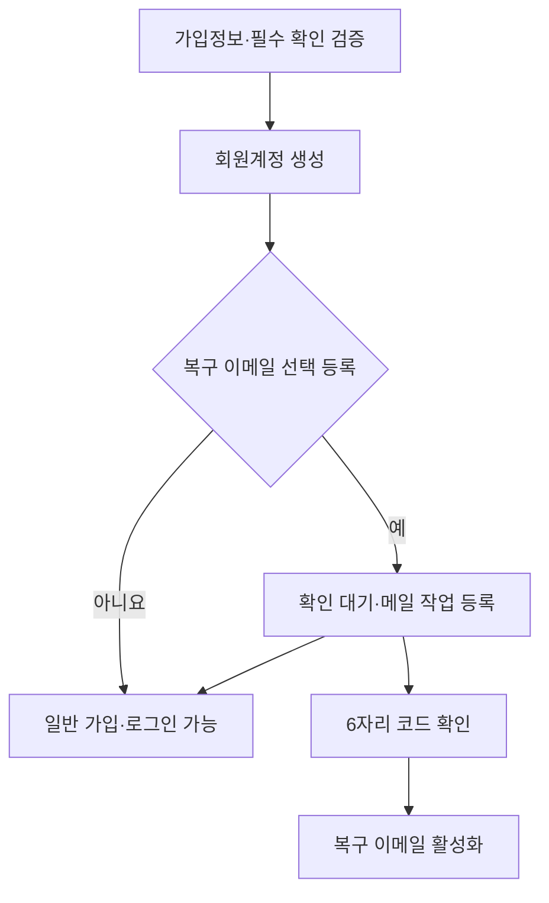

# 개인정보 보호를 반영한 회원가입·로그인·마이페이지 설계

> 기준일: 2026-11-06 (입력 정책 추가 승인 반영)
>
> 적용 대상: 기획, UI/UX, 프런트엔드, 백엔드, 데이터, 인프라, 검증 담당자
>
> 문서 성격: 승인된 제품 정책과 구현·운영 보완사항을 연결하는 설계 기준
>
> 구현 상태: 이 문서 작성만으로 코드 반영, 실제 DB 적용, SMTP 실발송 또는 AWS 운영 검증이 완료된 것은 아닙니다.

## 1. 문서의 사용 방법과 범위

회원가입에서 수집한 정보가 마이페이지, 이메일 확인, 계정 복구, 탈퇴까지 어떻게 처리되어야 하는지 정의합니다. 개인정보 처리방침과 동의문의 근거가 되는 내부 설계 문서이며, 이용자에게 그대로 게시할 최종 처리방침은 아닙니다.

- **확정:** 사용자가 선택·승인한 제품 정책입니다. 구현 시 일치시킵니다.
- **상세 구상:** 확정된 방향을 안전하고 일관되게 구현하기 위한 제안입니다. 코드와 계약으로 구체화합니다.
- **운영 전 확정:** 실제 운영자, 제공업체, 보유기간 등 현재 값이 정해지지 않은 항목입니다.
- **검증 필요:** 정책이 코드·DB·여러 서버에서 실제로 지켜지는지 확인할 항목입니다.

최신 승인 정책이 이전 UI 초안보다 우선합니다. 회원가입은 실명 대신 별명을 사용하고, 이메일 선택 등록과 주소 확인을 기본 가입·로그인에서 분리합니다. 메일 연동 방식은 Django SMTP로 정리합니다. 기존 데이터의 변경·마이그레이션은 영향 검토와 별도의 실행 범위를 정한 후 수행합니다.

연계 기준: [프로젝트 기술 기준](docs/handoff/infra/BASELINE.md), [검증 기준](docs/handoff/infra/TESTING.md), [전체 팀 Git 협업 가이드](TEAM-GIT-COLLABORATION-GUIDE.md), [저장소 기여 기준](CONTRIBUTING.md).

## 2. 확정 정책과 변경 이유

| ID | 항목 | 확정 정책 | 이유·유의점 |
|---|---|---|---|
| P-01 | 사용자 유형 | Guest와 Member를 구분합니다. 공개 회원가입으로 관리자 권한을 얻을 수 없습니다. | 비회원 사용과 회원 계정의 권한을 분리합니다. |
| P-02 | 아이디 | 영문·숫자·밑줄, 4~20자, 대소문자를 구분하지 않고 중복 방지, 가입 후 변경 불가입니다. | 로그인 식별자와 관련 데이터의 기준을 안정적으로 유지합니다. |
| P-03 | 비밀번호 | ASCII 영문·숫자·특수문자 8~20자, 공백 불가, 대문자 1개 이상·특수문자 2개 이상, 흔하거나 계정 정보와 유사한 비밀번호 차단입니다. | 2026-11-06 사용자가 승인한 제품 정책입니다. 가입·변경·재설정에 적용하며 기존 비밀번호 로그인은 유지합니다. |
| P-04 | 이름·별명 | 실명을 수집하지 않습니다. 별명은 선택 입력이며 한글·ASCII 영문·숫자 2~10자, 공백 불가, 중복 불가, 마이페이지에서 변경할 수 있습니다. | 검증하지 않은 실명을 계정 복구 조건으로 추가하지 않고 표시 목적에 맞게 최소화합니다. |
| P-05 | 기본 별명 | 별명 미입력 시 `회원####` 형식으로 0000~9999의 임의 네 자리 숫자를 부여합니다. 선행 0을 보존합니다. | 미입력 사용자도 화면 표시와 회원 구분이 가능합니다. |
| P-06 | 매장유형 | 현재 카페만 제공하고 향후 업종 확장을 지원할 구조로 설계합니다. | 현재 범위를 제한하면서 데이터 구조의 확장성을 확보합니다. |
| P-07 | 이메일 | 선택 등록이며 미등록·미확인이 기본 가입·일반 로그인을 차단하지 않습니다. | 계정 복구 편의를 선택할 수 있게 합니다. |
| P-08 | 이메일 목적 | 복구 이메일 확인, 아이디 안내, 비밀번호 재설정과 이에 필요한 등록·변경·복구 보안 안내에만 사용합니다. 마케팅에는 사용하지 않습니다. | 초기 재설정 전용 범위에 승인된 아이디 안내·주소 확인을 명확히 포함합니다. |
| P-09 | 이메일 연결 | 확인된 이메일 한 개당 계정 한 개만 연결합니다. | 복구 대상의 모호함을 줄입니다. 확인 대기 주소의 장기 선점은 방지해야 합니다. |
| P-10 | 이메일 확인 | 6자리 코드, 유효시간 5분, 최대 검증 실패 5회, 재발송 간격 60초입니다. | 주소 확인 단계의 사용성과 반복 시도 제한을 함께 관리합니다. |
| P-11 | 아이디 찾기 | 이메일 입력 후 아이디 안내 전용 일회용 링크를 발송합니다. 링크 유효시간은 10분입니다. | 이름·별명을 인증 비밀로 취급하지 않고 등록된 복구 수단을 확인합니다. |
| P-12 | 비밀번호 재설정 | 아이디 안내와 별개의 일회용 링크를 사용합니다. 링크 유효시간은 10분입니다. | 권한과 목적이 다른 토큰을 분리합니다. |
| P-13 | 가입 체크 | 이용약관 동의, 기본정보 처리 안내 확인, 선택 이메일 동의를 구분하고 사용자가 직접 선택합니다. 기본정보 안내 확인이 없으면 가입을 차단합니다. | 안내 확인은 제품의 가입 절차이며 법적 수집 동의와 동일하지 않습니다. |
| P-14 | 가입 연령 | 만 14세 이상만 가입합니다. 생년월일은 수집하지 않고 연령 확인 체크를 사용합니다. | 추가 생년월일 수집을 피합니다. 자기확인을 공신력 있는 연령 인증으로 표시하지 않습니다. |
| P-15 | 관리자 보호 | 관리자 추가 인증은 패스키로 구현하고 기존 관리자 SSO 흐름에 연결합니다. | 관리자 권한과 중요 기능을 일반 회원 복구보다 강하게 보호합니다. |
| P-16 | 저장 | 비밀번호는 Argon2id 일방향 해시, 이메일은 암호화 저장 후 승인된 발송 처리에 필요한 경우 복호화합니다. | 비밀번호 복원 기능을 만들지 않고 이메일 원문 노출을 줄입니다. |
| P-17 | 메일 발송 | Django SMTP 백엔드를 사용합니다. SMTP 제공자는 아직 확정하지 않았습니다. | 기존 애플리케이션에서 외부 발송 서비스를 사용할 수 있습니다. |
| P-18 | 내부 개인정보 담당 역할 | 내부 역할 식별자는 `encore1`로 지정합니다. | 공개 인프라 계정의 역할명이며 실제 책임자의 법적 지정·운영 주체·공개 담당부서·업무 연락처를 대신하지 않습니다. 이 실제 매핑과 공개 값은 운영 전 확정합니다. |

P-10~P-12의 시간·횟수는 이번에 확정된 **제품 보안 설정**입니다. 개인정보 보호법이 모든 서비스에 동일하게 정한 수치로 설명하지 않습니다. 비밀번호 길이·문자 조합은 2026-11-06 사용자 추가 승인으로 변경한 제품 규칙이며 법정 의무나 외부 권고 수치로 표시하지 않습니다. 이전 15~128자·공백 허용·조합 비강제 규칙을 대체합니다.

## 3. 개인정보 처리의 법적 기준

### 3.1 기본 계정정보와 선택 이메일

계정 생성·로그인 등 계약 체결·이행에 실제 필요한 최소정보는 개인정보 보호법 제15조 제1항 제4호의 적용을 검토하고, 동의에 기초한 선택 이메일과 구분해 고지합니다. 별명·매장유형·접속기록을 포함한 모든 항목을 자동으로 “필수”로 분류하지 않습니다. 항목별 필요성과 최소 범위를 설명할 수 있어야 합니다. [수집·이용 근거][law15], [최소수집 원칙][law16], [고지·동의 구분][law22]

| 항목 | 서비스에서의 역할·최소화 | 처리 근거를 정할 때의 기준 |
|---|---|---|
| 아이디·비밀번호 해시 | 로그인 계정 식별과 인증에 필요한 정보 | 회원서비스의 계약 체결·이행에 필요한 범위로 제15조 제1항 제4호 적용을 검토하고 고지 |
| 별명 | 선택 입력하거나 미입력 시 자동 생성하는 회원 표시명 | 표시 기능의 필요 범위와 처리 목적을 설명. 화면에서 선택 입력이라는 이유만으로 법적 근거가 자동으로 동의가 되지는 않음 |
| 매장유형 | 현재 서비스 범위가 카페이므로 서버의 허용값 `CAFE`로 제한 | 고정 서비스 설정으로 처리할 수 있는지 우선 검토. 실제 매장명·사업자 정보·소유 확인 등 추가 개인정보를 요구하는 근거로 확대하지 않음 |
| 복구 이메일 | 등록을 선택한 회원에게 주소 확인·계정 복구 제공 | 분리한 수집·이용 동의. 미등록 시 기본 회원서비스를 제한하지 않음 |
| 보안·접속 기록 | 실제 보안 운영과 법령이 요구하는 범위 | 로그 유형별 목적·법적 의무·최소 필드·보유기간을 별도로 검토 |

기본정보 처리 안내 확인 체크는 위 항목들의 처리 내용을 확인하는 절차입니다. 이 체크를 포괄적 수집 동의나 각 항목의 필요성을 대신하는 근거로 사용하지 않습니다.

선택 이메일의 수집·이용 동의에는 목적, 항목, 보유·이용 기간, 거부권, 거부 시 제한되는 복구 기능을 안내합니다. 이메일 동의를 거부해도 기본 가입·일반 로그인은 제공하는 것이 현재 정책입니다. 실제 보유기간 등이 미정인 템플릿을 최종 고지로 게시하지 않습니다.

별명은 실명보다 노출을 줄이는 표시명입니다. 별명을 사용한다고 개인정보 처리에서 자동으로 제외되거나 법상 가명정보 특례가 적용되는 것은 아닙니다. 회원 아이디·UUID도 법령이 정한 주민등록번호 등의 “고유식별정보”와 같은 용어로 혼용하지 않습니다. [개인정보의 정의][law2]

### 3.2 저장·전송·파기

비밀번호는 복호화되지 않도록 저장해야 합니다. 일반 이메일 주소는 안전성 확보조치 기준의 서버 저장 시 암호화 대상 목록에 직접 열거된 항목과 구분되므로, 평문 컬럼이라는 사실만으로 일률적인 위법 여부를 단정하지 않습니다. 이번 프로젝트는 이메일 암호화 저장을 별도의 보호 설계로 선택했습니다. 인터넷 구간의 전송 보호, 접근 통제, 로그·백업 보호도 함께 적용합니다. [암호화 기준][safety7]

탈퇴 등으로 개인정보가 불필요해지면 지체 없이 파기하는 것이 원칙입니다. 다른 법령의 보존 의무가 실제로 적용되는 항목은 근거·기간을 정하고 분리 관리합니다. 모든 회원정보를 편의상 장기 보존하거나 탈퇴 플래그만 바꾸는 것으로 파기를 완료했다고 표시하지 않습니다. [파기 기준][law21]

### 3.3 교육 프로젝트·공개 소스와 실제 운영

가상 데이터만으로 하는 시연과 실제 회원·테스터 정보를 받는 운영을 구분합니다. 교육·무료·오픈소스라는 명칭만으로 개인정보 관련 의무가 일괄 면제되는 것은 아닙니다. 실제 처리 목적·방식·데이터를 기준으로 판단합니다. [개인정보처리자 정의][law2]

공개 소스의 재사용자는 자신이 운영하는 서비스의 목적·보유기간·업체·담당 정보를 설정해야 합니다. 코드 제공자의 처리방침을 운영자가 확인 없이 그대로 사용하는 방식은 피합니다.

법 제22조의2는 만 14세 미만 아동의 개인정보 처리에 법에 따른 동의를 받아야 하는 경우 법정대리인의 동의와 확인을 요구합니다. 이번 프로젝트는 해당 가입 절차를 제공하지 않고 만 14세 이상으로 가입 대상을 제한합니다. 연령 체크는 자기확인이므로, 실제로 만 14세 미만임을 알게 된 경우의 대응은 O-09에서 정합니다. [아동의 개인정보 보호][law22-2]

## 4. 화면과 권한 구조

| 화면·기능 | Guest | 일반 Member | 관리자 | 핵심 확인 |
|---|---|---|---|---|
| 회원가입·로그인 | 사용 | 가입 완료 후 로그인 관리 | 공개 가입으로 관리자 승격 불가 | 사용자 역할을 입력값으로 신뢰하지 않음 |
| 아이디 안내·재설정 요청 | 사용 | 사용 | 패스키 해제 권한으로 연결하지 않음 | 외부 응답으로 계정 존재를 구분하지 않음 |
| 마이페이지 조회 | 로그인 안내 | 본인 정보 | 본인 정보 | 요청자 세션 기준으로 조회 |
| 별명 변경 | 불가 | 본인만 | 본인만 | 서버·DB의 중복 방지 |
| 이메일 등록·변경·삭제 | 불가 | 본인 재확인 후 | 본인 재확인 후 | 주소 확인과 동의 상태 |
| 비밀번호 변경 | 불가 | 현재 비밀번호 확인 | 현재 인증 정책에 맞게 확인 | 기존 비밀번호 표시·복호화 없음 |
| 회원탈퇴 | 로그인·본인 확인 경로 | 본인 재확인 후 | 관리 책임 이전·종료 정책 확인 | 세션·토큰 폐기 및 데이터 정리 |
| 관리자 화면·SSO | 불가 | 불가 | 역할 확인과 패스키 추가 인증 후 | 일반 계정 복구로 우회 불가 |

로그인하지 않은 상태의 마이페이지 URL 접근은 로그인 화면으로 안내합니다. 로그인 후 복귀 경로는 서비스 내부 허용 경로만 사용합니다. API는 화면 표시 여부와 별도로 인증·권한을 검증합니다.

## 5. 회원가입 상세 구상

### 5.1 입력 영역

| 항목 | 화면 구성 | 서버 검증·저장 |
|---|---|---|
| 아이디 | 입력, 형식 안내, 중복 확인, 사용 가능 여부 | `^[A-Za-z0-9_]{4,20}$` 기준과 대소문자 무시 중복 검증. DB 제약으로 경합 방지 |
| 비밀번호 | 입력, 표시/숨기기, 길이·흔한 비밀번호 안내 | ASCII 영문·숫자·특수문자 8~20자, 대문자 1개 이상·특수문자 2개 이상, 공백 불가, 흔한 값 차단, Argon2id 저장 |
| 비밀번호 확인 | 별도 입력과 일치 안내 | 비교에만 사용하고 별도 저장·로그 기록하지 않음 |
| 별명 | 선택 입력, 한글·영문·숫자 2~10자·공백 불가·중복 불가 안내 | 입력 시 길이·중복 검증, 미입력 시 고유한 기본 별명 생성 |
| 매장유형 | “카페” 표시 | 현재 허용된 카페 값만 저장. 임의 업종·권한 입력 거부 |
| 복구 이메일 | 선택 입력, 이용 목적·미등록 시 복구 제한 안내 | 동의 여부 확인, 주소 형식 검증, 확인 대기 상태로 암호화 저장 |
| 체크 영역 | 약관·기본정보 안내·연령·선택 이메일 구분 | 서버에서도 필수 확인·선택 동의와 입력 관계를 검증 |

아이디 중복 확인 성공은 최종 가입의 성공을 보장하지 않습니다. 동시 요청으로 먼저 등록된 경우 가입 요청에서 다시 중복 오류를 반환합니다. “대소문자 무시”는 로그인 식별자에 적용하는 확정 정책이며, 이메일이나 별명의 정규화 정책에 그대로 복제하지 않습니다.

별명 자동 생성은 `회원0000`부터 `회원9999`까지 네 자리 형식을 사용하며, DB의 고유성 제약으로 충돌을 검출하고 제한된 횟수로 재시도합니다. 이 공간은 최대 10,000개이며 직접 같은 형식으로 입력한 별명도 중복 판단에 포함합니다. 가용 값이 없거나 정한 재시도 상한에 도달하면 이용자에게 직접 별명을 입력하도록 안내할 수 있습니다. 무한 재시도하거나 승인 없이 다섯 자리로 바꾸지 않습니다. 공간 확장이 필요해지면 별도 정책을 결정합니다. 이미 사용 중인 별명을 덮어쓰거나 사용자의 기존 계정을 재사용하지 않습니다.

공백이 포함된 새 비밀번호는 자동으로 잘라내지 않고 오류로 거부합니다. 영문은 ASCII A–Z/a–z, 숫자는 0–9, 특수문자는 공백을 제외한 ASCII 문장부호입니다. 동일 특수문자의 반복도 개수에 포함하며 소문자와 숫자는 각각 필수가 아닙니다. 기존 비밀번호의 로그인·현재 비밀번호 확인은 유지합니다.

### 5.2 체크박스와 안내

| 표시 | 기본 상태 | 가입 완료에 필요한가? | 의미 |
|---|---|---|---|
| 서비스 이용약관에 동의 | 미선택 | 필요 | 서비스 계약 조건 동의 |
| 기본 회원정보 처리 안내 확인 | 미선택 | 필요 | 처리 내용을 확인했다는 제품 절차. 수집 동의로 명명하지 않음 |
| 만 14세 이상임을 확인 | 미선택 | 필요 | 연령 자기확인. 생년월일 미수집 |
| 복구 이메일 수집·이용 동의 | 미선택 | 이메일을 등록할 때만 필요 | 이메일 복구 기능을 위한 선택 동의 |

각 안내는 제출 전에 내용을 볼 수 있어야 합니다. 선택 이메일 동의를 필수 항목과 묶어야만 가입할 수 있는 구조를 만들지 않습니다. 안내 확인이나 연령 체크가 서버 요청에서 누락·변조되면 가입을 완료하지 않습니다.

이메일을 입력했지만 선택 동의가 없는 경우에는 이메일을 빼고 가입할 수 있게 안내합니다. 동의 없는 주소를 회원 프로필·확인 대기 DB·메일 큐에 저장하거나 확인 메일을 발송하지 않습니다. 입력 자체를 먼저 서버에 자동 전송·수집하는 기능도 최소화합니다.

화면 문구 초안은 다음과 같습니다. 각 항목 옆의 내용 보기로 해당 안내 전문을 엽니다. 접근성 레이블과 오류 포커스를 제공하고 기본 체크값은 모두 미선택입니다.

```text
[ ] [필수] 서비스 이용약관에 동의합니다.                 [내용 보기]
[ ] [필수] 기본 회원정보 처리 안내를 확인했습니다.         [내용 보기]
[ ] [필수] 만 14세 이상입니다.
[ ] [선택] 계정 복구용 이메일 수집·이용에 동의합니다.      [내용 보기]

이메일은 선택 사항입니다. 등록·확인하지 않아도 가입하고 로그인할 수 있습니다.
확인된 이메일이 없으면 아이디 찾기·비밀번호 재설정을 이용할 수 없습니다.
실명은 수집하지 않으며, 별명을 비워 두면 회원#### 형식으로 생성됩니다.
```

선택 이메일 안내에는 다음 요소를 넣습니다. **검토용 구성안**이며 미결 보유기간을 확정한 후 최종 전문을 게시합니다.

| 고지 요소 | 넣을 내용 |
|---|---|
| 수집·이용 목적 | 복구 주소 확인, 아이디 안내, 비밀번호 재설정 및 관련 등록·변경·복구 보안 안내; 마케팅 사용 없음 |
| 항목 | 이메일 주소. 확인 상태·동의 시각 등 부수 기록의 처리도 실제 목록과 함께 설명 |
| 보유·이용 기간 | 확인된 주소는 해당 복구 기능의 선택 등록을 유지하는 기간. 삭제·동의 철회·탈퇴·목적 종료 시 지체 없이 파기. 대기 주소·발송 기록 등의 구체 기간과 실제 적용되는 법정 예외는 §11과 일치시킴 |
| 거부권·영향 | 등록과 동의를 거부할 수 있으며 기본 가입·로그인은 가능. 확인된 이메일을 사용하는 복구 기능은 제한 |

필수 안내 확인을 하지 않은 경우에는 “기본 회원정보 처리 안내를 확인해 주세요”라고 표시합니다. “개인정보 수집에 동의하지 않아 가입할 수 없습니다”라는 문구로 법적 근거를 바꾸어 설명하지 않습니다.

### 5.3 가입과 이메일 확인의 분리



이메일 전송 지연이나 오류로 이미 생성된 정상 회원계정을 잠그지 않습니다. 가입 성공과 복구 이메일 확인 상태를 서로 다른 상태로 표시합니다.

| 상황 | 가입·로그인 | 이메일 복구 | 화면 행동 |
|---|---|---|---|
| 이메일 미등록 | 가능 | 이용 불가 | 등록 선택과 복구 제한 안내 |
| 이메일 확인 대기 | 가능 | 이용 불가 | 코드 입력·재발송·취소 |
| 이메일 확인 완료 | 가능 | 가능 | 확인 완료·변경·삭제 |
| 코드 만료·5회 실패 | 가능 | 대기 주소로는 불가 | 새 확인 요청 안내 |
| SMTP 장애 | 가능 | 확인 완료 전까지 불가 | 지연·재시도 안내와 내부 오류 관리 |

미확인 이메일이 다른 사람이 등록할 주소를 무기한 선점하지 않도록 임시 보유기간을 둡니다. 다른 계정에서 이미 확인된 주소와 충돌하면 연결을 완료하지 않습니다. 동시 확인 요청 중 하나만 성공하도록 DB에서 처리합니다.

## 6. 로그인과 세션

### 6.1 일반 회원 로그인

- 아이디는 가입과 같은 대소문자 처리 규칙으로 검색합니다.
- 비밀번호는 Django 해시 검증 기능으로 비교합니다. 새 해시를 단순 문자열 비교하는 방식으로 구현하지 않습니다.
- 이메일이 없거나 확인되지 않았다는 이유로 일반 로그인을 차단하지 않습니다.
- 실패 안내와 처리시간 차이를 통해 아이디 존재 여부를 불필요하게 드러내지 않습니다.
- 로그인 성공 시 세션 식별자를 안전하게 갱신하고 로그아웃 시 서버 측 세션을 무효화합니다.
- HTTPS, Secure·HttpOnly·SameSite 등 쿠키 정책과 CSRF 방어를 확인합니다. 구체적인 세션 만료시간과 기기별 로그아웃 정책은 별도 운영값으로 정합니다.

비밀번호 변경·탈퇴 등 민감한 동작은 “로그인 상태”만으로 충분하다고 가정하지 않고 최근 재확인을 요구합니다. 재확인 유효기간과 적용 행동은 서버의 일관된 정책으로 관리합니다.

### 6.2 관리자 패스키와 기존 SSO

관리자 권한은 별도 승인·역할 관리로 부여합니다. 패스키 등록 자체가 관리자 권한을 생성하지 않습니다.

현재 추가 인증의 확정 대상은 관리자입니다. 일반 회원에게 별도 MFA 가입 절차를 필수로 추가하거나, 모든 회원의 MFA가 개인정보 보호법상 일률적 의무라고 표시하지 않습니다.

1. 서버가 현재 계정의 관리자 권한을 확인합니다.
2. 등록된 패스키로 추가 인증을 수행합니다.
3. 성공한 추가 인증의 계정·세션·시각·목적을 서버에서 확인합니다.
4. 필요한 조건을 충족했을 때만 기존 관리자 SSO 진입·티켓 발급을 허용합니다.
5. 권한 철회·로그아웃·추가 인증 만료 시 이후 SSO 진입을 제한합니다.

WebAuthn challenge, RP ID, origin, 인증서명 및 사용자 검증 결과는 서버에서 확인합니다. 브라우저가 성공이라고 전달한 필드만 신뢰하지 않습니다. 패스키 등록·삭제·교체, 최초 관리자 등록, 기기 분실 시 복구 절차는 별도 수용 기준을 둡니다. 이메일 재설정 링크 하나로 패스키를 삭제하거나 SSO 추가 인증을 생략할 수 없게 합니다. [추가 인증·복구 지침][owasp-mfa]

구현 구상에서는 등록·인증에 사용자 검증을 요구하고(`userVerification: required`), 서버가 challenge의 계정·현재 세션·목적·만료·일회성까지 검증합니다. 기기 잠금 해제에 쓰는 생체정보나 PIN을 서비스 DB로 수집하지 않습니다. 최초 등록은 승인된 관리자와 연결된 제한된 등록 절차로 처리하고, 분실 복구 시 기존 세션·등록 수단을 점검한 뒤 재등록합니다. 복구 절차와 SSO의 재인증 유효기간은 O-08에서 확정합니다.

## 7. 마이페이지 상세 구상

### 7.1 정보 구조

로그인 후 헤더 또는 사용자 메뉴에서 마이페이지로 접근합니다. 정보 조회와 변경 행동을 구분하고 한 화면의 “전체 저장”으로 별명·비밀번호·이메일·탈퇴가 함께 처리되지 않도록 합니다.

| 영역 | 표시 정보 | 제공 행동 | 보호 조건 |
|---|---|---|---|
| 계정 기본정보 | 아이디, 별명, 매장유형 카페 | 별명 변경 | 아이디 읽기 전용, 본인 정보만 변경 |
| 복구 이메일 | 미등록/확인 대기/확인 완료, 필요한 범위의 마스킹 주소 | 등록·확인·재발송·변경·삭제 | 선택 동의, 재확인, 새 주소 검증 |
| 비밀번호·보안 | 변경 기능, 필요한 계정 보안 상태 | 비밀번호 변경, 로그아웃 | 현재 비밀번호 확인, 세션 정리 |
| 서비스 저장 목록 | 서비스에서 제공하는 본인 저장 추천·플레이리스트 목록 | 본인 목록 조회·삭제 등 승인된 기능 | 계정 간 접근 차단, 별도 보유·삭제 범위 확인 |
| 개인정보 안내 | 처리방침·선택 동의 내용·권리행사 창구 | 이메일 동의 철회, 문의 | 마케팅 동의 항목을 새로 추가하지 않음 |
| 관리자 보안 | 관리자에게만 패스키 관리 | 등록·확인·삭제 | 관리자 역할과 별도 보호 절차 |
| 회원탈퇴 | 삭제 범위·예외·복구 불가 안내 | 탈퇴 확인·실행 | 본인 재확인과 명시적인 최종 행동 |

기술 상태 이름·DB 컬럼명·메일 업체 내부 오류를 이용자 화면에 그대로 노출하지 않습니다. “처리 중”, “다시 시도할 수 있습니다”, “확인이 만료되었습니다” 등 사용자가 다음 행동을 선택하는 데 필요한 내용으로 안내합니다.

### 7.2 별명 변경

- 현재 별명을 표시하고 새 별명을 2~20자로 입력받습니다.
- 중복 사용은 허용하지 않습니다. 화면의 중복 확인과 저장 시 DB 검증을 함께 적용합니다.
- 실패하면 현재 별명을 유지하고 원인을 입력란 가까이에 안내합니다.
- 성공하면 헤더·마이페이지 등 회원 표시 영역이 같은 값을 보게 합니다.
- 로그인 아이디·권한·복구 이메일은 별명 변경에 의해 변경되지 않습니다.
- 앞뒤 공백, Unicode 정규화, 영문 대소문자 등 별명 중복 판정 기준과 변경 빈도 제한은 구현 전에 명시합니다.

### 7.3 이메일 미등록 상태

복구 기능을 사용할 수 없다는 안내와 “복구 이메일 등록” 행동을 제공합니다. 해당 안내가 일반 서비스 이용 제한으로 보이지 않게 합니다.

등록을 선택하면 이용 목적·항목·보유 기준·거부 시 영향을 확인하고 선택 동의를 받습니다. 현재 비밀번호 또는 적절한 기존 인증수단으로 본인을 다시 확인한 후 주소 확인 단계로 진행합니다. 동의 버전과 시각은 필요한 범위로 기록합니다.

### 7.4 이메일 확인 대기 상태

- 주소 확인 코드 입력, 남은 유효시간, 재발송 가능 시점, 등록 취소를 제공합니다.
- 코드는 숫자 6자리 문자열로 취급하여 앞자리 0을 보존합니다.
- 5분 만료와 실패 5회 제한은 서버 시각·상태가 기준입니다.
- 재발송은 마지막 발송 요청으로부터 60초 후 허용합니다.
- 새 코드 발급 시 기존 대기 코드가 계속 유효하게 남지 않도록 처리합니다.
- 새 코드 요청으로 계정·주소·IP 전체 제한을 무한히 초기화할 수 없도록 별도 발송 상한을 둡니다.
- 주소 수정 또는 등록 취소 시 기존 확인 요청을 폐기합니다.

주소 확인 링크나 페이지를 열었다는 사실만으로 다른 계정에 주소를 연결하지 않습니다. 등록을 요청한 계정, 재확인 상태, 대상 주소와 유효 코드를 함께 검증하는 방식으로 상세 계약을 정합니다. 타인의 주소를 선입력한 계정에 메일 수신자가 무심코 확인해 주는 상황도 검증 항목에 포함합니다.

### 7.5 확인된 이메일 변경

1. 현재 확인된 주소를 필요한 범위로 마스킹하여 표시합니다.
2. 현재 비밀번호 등으로 재확인합니다.
3. 새 주소를 입력받고 확인 코드를 발송합니다.
4. 새 주소 확인과 중복 연결 검증이 끝난 시점에 변경을 확정합니다.
5. 기존 주소에 변경 사실을 알리고 이전 주소에 연결된 미사용 복구 토큰을 폐기합니다.

변경 대기 중에는 기존에 확인된 주소를 유지하는 것을 기본 상세 구상으로 합니다. 새 주소의 메일 발송 실패만으로 기존 복구 주소를 제거하지 않습니다. 기존 주소를 잃어버린 이용자의 예외 처리, 관리자 계정의 추가 확인 범위는 운영 정책으로 확정합니다. [이메일 변경 권고][owasp-email]

### 7.6 이메일 삭제·선택 동의 철회

- 이메일 삭제 시 아이디 안내·비밀번호 재설정이 제한된다는 점을 먼저 설명합니다.
- 로그인한 본인을 재확인하고 삭제를 최종 선택하게 합니다.
- 삭제 후에도 회원계정·기본 로그인은 유지합니다.
- 확인 주소, 변경 대기 주소, 관련 확인·복구 토큰, 발송 대기 작업을 함께 정리합니다.
- 이메일 동의 상태를 철회로 기록하되, 동의 이력을 무기한 유지하는 기본값은 만들지 않습니다.
- 이미 발송된 메일이나 외부 제공자의 법정·계약상 기록을 서비스 DB와 동일하게 즉시 회수할 수 있다고 안내하지 않습니다.

선택 이메일 철회를 전체 회원탈퇴와 같은 기능으로 연결하지 않습니다. 법령상 별도 보존이 필요한 이력이 있다면 대상·근거·기간을 운영 정책에서 설명합니다.

### 7.7 비밀번호 변경

화면은 현재 비밀번호, 새 비밀번호, 새 비밀번호 확인으로 구성합니다. 새 비밀번호 정책은 가입과 동일하게 적용합니다. 현재 비밀번호 오류, 새 값 불일치, 흔한 비밀번호, 길이 오류를 구분하되 기존 비밀번호 내용을 노출하지 않습니다.

성공 시 해시를 갱신하고 기존 세션과 미사용 복구 토큰을 무효화하는 방식을 구현 계약으로 정합니다. 현재 세션까지 종료하여 다시 로그인하게 할지, 안전하게 재확인된 현재 세션만 유지할지는 운영 전 선택 항목입니다. 두 경우 모두 다른 서버에 남은 이전 세션이 계속 유효한 문제가 없어야 합니다.

### 7.8 회원탈퇴

탈퇴 화면에는 삭제될 정보, 법령상 예외 보존 여부, 이메일 복구 중단, 되돌릴 수 없는 영향을 알기 쉽게 안내합니다. 입력받지 않은 이름·주민등록번호·휴대전화번호를 탈퇴 확인을 위해 새로 요구하지 않습니다.

상세 처리 순서:

1. 현재 계정과 재확인 상태를 확인합니다.
2. 이용자가 명시적으로 최종 탈퇴를 선택합니다.
3. 로그인·SSO·토큰 발급을 중단하고 활성 세션·확인·복구 토큰을 무효화합니다.
4. 계정과 연결된 개인정보를 정한 절차로 파기합니다.
5. 캐시·검색 인덱스·발송 대기·백업 등 후속 정리 작업의 결과를 추적합니다.
6. 법정 보존 대상이 실제로 있으면 운영정보와 분리하고 정해진 기간 후 파기합니다.

서비스·데이터 관리 책임을 맡은 관리자에게는 책임 이전 또는 서비스 종료 절차를 먼저 정합니다. 이 예외는 일반 회원의 탈퇴를 불필요하게 막는 조건으로 확장하지 않습니다.

## 8. 아이디 찾기와 비밀번호 재설정

### 8.1 아이디 안내

1. 공개 화면에서 이메일을 입력받습니다.
2. 등록 여부와 관계없이 같은 외부 응답을 제공합니다.
3. 등록·확인된 주소가 있을 때만 아이디 안내 전용 링크를 보냅니다.
4. 서버가 계정·주소·목적·만료·사용 상태를 확인합니다.
5. 이용자의 확인 행동 후 아이디만 안내하고 토큰을 소비합니다.

링크는 10분 동안 한 번만 사용할 수 있습니다. 아이디 안내에 이름·별명은 요구하지 않으며, 성공 후 자동 로그인이나 비밀번호·이메일 변경 권한을 부여하지 않습니다.

이 과정은 **계정에 미리 연결한 이메일을 현재 사용할 수 있는지 확인하는 계정 복구**입니다. 법정 본인확인이나 실명 인증을 수행했다고 표현하지 않습니다. 별도의 검증을 거치지 않은 이름을 이메일과 함께 입력받아도 인증 강도가 자동으로 높아지지 않습니다. 실명 기반 확인이 필요한 별도 서비스로 범위가 확장되면 그때 목적·법적 근거·확인 수단을 다시 설계합니다.

### 8.2 비밀번호 재설정

아이디 안내와 별도의 요청·토큰을 사용합니다. 유효한 링크를 확인한 후 새 비밀번호와 확인값을 입력하게 하며, 성공하면 이전 비밀번호로 로그인할 수 없게 합니다. 링크 유효시간은 10분이고 한 번만 사용합니다.

원래 비밀번호를 알려주는 기능을 제공하지 않습니다. 재설정 링크 요청만으로 계정을 잠그거나 비밀번호를 바꾸지 않습니다. 완료 후에는 정상 로그인 절차로 안내하며 기존 세션·미사용 재설정 토큰의 무효화와 보안 알림을 구현합니다. [계정 복구 권고][owasp-reset]

### 8.3 공통 보안과 예외

| 위험·상황 | 상세 구상 |
|---|---|
| 계정 존재 확인 공격 | 요청 단계의 문구·응답 구조·시간 차이를 줄이고 발송은 내부 작업으로 분리합니다. |
| 토큰 재사용·동시 사용 | 공유 DB에서 조건부 갱신 또는 트랜잭션 잠금으로 한 번만 소비합니다. |
| 용도 혼동 | 이메일 확인·아이디 안내·비밀번호 재설정 목적을 서버가 검증합니다. |
| 메일 보안 스캐너의 링크 조회 | GET 조회만으로 중요한 상태를 변경하거나 토큰을 소모하지 않고 이용자의 명시적 확인/제출 단계로 구분합니다. |
| 전달·로그를 통한 링크 노출 | HTTPS, 허용된 서비스 URL, 최소한의 페이지 구성, 전체 링크·원문 토큰 로그 제외를 적용합니다. |
| 이메일 교체·삭제·탈퇴 | 기존 주소·계정에 연결된 미사용 토큰을 무효화합니다. |
| 이메일 미등록·미확인 | 기본 가입·로그인은 허용하고 이메일 복구는 제공하지 않습니다. |
| 새 이메일만 제시한 분실자 | 기존 계정의 소유를 증명한 것으로 취급하지 않습니다. |
| SMTP 타임아웃 | 실제 전송 성공 여부가 불명확할 수 있음을 전제로 중복·재시도 정책을 정합니다. |

이메일을 등록하지 않은 회원도 로그인 상태라면 기존 비밀번호 등으로 재확인하여 복구 이메일을 추가할 수 있습니다. 로그아웃 상태에서 아이디·비밀번호를 잃었고 미리 확인된 다른 복구 수단도 없다면 자동 복구를 제공할 수 없습니다. 이름·별명을 맞히거나 새 이메일만 제시한 것을 본인 증명으로 대신하지 않습니다. 이런 제한은 가입과 마이페이지에서 사전에 안내합니다.

## 9. 데이터 모델과 Control A/B 처리

### 9.1 논리 데이터 구조

아래 이름은 설계상의 역할입니다. 실제 Django 모델·테이블명을 강제로 교체하라는 지시가 아닙니다. 기존 accounts 모델과 대조하여 중복 테이블·이중 동의 상태를 만들지 않도록 합니다.

| 논리 영역 | 최소 역할 | 제약·보호 |
|---|---|---|
| 회원 계정 | 내부 PK, 아이디 정규형, 비밀번호 해시, 활성·권한 상태 | 아이디 대소문자 무시 고유성, 관리자 권한 서버 관리 |
| 회원 프로필 | 별명, 중복 비교 기준, 카페 업종 | 별명 고유성, 현재 허용 업종 제한 |
| 복구 이메일 | 암호문, 조회용 검증값, 확인 시각, 변경 대기 정보 | 확인된 이메일 한 개당 계정 한 개 |
| 동의·안내 기록 | 항목·버전·선택/철회 시각·계정 연결 | 고지 확인과 수집 동의 구분, 필요한 이력만 보유 |
| 확인 요청 | 목적, 계정·대상 주소 연결, 코드 검증값, 만료, 실패 수, 발송 시각 | 5분·5회·60초의 서버 강제 |
| 복구 토큰 | 목적, 계정·주소 버전, 검증값, 만료, 소비 상태 | 10분, 일회용, 용도별 권한 분리 |
| 발송 작업 | 목적, 대상 참조, 상태, 재시도·만료 정보 | 최소 payload, 중복 방지, 삭제·철회 연계 |
| 패스키 | 관리자 계정, credential ID, 공개키 등 검증에 필요한 정보 | 개인키를 서버에 수집하지 않음, SSO 조건과 연결 |
| 감사·정리 작업 | 필요한 보안 사건·개인정보 처리·파기 작업 결과 | 비밀값·원문 링크 제외, 보유 근거 구분 |

### 9.2 저장 보호

- 비밀번호는 Django의 Argon2id hasher를 우선 사용하고 실제 결과 해시의 알고리즘을 확인합니다. 기존 다른 알고리즘의 정상 해시를 무계획하게 제거하지 않습니다. [Django 비밀번호 관리][django-password], [OWASP 저장 권고][owasp-password]
- 이메일의 암호화 알고리즘·키 관리·조회 방식은 운영 전 확정합니다. 조회 편의를 위해 원문을 별도 일반 컬럼으로 복제하지 않습니다.
- 이메일은 단순 해시만으로 발송 주소를 복원할 수 없습니다. 발송용 암호문과 필요한 조회 수단을 구분해 설계합니다.
- 6자리 코드는 낮은 엔트로피를 가지므로 단순한 빠른 해시만 저장해도 DB 유출 시 대입 위험이 남습니다. 별도 서버 키를 사용하는 검증값 등 구현 방식을 검토합니다.
- 고엔트로피 복구 토큰도 원문을 일반 로그에 남기지 않습니다. 비동기 재시도에 원문 payload가 필요하다면 제한된 임시 암호화 저장과 발송·만료 후 삭제를 설계합니다.
- 이메일 암호화 키·SMTP 비밀번호·토큰 검증 키는 공개 소스, 프런트엔드 번들, 일반 DB 백업과 무방비하게 함께 보관하지 않습니다.

#### 9.2.1 이메일 암호화·조회·복호화의 구현 구상

다음은 승인된 암호화 저장 방향을 구체화한 설계입니다. 운영 키의 실제 값·배포·회전·복구 절차는 O-04에서 정하며, 문서에 비밀값을 넣지 않습니다. 현재 계정 코드와 대조해 같은 역할의 보호 로직을 중복 구현하지 않습니다.

| 단계 | 처리 방식 | 남기지 않을 정보·실패 처리 |
|---|---|---|
| 입력 검증 | 동의와 목적을 먼저 확인하고, O-05에서 정한 동일한 규칙으로 이메일을 정규화 | Gmail의 점·플러스 주소 규칙 등을 모든 제공자에 일괄 적용하지 않음 |
| 암호화 저장 | 표준 라이브러리의 AES-256-GCM처럼 무결성을 함께 검증하는 암호화를 사용. 키 버전·nonce·암호문·인증 태그를 보관 | 같은 키에서 nonce 재사용 금지. 자체 암호 알고리즘 구현 금지 |
| 중복·복구 조회 | 암호화 키와 분리한 키로 `HMAC-SHA-256(용도 구분값 + 정규화 이메일)`을 계산해 조회 인덱스로 사용 | 원문 검색 컬럼이나 단순 SHA-256 이메일 해시로 대체하지 않음 |
| 주소 연결 확정 | 이메일 확인이 성공한 트랜잭션에서 확인된 주소의 조회 인덱스 고유성 제약 검증 | 미확인 요청이 주소를 영구 선점하지 않음 |
| 발송 | 작업자가 계정·동의·주소 버전·토큰 상태를 확인하고 필요한 순간에만 복호화해 SMTP에 전달 | API 응답·예외·일반 로그에 원문 또는 전체 복구 URL 기록 금지 |
| 오류 | 키 없음·암호문 변조·복호화 실패는 제한된 내부 오류로 기록하고 해당 이메일 처리를 중단 | 평문 저장이나 임시 공용 키로 자동 우회하지 않음 |
| 삭제 | 철회·탈퇴 시 암호문·조회 인덱스·관련 대기 작업을 함께 삭제하고 백업 처리에 연결 | 조회용 값도 계정과 연결 가능한 개인정보로 관리 |

AES-GCM은 키와 nonce 조합을 재사용하면 안 됩니다. 256비트 키와 암호학적으로 생성한 96비트 nonce를 사용하는 구상을 기준으로, 키별 사용량·교체와 충돌 방지 조건을 관리합니다. 부가 인증 데이터에는 키 버전과 용도 등 필요한 맥락을 결합하는 방식을 검토합니다. [암호화 라이브러리의 AES-GCM 사용 조건][crypto-aesgcm]

암호화 키 회전은 새 키를 활성화하고 기존 키로 복호화 가능한 기간에 기존 암호문을 재암호화한 뒤, 보존·복원에 필요한 잔여 사본을 확인하는 순서로 설계합니다. 조회용 HMAC 키는 변경하면 인덱스도 달라지므로 전환 중 조회와 이메일 중복 검사가 모두 일관되게 동작하는 계획이 필요합니다. 키 손실·유출 대응과 복원 시험까지 마친 후 운영에 적용합니다.

DB는 필요한 애플리케이션·관리 경로에서만 접근하게 하고 역할별 최소 권한을 부여합니다. 암호화된 이메일을 저장해도 DB 계정 공유, 무제한 관리자 조회, 백업의 무단 반출 위험이 해결되는 것은 아니므로 접근 기록·비밀관리·복원 절차를 함께 검증합니다.

### 9.3 동시성·다중 서버

Control A/B는 같은 계정·확인 상태·발송 제한을 기준으로 판단해야 합니다. 프로세스 메모리에만 실패 횟수나 사용 완료 상태를 두지 않습니다.

| 동시 요청 | 일관성 기준 |
|---|---|
| 같은 아이디·별명으로 가입 | DB 고유성 제약을 통과한 하나만 성공 |
| 같은 이메일을 다른 계정에서 확인 | 최종 연결 시점에 하나의 계정만 확정 |
| 같은 코드의 실패 요청 | 실패 횟수 증가가 누락되지 않음 |
| 두 서버에서 재발송 요청 | 60초 제한이 우회되지 않음 |
| 같은 복구 링크를 동시 사용 | 첫 정상 소비만 성공 |
| 탈퇴와 발송 작업의 경합 | 신규 작업 생성 차단, 미발송 작업 취소, SMTP 인계 직전 계정·주소·동의·토큰 상태 재확인 |
| 비밀번호 재설정과 이전 세션 | 기존 인증 상태가 다른 노드에서 계속 유효하지 않음 |

계정·확인 상태 변경과 발송 작업 등록의 원자성을 고려합니다. 실제 SMTP 전송은 DB 트랜잭션을 장시간 붙잡는 방식으로 처리하지 않습니다. 재시도·중복 방지 키와 작업 만료를 둡니다. 새 Redis·Celery 서버 등의 추가 자원은 문서만으로 필수화하지 않고 기존 구조에 맞게 선택합니다.

이미 SMTP에 인계되었거나 전송 중인 메일은 회수할 수 없을 수 있습니다. 타임아웃에서 정확히 한 번 발송을 보장한다고 설명하지 않고, 신규 발송 차단·재시도·사후 정리의 범위를 구분합니다. 메일이 늦게 도착해도 5분·10분 유효시간을 임의로 늘리지 않으며 만료·철회된 코드나 링크는 서버가 거부합니다.

## 10. Django SMTP 발송 설계

### 10.1 확정 범위와 제공자 미결

기존 Django 서버가 외부 SMTP 서비스에 연결하는 방식입니다. Django SMTP는 연결 방식이고 SMTP 제공자 선택은 별도입니다. SES SMTP도 후보이며, SES를 선택했다고 가정한 요금·운영 승인 완료를 기록하지 않습니다.

Django 버전 기준은 6.1.2입니다. Django 6.1은 `MAILERS` 설정으로 백엔드와 옵션을 명시하는 경로를 안내합니다. 기존 `EMAIL_BACKEND`·`EMAIL_HOST` 계열은 호환·전환 상태를 확인해야 하며, 5.2 예제를 그대로 현재 권장 설정으로 고정하지 않습니다. SMTP 백엔드는 `django.core.mail.backends.smtp.EmailBackend`입니다. [Django 6.1 메일 구성][django-email]

### 10.2 설정·운영 항목

| 항목 | 기준 |
|---|---|
| 실행 위치 | 기존 Django/Control 실행 환경 |
| SMTP 호스트·계정 | 제공자 선정 후 실제 값 설정 |
| 전송 보호 | 제공자에 맞는 587 STARTTLS 또는 465 TLS 등 암호화 연결과 인증서 검증 |
| 발신 주소 | 검증·권한이 확인된 주소와 표시명 사용 |
| 도메인·도달성 | 제공자 지침에 따른 SPF·DKIM·DMARC, 발신 도메인 검증, 발송 한도·반송·차단 대응 확인 |
| 비밀번호 | 비공개 런타임 설정으로 주입, 접근·교체 절차 정의 |
| 발송 종류 | 이메일 확인, 아이디 안내, 비밀번호 재설정, 관련 보안 안내 |
| 마케팅·추적 | 광고·홍보 발송 없음. 필요 없는 열람·클릭 추적은 사용하지 않음 |
| 타임아웃·재시도 | 상한·횟수·대기·만료·중복 처리 정의 |
| 개발 시험 | 테스트 메일 수집과 실제 수신함 도착 검증 구분 |
| 외부 통신 | 기존 경로의 SMTP 연결 가능 여부 확인 후 필요한 변경만 검토 |

앱→SMTP의 TLS와 제공자→수신 메일 서버의 전송 정책은 구분해서 확인합니다. SMTP 인증정보와 DB 암호화만으로 전체 메일 경로가 자동으로 종단 간 암호화되는 것은 아닙니다. 메일에는 복구에 필요한 최소 내용만 넣습니다.

가입·마이페이지에서 이용자 자신의 등록 확인 실패는 필요한 범위로 안내하되, 공개 복구 요청에서 내부 SMTP 오류를 이용해 계정 존재 여부가 노출되지 않도록 합니다. 발송 성공 응답이 수신함 도착을 보장하는 것으로 표시하지 않습니다.

## 11. 보유기간과 파기 설계

### 11.1 데이터별 정책

| 데이터 | 보유 기준 | 상태 |
|---|---|---|
| 기본 계정·프로필 | 회원서비스 목적에 필요한 기간, 탈퇴·목적 종료 시 파기. 실제 법정 예외는 분리 | 원칙 확정, 최종 고지 문구 필요 |
| 확인된 이메일 | 선택 등록 유지 기간, 철회·삭제·탈퇴 시 관련 정보 정리 | 원칙 확정 |
| 미확인·변경 대기 이메일 | 확인 기능에 필요한 짧은 기간 후 자동 정리 | 구체 기간 미결 |
| 이메일 확인 코드 | 5분 유효, 사용·만료·5회 실패 시 더 이상 인증에 사용 불가 | 유효 정책 확정, 잔여 레코드 정리 시점 보완 |
| 아이디 안내·재설정 토큰 | 각 10분 유효, 한 번 사용, 계정·주소 변경에 따른 무효화 | 유효 정책 확정, 잔여 레코드 정리 시점 보완 |
| 발송 payload·실패 기록 | 발송·재시도 목적에 필요한 범위, 원문 최소화 | 보유·정리 정책 미결 |
| 동의·안내 이력 | 증적 필요성과 적법한 보유 근거를 구분하여 설정 | 기간·최소 필드 미결 |
| 일반 접속·행동 로그 | 보안·서비스 목적별 최소 범위 | 실제 수집 목록·기간 미결 |
| 개인정보취급자 접속기록 | 적용 대상이라면 고시의 법정 최소 보관 기준 적용 | 대상·구현 확인 필요 |
| 백업·복제본 | 보유 주기, 파기 방법, 복원 시 삭제 재적용을 포함 | 구체 주기·실행 방식 미결 |

코드·토큰의 “유효시간”과 개인정보 레코드의 “보유기간”은 같은 개념이 아닙니다. 만료 처리만 하고 이메일·토큰 관련 레코드를 무기한 남겨두지 않습니다. 정당한 별도 보유 근거 없이 “나중에 필요할 수 있음”을 보존 사유로 사용하지 않습니다.

### 11.2 개인정보취급자 접속기록

안전성 확보조치 기준 제8조는 정보주체 본인을 제외한 개인정보처리시스템 접속자의 기록을 원칙적으로 1년 이상 관리하도록 합니다. 5만 명 이상 정보주체를 처리하는 시스템, 고유식별정보·민감정보 처리 시스템, 고시에 정한 기간통신사업자 등의 조건에 해당하면 2년 이상입니다. 이는 모든 회원의 웹 행동 로그를 일괄 보존하라는 뜻이 아닙니다. 접속기록 점검 주기·방법·사후조치와 위변조 방지 역시 실제 적용 범위에 맞게 정합니다. [접속기록 기준][safety8]

### 11.3 삭제 범위와 복원

운영 DB 외에 실제 사용하는 캐시·검색 인덱스·로그·백업·복제본·SMTP 제공자 기록을 조사합니다. 사용하는 저장소만 대상으로 하며, 문서의 목록 때문에 새 저장소를 도입하지 않습니다.

SQL 계정·세션·연결 데이터·발송 작업을 삭제하는 애플리케이션 처리가 있더라도, 그것만으로 외부 로그·백업·SMTP 제공자 기록까지 파기된 것으로 판단하지 않습니다. Control A/B와 비동기 작업의 접근 차단, 외부 저장소 정리, 실패 재처리와 운영자 확인을 각각 수용 기준으로 남깁니다.

백업의 파기 주기와 복원 절차에는 탈퇴·철회한 개인정보가 다시 활성화되지 않도록 하는 처리를 포함합니다. 최소한의 삭제 이력 또는 정리 작업 증적을 유지할 필요가 있다면 그 목적·필드·보유기간도 정합니다. 최종 파기까지의 상태를 추적하고 실패를 완료로 기록하지 않습니다.

프로젝트 종료 시 회원·테스터 데이터도 목적 종료 검토에 포함합니다. 발표·포트폴리오·GitHub 공개에는 실제 DB나 재식별 가능한 샘플 대신 합성 데이터와 공개 가능한 결과를 사용합니다.

## 12. 공개 GitHub와 담당 정보

### 12.1 공개 위치

공개 저장소에는 개인정보 처리방침 템플릿과 설정 예시를 둡니다. 실제 서비스를 운영할 때 실제 운영 주체, 담당팀, 업무용 연락처, 처리업체와 기간으로 채웁니다. 사적인 실명·휴대전화번호를 소스에 고정할 의무가 있다는 의미로 해석하지 않습니다.

내부 개인정보 담당 역할을 `encore1`로 지정한 결정은 유지합니다. 이 값은 공개 인프라 계정의 역할 식별자입니다. 실제 법적 책임 주체와의 매핑, 공개할 담당부서 및 연락 창구는 별도로 확정해야 하며 역할명만 표기한 상태를 최종 처리방침의 담당 정보 완성으로 보지 않습니다.

법 제30조는 책임자 성명 또는 개인정보 보호·고충처리 담당 부서명과 전화번호 등 연락처를 처리방침에 포함하도록 합니다. 담당 창구는 실제로 요청에 응대해야 하며, 내부 책임 주체를 정하는 일과 공개 연락 창구를 제공하는 일을 구분합니다. [처리방침][law30], [책임자][law31]

환경설정에서 주입하더라도 서비스 화면에 표시하는 업무용 연락처는 공개되는 정보입니다. 담당팀·연락처의 구체 값과 내부 책임 매핑은 운영 전에 확정합니다. 다른 운영자의 포크 서비스는 그 운영자의 정보를 사용하도록 안내합니다.

### 12.2 처리방침과 선택 동의문

처리방침에는 목적·항목·보유기간·파기·권리행사·안전조치·담당 정보와 해당하는 위탁·제3자 제공·국외이전·자동 수집 사항을 포함합니다. 서비스에서 쉽게 지속적으로 확인할 수 있게 하며, 담당자와 연락처만으로 전체 내용을 대신하지 않습니다. [공개 내용·방법][decree31]

선택 이메일 동의문은 처리방침 전체의 포괄 동의와 분리합니다. 마케팅을 하지 않는 현재 범위에서는 마케팅 선택 동의나 광고성 메일 수신 동의를 추가하지 않습니다. 동의문 변경 시 실제 목적·항목·조건 변경에 따른 추가 안내·동의 필요성을 검토합니다.

### 12.3 위탁과 국외이전

SMTP 제공자가 처리하는 주소·메일 내용·발송 이벤트·반송 기록을 확인하고, 처리위탁 계약과 공개사항을 검토합니다. 국외이전은 실제 처리·보관·접근·재위탁 구조와 적용 근거를 확인합니다. 국내 리전 선택 또는 SMTP라는 프로토콜만으로 검토가 끝났다고 보지 않습니다. [위탁][law26], [국외이전][law28-8]

### 12.4 권리 요청과 유출 사고 대응

열람, 정정·삭제, 처리정지·동의 철회를 요청할 수 있는 창구를 처리방침과 마이페이지에 안내합니다. 화면에서 해결되지 않는 요청도 접수하고, 요청 범위에 맞게 본인 또는 정당한 대리인인지 확인합니다. 확인을 이유로 모든 신청자에게 신분증 원본을 새로 수집하는 기본 절차를 만들지 않습니다. 법령상 제한·보존 사유가 실제로 적용되면 근거와 처리 결과를 안내합니다. [열람][law35], [정정·삭제][law36], [처리정지·동의 철회][law37]

이메일 미등록 회원도 로그인 상태에서 요청할 수 있게 하고, 로그인할 수 없는 경우의 접수·본인 확인·회신 방법을 별도로 정합니다. 계정 복구 수단이 없다는 이유로 권리 요청 자체를 받지 않는 방식은 피하되, 타인의 요청으로 계정을 공개·삭제하지 않도록 확인 절차를 둡니다.

유출이 의심되면 담당자가 추가 노출을 차단하고 관련 증거를 제한된 위치에 보존한 뒤, 영향받은 항목·대상·경로를 확인합니다. 법 제34조 및 시행령에 따른 통지·신고의 대상·시기·방법을 확인해 이행하며, 연락처가 없는 회원의 통지 대체 방법도 검토합니다. 공개 Issue에 유출 원문을 붙이지 않습니다. 운영 전 담당자·신고 경로·연락 체계와 법정 처리기한을 반영한 절차를 준비합니다. [유출 등의 통지·신고][law34]

## 13. 기획·구현·검증의 인계 기준

| 파트 | 담당 산출물·판단 |
|---|---|
| 기획 | 정책표, 상태별 문구, 보유 기준, 탈퇴·권리행사·예외 흐름, 공개 연락 창구 |
| UI/UX | 가입 체크 구분, 이메일 상태와 다음 행동, 재확인·탈퇴 확인, 접근성·오류 안내 |
| 프런트엔드 | 입력 검증·비밀값 노출 방지·상태 표시·서버 오류 연결·중복 제출 방지 |
| 백엔드 | 권한·데이터 제약·코드/토큰·동의·메일 작업·세션·탈퇴 트랜잭션 |
| 데이터 | 회원 연결 데이터 목록, 조회·삭제·익명 결과의 경계, 백업 복원 시 정리 |
| 인프라 | TLS·비밀값 주입·DB 접근·SMTP 경로·실행 환경·보안 로그·운영 파기 실행 |
| 검증 | 경계값·동시성·권한 우회·발송 장애·탈퇴·복원 시나리오의 근거 |
| 운영 책임 | 수탁자·국외이전·보유기간·연락처·권리 요청·사고 대응·서비스 종료 |

본 문서로 실제 SMTP 계약, 비용 자원 생성, 운영 DB 변경 또는 배포가 실행된 것으로 간주하지 않습니다. 역할별 산출물의 완료와 전체 통합·실환경 검증 결과를 구분합니다.

## 14. 운영 전 남은 결정

| ID | 미결·보완 항목 | 필요한 결과 |
|---|---|---|
| O-01 | 실제 운영 주체·`encore1` 역할의 실제 책임 매핑·공개 담당팀·업무용 연락처 | 내부 역할 지정과 구분한 최종 처리방침의 실제 값 및 대응 절차 |
| O-02 | SMTP 제공자·발신 도메인·요금·한도·TLS·반송 관리 | 검증 가능한 공급자·연결 계약 |
| O-03 | 데이터 종류별 보유기간·법정 예외·백업 파기 | 보유·파기 표와 실행·실패 처리 |
| O-04 | 이메일 암호화·조회·키 보관·교체·복구 | 키가 분리된 구현과 운영 절차 |
| O-05 | 이메일·별명 정규화, 자동 별명 경합·가용 공간 | 서버·DB·화면의 같은 규칙 |
| O-06 | 코드·토큰 저장 방식, 전체 발송 상한, 작업 재시도 | 확정된 5분·5회·60초·10분을 실제 강제할 구현 |
| O-07 | 세션·재확인 유효시간, 비밀번호 변경 후 현재 세션 정책 | 다중 서버를 포함한 인증 상태 전이 |
| O-08 | 패스키 최초 등록·분실·교체·최후 관리자 처리, SSO 추가 인증 유효기간 | 이메일 복구로 우회되지 않는 관리자 복구 |
| O-09 | 연령 자기확인 후 만 14세 미만 사실을 알게 된 경우 | 가입 제한·정정·파기 등 대응 절차 |
| O-10 | 실제 수집하는 행동·추천·광고·분석·외부 연동 데이터 | 가입 정보 외의 목적·근거·기간 목록 |
| O-11 | 동의·고지 전문, 적용 버전, 이용자 권리 접수 | 실제 수집 전에 안내 가능한 내용 |
| O-12 | 기존 계정·프로필·비밀번호 해시와 새로운 정책의 호환 | 필요한 데이터 변경 계획과 검증 근거 |
| O-13 | 권리 요청과 개인정보 유출 사고 대응 | 담당자·본인 확인·회신·법정 기한·통지/신고·증거 보존 절차 |

만 14세 이상 체크는 자기확인 정책입니다. 생년월일을 수집하지 않는다는 결정과 함께 적용하며, 체크만으로 공신력 있는 본인·연령 확인을 완료했다고 표시하지 않습니다. 운영 전 O-09에서 실제 대응을 정합니다.

## 15. 수용 기준과 검증 기록

검증 결과는 각 항목에 `pass / fail / blocked / not_run`, 입력·명령·환경·근거를 남깁니다. 문서가 상세하다는 이유로 결과를 pass로 표시하지 않습니다. 기존 DB 대신 격리한 합성 데이터로 먼저 확인합니다.

| ID | 시나리오 | 기대 결과 |
|---|---|---|
| AC-01 | 이메일 없이 필수 입력·체크 완료 | 회원가입·일반 로그인 가능, 이메일 복구 비활성 |
| AC-02 | 기본정보 안내 또는 만 14세 확인 미체크·변조 | 서버에서 가입 거부 |
| AC-03 | 선택 동의 없이 이메일 전송 | 이메일 미적재·미발송, 이메일 제외 가입 경로 제공 |
| AC-04 | 아이디 3/4/20/21자·허용 문자·대소문자 중복 | P-02 경계와 DB 제약 준수 |
| AC-05 | 비밀번호 7/8/20/21자·대문자 0/1개·특수문자 1/2개·공백·흔한 값 | P-03 준수, 공백 자동 제거 없이 거부, 기존 로그인 보존 |
| AC-06 | 별명 미입력·1/2/10/11자·공백·허용 외 문자·동시 중복·자동 별명 공간 소진 | 네 자리·선행 0 보존, 고유 기본 별명 또는 직접 입력 안내, 무한 반복·무단 형식 확장 없음 |
| AC-07 | 가입 후 아이디 변경 요청 | 읽기 전용 정책을 서버에서도 보장 |
| AC-08 | 이메일 코드 앞자리 0·만료·실패 5회 | 유효 코드만 성공, 경계 후 인증 불가 |
| AC-09 | 60초 전 재발송·두 서버 동시 요청 | 제한 우회·실패 횟수 누락 없음 |
| AC-10 | 두 계정에서 같은 이메일 확인 | 한 계정에만 확인 주소 연결 |
| AC-11 | 미등록·미확인·존재하지 않는 이메일로 복구 요청 | 외부 응답에 불필요한 구분 없음, 허용되지 않은 발송 없음 |
| AC-12 | 아이디 안내 토큰으로 재설정·로그인·주소 변경 시도 | 목적 외 권한 거부 |
| AC-13 | 10분 만료·일회용 링크 재사용·동시 사용 | 첫 유효 소비만 성공 |
| AC-14 | 링크를 자동 GET 조회하는 메일 스캐너 | 중요한 상태 변경·자동 로그인·불필요한 토큰 소모 없음 |
| AC-15 | 이메일 변경 중 SMTP 장애·확인 실패 | 기존 확인 주소 유지, 새 주소 미활성 |
| AC-16 | 이메일 철회·삭제 후 이전 코드·복구 링크 사용 | 거부, 기본 계정 로그인은 유지 |
| AC-17 | 비밀번호 재설정 후 이전 세션·비밀번호 사용 | 정한 무효화 정책이 A/B에서 일관되게 적용 |
| AC-18 | 일반 회원의 관리자 패스키·SSO API 접근 | 서버 권한 검사로 거부 |
| AC-19 | 관리자 추가 인증 미완료·만료·이메일 재설정만 수행 | 관리자 SSO 추가 인증 우회 불가 |
| AC-20 | SMTP 타임아웃·재시도·발송 중 이메일 삭제 | 정의된 중복·만료·철회 처리, 오류 기록 |
| AC-21 | 로그·백업·예외 화면·프런트엔드 번들 점검 | 비밀번호·SMTP 비밀값·원문 토큰·전체 복구 URL 노출 없음 |
| AC-22 | 탈퇴와 진행 중 복구·메일 작업 경합 | 계정 접근·추가 복구 차단과 후속 파기 추적 |
| AC-23 | 탈퇴 전 백업 복원 | 삭제된 계정·주소가 다시 활성화되지 않음 |
| AC-24 | 공개 저장소·문서·샘플 점검 | 실제 개인정보·비밀값·사적 연락처 없음 |
| AC-25 | 처리방침·동의문·마이페이지 상태 비교 | 실제 수집 항목·목적·기간·철회 가능 범위와 일치 |
| AC-26 | 이메일 암호문 변조·키 없음·키 회전·조회키 전환 | 평문 우회 없음, 정상 복호화와 중복 검사의 일관성, 제한된 오류 기록 |
| AC-27 | 권리 요청·유출 의심 상황 모의 점검 | 미등록 이메일 회원의 요청 경로, 본인 확인, 담당 인계·통지/신고 판단 절차 확인 |

## 16. 공식 근거와 확인일

아래 법령은 문서 기준일의 현행 조문을 확인한 자료입니다. 기술 문서는 구현 가이드이며 한국 법의 의무와 동일하게 표시하지 않습니다. 향후 법령·프레임워크·제공자 조건이 변경되면 해당 부분을 갱신합니다.

| 분류 | 자료 | 적용 부분 |
|---|---|---|
| 법령 | [개인정보 보호법 제2조][law2] | 개인정보·개인정보처리자 범위 |
| 법령 | [제15조][law15], [제16조][law16], [제22조][law22] | 처리 근거·최소수집·동의 및 고지 구분 |
| 법령 | [제21조][law21] | 목적 종료 시 파기·별도 보존 |
| 법령 | [제22조의2][law22-2] | 만 14세 미만 아동 관련 동의·확인과 프로젝트 연령 범위 구분 |
| 법령 | [제26조][law26], [제28조의8][law28-8] | 위탁·국외이전 검토 |
| 법령 | [제30조][law30], [제31조][law31], [시행령 제31조][decree31] | 처리방침·책임·공개 항목 |
| 법령 | [제34조][law34], [제35조][law35], [제36조][law36], [제37조][law37] | 유출 대응·정보주체 권리 |
| 고시 | [안전성 확보조치 기준 제7조][safety7], [제8조][safety8] | 암호화·접속기록 |
| 보안 | [OWASP 계정 복구][owasp-reset], [이메일 확인][owasp-email] | 토큰·재확인·주소 변경·열거 방지 |
| 보안 | [OWASP 비밀번호 저장][owasp-password], [추가 인증][owasp-mfa] | Argon2id·관리자 보호·복구 경계 |
| 보안 | [OWASP 인증][owasp-auth], [AES-GCM 라이브러리 문서][crypto-aesgcm] | 비밀번호 정책 참고·이메일 암호화 구현 조건 |
| 프레임워크 | [Django 6.1 이메일][django-email], [비밀번호][django-password] | SMTP·MAILERS·해시 검증 |

[law2]: https://www.law.go.kr/LSW/lsSideInfoP.do?docCls=jo&joBrNo=00&joNo=0002&lsiSeq=283839&urlMode=lsScJoRltInfoR
[law15]: https://www.law.go.kr/LSW/lsLinkCommonInfo.do?chrClsCd=010202&lsJoLnkSeq=1029335389
[law16]: https://www.law.go.kr/LSW/lsSideInfoP.do?docCls=jo&joBrNo=00&joNo=0016&lsiSeq=283839&urlMode=lsScJoRltInfoR
[law21]: https://law.go.kr/LSW/lsLinkCommonInfo.do?lsJoLnkSeq=1029334977
[law22]: https://law.go.kr/LSW/lsSideInfoP.do?docCls=jo&joBrNo=00&joNo=0022&lsiSeq=283839&urlMode=lsScJoRltInfoR
[law22-2]: https://www.law.go.kr/LSW/lsSideInfoP.do?docCls=jo&joBrNo=02&joNo=0022&lsiSeq=283839&urlMode=lsScJoRltInfoR
[law26]: https://www.law.go.kr/LSW/lsLinkCommonInfo.do?chrClsCd=010202&lsJoLnkSeq=1029335193
[law28-8]: https://www.law.go.kr/LSW/lsLinkCommonInfo.do?chrClsCd=010202&lsJoLnkSeq=1034515803
[law30]: https://www.law.go.kr/LSW/lsSideInfoP.do?docCls=jo&joBrNo=00&joNo=0030&lsiSeq=283839&urlMode=lsScJoRltInfoR
[law31]: https://www.law.go.kr/LSW/lsLinkCommonInfo.do?chrClsCd=010202&lsJoLnkSeq=1029332547
[law34]: https://www.law.go.kr/LSW/lsSideInfoP.do?docCls=jo&joBrNo=00&joNo=0034&lsiSeq=283839&urlMode=lsScJoRltInfoR
[law35]: https://www.law.go.kr/LSW/lsSideInfoP.do?docCls=jo&joBrNo=00&joNo=0035&lsiSeq=283839&urlMode=lsScJoRltInfoR
[law36]: https://www.law.go.kr/LSW/lsSideInfoP.do?docCls=jo&joBrNo=00&joNo=0036&lsiSeq=283839&urlMode=lsScJoRltInfoR
[law37]: https://law.go.kr/lsLinkCommonInfo.do?lsJoLnkSeq=1020398509
[decree31]: https://www.law.go.kr/lsLinkCommonInfo.do?chrClsCd=010202&lsJoLnkSeq=1029331787
[safety7]: https://www.law.go.kr/LSW/admRulSideInfoP.do?admRulSeq=2100000281400&chrClsCd=010201&docCls=jo&joBrNo=00&joNo=0007&urlMode=admRulScJoRltInfoR
[safety8]: https://www.law.go.kr/LSW/admRulSideInfoP.do?admRulSeq=2100000281400&chrClsCd=010201&docCls=jo&joBrNo=00&joNo=0008&urlMode=admRulScJoRltInfoR
[owasp-reset]: https://cheatsheetseries.owasp.org/cheatsheets/Forgot_Password_Cheat_Sheet.html
[owasp-email]: https://cheatsheetseries.owasp.org/cheatsheets/Email_Validation_and_Verification_Cheat_Sheet.html
[owasp-password]: https://cheatsheetseries.owasp.org/cheatsheets/Password_Storage_Cheat_Sheet.html
[owasp-mfa]: https://cheatsheetseries.owasp.org/cheatsheets/Multifactor_Authentication_Cheat_Sheet.html
[owasp-auth]: https://cheatsheetseries.owasp.org/cheatsheets/Authentication_Cheat_Sheet.html
[crypto-aesgcm]: https://cryptography.io/en/latest/hazmat/primitives/aead/#cryptography.hazmat.primitives.ciphers.aead.AESGCM
[django-email]: https://docs.djangoproject.com/en/6.1/topics/email/
[django-password]: https://docs.djangoproject.com/en/6.1/topics/auth/passwords/
