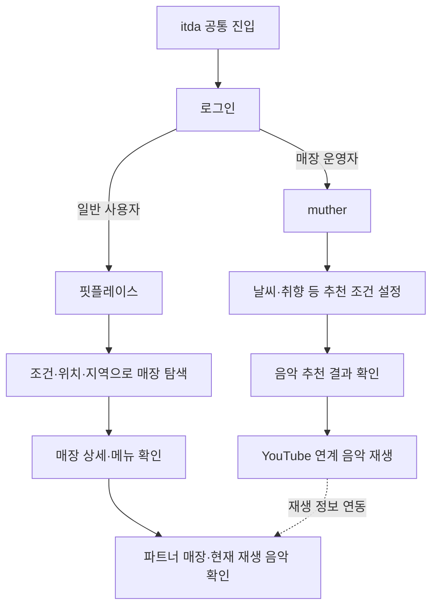

# MLO 1기 4차 프로젝트 — 핏플레이스

- 작성일 : 2026-11-12
- 문서상태 : 초안

## 1. 프로젝트 개요

| 항목 | 내용 |
|---|---|
| 프로젝트명 | 핏플레이스 |
| 프로젝트 소개 | 날씨·분위기·예산 등을 고려한 카페·주점 탐색 서비스 |
| 연계 서비스 | 3차 음악 큐레이션 서비스 muther, 두 서비스를 연결하는 통합 플랫폼 itda |
| 프로젝트 기간 | 확인 필요 |
| 평가 방식 | 기능 시연 중심 |

## 2. 프로젝트 배경과 목표

**핏플레이스**는 일반 사용자가 지역, 날씨, 분위기, 예산 등을 고려해 카페와 주점을 찾는 서비스입니다. 매장 운영자용 음악 큐레이션 서비스 **muther(뮤더)**의 확장 서비스이며, 매장에서 재생되는 음악의 정보를 **핏플레이스**에 연동하는 것을 목적으로 합니다.

- 일반 사용자가 조건에 맞는 매장을 찾고 방문에 필요한 정보를 확인하도록 돕습니다.
- 통합 플랫폼 itda를 통해 3차 뮤더와 핏플레이스 각각의 플랫폼으로 연결할 수 있도록 합니다.


## 3. 서비스 구성과 이용 흐름

| 서비스 | 대상 | 주요 흐름 |
|---|---|---|
| **핏플레이스 · track2** | 일반 사용자 | 중심 서비스: 로그인 → 필터·지역 설정 → 검색 또는 지도에서 매장 확인 → 상세 정보 확인 |
| **muther · track1** | 매장 운영자 | 3차 음악 서비스: 로그인 → 음악 추천 조건 설정 → 추천 결과 확인 → YouTube 연계 재생 |
| **itda · 통합 플랫폼** | 두 서비스의 이용자 | 핏플레이스와 뮤더의 공통 진입·서비스 연동 지원 |



점선은 서비스 간 연동이 필요한 **목표 흐름**입니다. 매장 식별과 재생 정보의 전달·갱신 방식, 실제 재생 상태의 통합 검증은 확인이 필요합니다. 적용된 선곡표와 현재 재생 중인 음악은 서로 다른 상태입니다.

## 4. 주요 기능


### track2 · 핏플레이스

- 사용자가 설정한 조건에 따라 매장을 추천받습니다.
- 현재 위치 또는 선택한 지역을 기준으로 주변 매장을 검색합니다.
- 목록이나 지도에서 매장을 선택하고 사진·대표 메뉴·위치 등 상세 정보를 확인합니다.

### track1 · muther

- 음악 데이터의 적재 여부를 확인합니다.
- 날씨와 취향 등 선택한 조건에 따라 음악을 추천받습니다.
- 추천 음악을 YouTube와 연계해 재생합니다.
- 사용자 피드백과 해당 데이터의 적재 여부를 확인합니다.

### 공통·서비스 연동

- 로그인 후 이용 유형에 맞는 서비스에 접근합니다.
- 뮤더 이용 매장을 핏플레이스에 파트너 매장으로 표시하고 해당 매장의 현재 재생 음악을 보여줍니다.

매장 운영자의 이벤트 발행은 이번 업무 범위에서 제외합니다. 찜·리뷰와 메뉴 조합은 BRD와 PRD의 범위 정합성을 확인해야 합니다.

## 5. 주요 화면

| 화면 | 주요 내용 |
|---|---|
| 공통 진입·로그인 | 사용자 유형별 서비스 진입 |
| 핏플레이스 탐색 | 조건 설정과 매장 목록·지도 |
| 매장 상세 | 매장 사진·대표 메뉴·위치 |
| 뮤더 | 음악 추천 조건 설정, 선곡 결과와 재생 |
| 서비스 연동 | 파트너 매장과 현재 재생 음악 표시 · 통합 검증 필요 |

화면 이미지와 최종 시연 화면은 확인 후 추가합니다. 프론트엔드 화면 문서는 준비 중입니다.

## 6. 데이터와 처리 흐름

| 데이터 | 활용 목적 | 확인 사항 |
|---|---|---|
| 매장·메뉴 | 매장 검색·추천과 상세 정보 제공 | 출처·사용 범위·정보 갱신 |
| 날씨 | 매장 탐색과 음악 추천 조건 | 출처·갱신 주기·조회 실패 처리 |
| 음악 | 조건별 추천과 재생 | 출처·적재 상태·추천 기준 |
| 사용자 피드백 | 사용자 반응 수집과 데이터 적재 확인 | 수집 항목·저장·조회 권한 |
| 파트너·재생 정보 | 매장과 음악 정보 연결 | 매장 식별·상태 전달·갱신·오류 처리 |

실제 데이터를 사용한다는 팀 공유 사항이 있으며, 데이터별 출처와 사용 범위는 확인이 필요합니다. 매장 데이터 처리 코드에 관한 이력은 [PR #56](https://github.com/encore-ai-campus/mlo-01-p4-team1/pull/56)을 참고합니다.


## 7. 기술 구성

| 영역 | 구성·역할 |
|---|---|
| 프론트엔드 | React · TypeScript · Vite — 서비스 화면 |
| 백엔드 | Django 기반 서비스 API와 별도 광고 API |
| 데이터 처리 | 음악·날씨·매장·피드백 데이터 처리 코드 |
| 인프라 | Docker 및 AWS 실행·배포 관련 코드 |
| 외부 연동 | YouTube 연계 재생, 날씨 데이터 조회 등 |

구성은 저장소와 기존 문서에서 확인한 개요입니다. 최신 통합 환경의 정확한 버전과 실제 운영 적용 범위는 추가 확인이 필요합니다. 상세 내용은 [앱 안내](app/README.md), [Docker 개발 가이드](app/docker/README.md), [아키텍처 문서](docs/architecture/README.md)를 참고합니다.

## 8. 프로젝트 구조

```text
.
├─ app/                 # 앱·API·프론트엔드·데이터 처리 코드
│  ├─ frontend/         # 프론트엔드
│  ├─ backend/          # 백엔드
│  ├─ ad-server/        # 광고 API
│  ├─ pipeline/         # 데이터 처리
│  ├─ docker/           # Docker 실행 관련 자료
│  └─ docs/             # 기존 음악 서비스 문서
├─ aws-infra/           # 인프라 코드
├─ docs/                # 프로젝트 요구사항·화면·아키텍처 문서
├─ scripts/             # 공통 실행·검사 도구
└─ tests/               # 검증 테스트
```

## 9. 팀 역할과 주요 작업

| 담당 영역 | 주요 역할 |
|---|---|
| 서비스 기획·프론트엔드 | 요구사항·화면·사용자 이용 흐름 |
| track2 백엔드·매장 추천 | 매장·메뉴 API와 장소 추천 |
| 3차 개선·AI | 기존 음악 기능·DB 개선과 음악 분류기 학습·평가 |
| 인프라·배포 | 서버·DB·컨테이너·데이터 파이프라인 |
| track1·track2 통합 | 공통 인증·권한, 매장 연결과 API·화면 통합 |

역할별 협의 사항은 [BRD](docs/BRD.md)를 참고합니다.

## 10. 구현·검증 및 수행 결과

| 구분 | 확인된 내용 |
|---|---|
| 구현 이력 | 매장·관리 화면과 데이터 처리, 뮤더 선곡·날씨 화면 변경이 `main`에 병합됨. [릴리스 PR #61](https://github.com/encore-ai-campus/mlo-01-p4-team1/pull/61) |
| 격리 환경 검증 | PR #61에 Linux AMD64 이미지 기준 웹·매장·시연 점주 회귀 테스트 99개 통과와 격리 PostgreSQL 마이그레이션 확인이 기록됨 |
| 인프라 검증 | PR #63에 OIDC 시각 경계 테스트 32개, 네이티브 테스트 5개 및 관련 검사 통과가 기록됨. [PR #63](https://github.com/encore-ai-campus/mlo-01-p4-team1/pull/63) |
| 운영 배포·전체 시연 | 실제 운영 배포 및 전체 통합 시연의 완료 여부 확인 필요 |
| 남은 확인 | 음악 추천, 매장 추천 데이터의 조회·표시와 서비스 간 연동을 시연 환경에서 검증 |

위 테스트는 PR에 기록된 결과이며, 이번 README 수정 과정에서 직접 실행하지 않았습니다. 코드 병합과 격리 환경 테스트만으로 운영 배포·전체 시연 성공을 판정하지 않습니다.

## 11. 실행 및 테스트

- [통합 플랫폼 itda](https://dktu9581en6nc.cloudfront.net/platform)
- [핏플레이스](https://dktu9581en6nc.cloudfront.net/venues)
- [muther](https://dktu9581en6nc.cloudfront.net/muther)

## 12. 관련 문서와 발표 자료

| 문서 | 내용 |
|---|---|
| [BRD](docs/BRD.md) | 프로젝트 배경·목표·업무 범위 |
| [PRD](docs/PRD.md) | 기능·데이터·예외 처리·수용 기준 |
| 프론트엔드 화면 문서 | 준비 중 |
| [뮤더 앱 안내](app/README.md) | 기존 음악 서비스의 기능과 기술 기록 |
| [기존 음악 서비스 BRD](app/docs/BRD.md) · [PRD](app/docs/PRD.md) | Track 1 참고 문서 |
| [아키텍처 문서](docs/architecture/README.md) | 기존 시스템과 데이터 흐름 설계도 |
| [인프라 기준](docs/handoff/infra/BASELINE.md) · [테스트 안내](docs/handoff/infra/TESTING.md) | 인프라와 검증 안내 |
| [협업 안내](CONTRIBUTING.md) | 작업·리뷰·통합 절차 |

최종 발표 자료와 시연 영상 링크는 확인 후 추가합니다.
