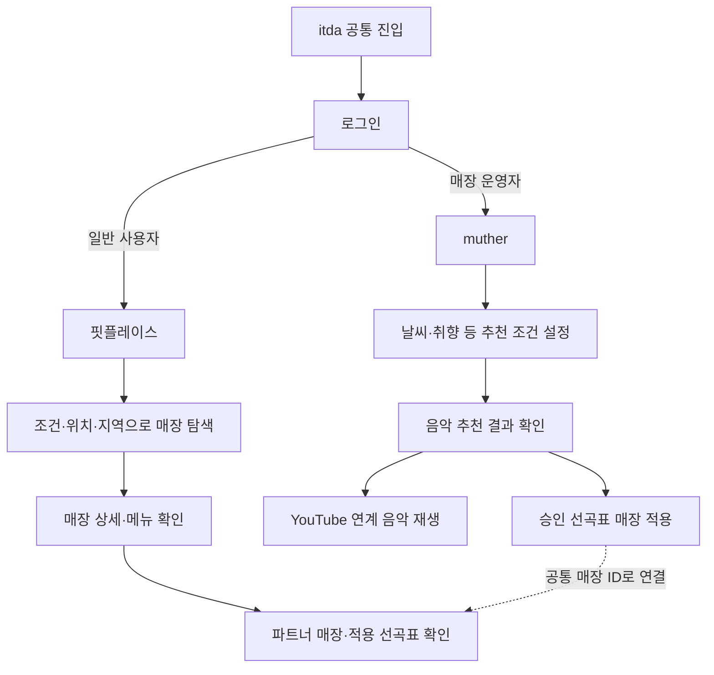

# MLO 1기 4차 프로젝트 — muther x 핏플레이스

- 작성일 : 2026-11-16

## 1. 프로젝트 개요

| 항목 | 내용 |
|---|---|
| 프로젝트명 | 핏플레이스 |
| 프로젝트 소개 | 날씨·분위기·예산 등을 고려한 카페·주점 탐색 서비스 |
| 연계 서비스 | 3차 음악 큐레이션 서비스 muther, 두 서비스를 연결하는 통합 플랫폼 itda |
| 평가 방식 | 기능 시연 중심 |

## 2. 프로젝트 배경과 목표

**핏플레이스**는 일반 사용자가 지역, 날씨, 분위기, 예산 등을 고려해 카페와 주점을 찾는 서비스이다. 매장 운영자용 음악 큐레이션 서비스 'muther'의 확장 서비스이며, 매장에서 재생되는 음악의 정보를 '핏플레이스'에 연동하는 것을 목적으로 한다.

- 일반 사용자가 조건에 맞는 매장을 찾고 방문에 필요한 정보를 확인하도록 돕는다.
- 통합 플랫폼 itda를 통해 3차 뮤더와 핏플레이스 각각의 플랫폼으로 연결할 수 있도록 한다.
- 음악의 장르·분위기 분류 모델을 비교·평가하고, 매장 탐색과 이벤트 참여로 일반 사용자의 이용 범위를 넓힌다.


## 3. 서비스 구성과 이용 흐름

| 서비스 | 대상 | 주요 흐름 |
|---|---|---|
| **핏플레이스 · track2** | 일반 사용자 | 중심 서비스: 로그인 → 필터·지역 설정 → 검색 또는 지도에서 매장 확인 → 상세 정보 확인 |
| **muther · track1** | 매장 운영자 | 3차 음악 서비스: 로그인 → 음악 추천 조건 설정 → 추천 결과 확인 → YouTube 연계 재생 |
| **itda · 통합 플랫폼** | 두 서비스의 이용자 | 핏플레이스와 뮤더의 공통 진입·서비스 연동 지원 |



점선은 운영 통합이 필요한 흐름이다. 공통 `venue_id`로 승인된 테스트 선곡표를 매장에 적용하고 상세에서 조회한 결과는 로컬 Docker·PostgreSQL 환경에서 확인됐다. 점주 관리 권한과 공개 매장의 연결은 운영 통합 검증이 남아 있다. 적용 선곡표 조회는 실제 재생 중인 곡의 실시간 확인과 다르며, 실시간 재생 정보의 전달·갱신은 후속 확인 사항이다. 관리자 로그인은 손님·점주 공통 로그인과 분리한다.

## 4. 주요 기능


### track2 · 핏플레이스

- 현재 위치·선택 지역을 기준으로 업종·예산·현재 영업 여부 등을 설정해 목록·지도에서 매장을 탐색한다.
- 매장 사진·위치·대표 메뉴와 카테고리별 메뉴·가격을 확인한다.
- 사용자·매장 벡터의 유사도로 추천 순위를 계산하고, Gemini로 날씨·후보 매장·이벤트에 따른 추천 이유를 안내한다. Two-Tower는 고정 시드 초기 가중치를 사용하며 추천 정확도는 미검증이다.
- 관심 매장 찜, 리뷰, 인원·예산에 따른 메뉴 조합 추천을 MVP에 포함한다. 메뉴 조합의 계산 정책과 구현·검증 결과는 발표 자료에서 확인되지 않았다.
- 이벤트 참여 의사를 표시하고 현장에서 QR을 인증한다. 이벤트·재고 차감·중복 차단 테스트 기록이 발표에 소개됐으며 공통 플랫폼 연동은 예정 상태이다.
- 폐업 제보, 이벤트 알림과 활동 내역을 제공한다. 상세 검증 상태는 [PRD](docs/PRD.md)를 참고한다.

### track1 · muther

- 음악 데이터의 적재 여부를 확인한다.
- 날씨와 취향 등 선택한 조건에 따라 음악을 추천받는다.
- 추천 음악을 YouTube와 연계해 재생한다.
- 사용자 피드백과 해당 데이터의 적재 여부를 확인한다.
- 음원 특징을 이용한 장르 14개·분위기 9개 다중 라벨 분류기를 학습·평가한다.

### 공통·서비스 연동

- 로그인 후 이용 유형에 맞는 서비스에 접근한다.
- 점주 이벤트 발행과 관리 기능을 개발 범위에 포함하며, 본인 매장 관리 권한 확인 후 공통 플랫폼에 연결한다.
- 공통 매장 ID를 기준으로 뮤더에서 승인·적용한 선곡표를 핏플레이스의 같은 매장에 연결한다.
- 관리자는 매장 관리 권한 신청과 폐업 제보를 검수한다. 역할별 운영 연동 상태는 10번에 기록한다.

## 5. 주요 화면

| 화면 | 주요 내용 |
|---|---|
| 공통 진입·로그인 | 사용자 유형별 서비스 진입 |
| 핏플레이스 탐색 | 조건 설정과 매장 목록·지도 |
| 매장 상세 | 매장 사진·대표 메뉴·위치 |
| 뮤더 | 음악 추천 조건 설정, 선곡 결과와 재생 |
| 이벤트·QR | 참여 의사 표시, QR 발급과 현장 인증 |
| 활동 내역·알림 | 찜·리뷰·이벤트 참여·QR 인증·제보 이력과 미읽음 알림 |
| 점주·관리자 | 매장 관리 권한 신청·심사, 이벤트 관리, 폐업 제보 검수 |
| 서비스 연동 | 승인·적용 선곡표 조회 · 로컬 확인, 운영 연결 검증 필요 |

## 6. 데이터와 처리 흐름

| 데이터 | 활용 목적 | 처리 내용과 남은 확인 |
|---|---|---|
| 매장·메뉴 | 매장 탐색과 상세 제공 | 분석용 카탈로그 처리와 CSV·DB 미러 기반 온라인 추천 경로 분리. 운영 연결 별도 검증 |
| 날씨 | 탐색·추천 조건 | 분할 도착 예보를 보존해 최신 완성 회차 선택. 유효한 예보만 추천에 반영 |
| 음악 | 자동 태깅과 음악 추천 | MERT·MAEST 특징 추출 및 분류기 비교. 학습·평가 결과와 서비스 반영 상태 구분 |
| 사용자 행동·피드백 | 취향 반영과 활동 기록 | 행동에 따라 사용자 벡터 갱신. 프로세스 재시작 후 지속성·추천 품질 별도 검증 |
| 파트너·선곡표 | 매장과 음악 정보 연결 | 공통 `venue_id`로 승인 선곡표 연결. 실시간 재생 상태는 별도 과제 |

상세 규칙은 [PRD의 데이터 정책](docs/PRD.md#6-데이터와-연동-정책), 처리 이력은 [PR #56](https://github.com/encore-ai-campus/mlo-01-p4-team1/pull/56)을 참고한다.


## 7. 기술 구성

| 영역 | 구성·역할 |
|---|---|
| 프론트엔드 | React · TypeScript · Vite — 서비스 화면 |
| 백엔드 | Django 기반 서비스 API와 별도 광고 API |
| 데이터 처리 | Kafka·Spark·Elasticsearch, PostgreSQL, S3 기반 데이터 처리 |
| 인프라 | AWS 5계정·5VPC·16EC2·3AZ 설계, CloudFront·ALB, Docker |
| 구성·운영 | Terraform 자원 정의, Ansible 호스트 설정·배포, Python Lifecycle 실행기 |
| 모델·외부 연동 | 음악 분류기, Two-Tower, Gemini 안내, 매장 추천 MCP, 기상청 API·YouTube |


## 8. 프로젝트 구조

```text
.
├─ app/                 # 앱·API·프론트엔드·데이터 처리 코드
│  ├─ frontend/         # 프론트엔드
│  ├─ backend/          # 백엔드
│  ├─ ad-server/        # 광고 API
│  ├─ pipeline/         # 데이터 처리
│  ├─ docker/           # Docker 실행 관련 자료
│  └─ docs/             # 기존 음악 서비스 문서
├─ aws-infra/           # 인프라 코드
├─ docs/                # 프로젝트 요구사항·화면·아키텍처 문서
├─ scripts/             # 공통 실행·검사 도구
└─ tests/               # 검증 테스트
```

## 9. 팀 역할과 주요 작업

| 담당자 | 담당 영역 | 주요 역할 |
|---|---|---|
| 김민서 | 기획·프론트엔드 | 요구사항·화면·사용자 유형별 UI |
| 김건우 | track2 백엔드 | 매장·메뉴 API, 추천, 이벤트·QR 인증·알림 |
| 안길찬 | 3차 개선·AI | 기존 음악 기능·DB 개선, 분류기 학습·평가 |
| 이인건 | 인프라 | 서버·DB·컨테이너·데이터 파이프라인 |
| 오재석 | track1·track2 통합 | 인증·권한, 매장·선곡표 매핑, API·화면 통합 검증 |

역할별 협의 사항은 [BRD](docs/BRD.md)를 참고한다.

## 10. 구현·검증 및 수행 결과

| 구분 | 결과 |
|---|---|
| 구현 이력 | 매장·관리·뮤더 화면과 데이터 처리 변경 병합. [PR #61](https://github.com/encore-ai-campus/mlo-01-p4-team1/pull/61) |
| 격리 환경 검증 | Linux AMD64 회귀 테스트 99개 통과, PostgreSQL 마이그레이션 확인 |
| 인프라 검증 | OIDC 32개·네이티브 5개 테스트 통과. [PR #63](https://github.com/encore-ai-campus/mlo-01-p4-team1/pull/63) |
| 음악 분류 내부 평가 | 876곡 평균 mAP: 0.8180 → 0.8274 |
| 음악 분류 외부 평가 | 498곡 평균 mAP: 0.6890 → 0.7274. 분위기 상승·장르 하락 |
| AWS 상태 검사 | 11월 11일 EC2 16대·ALB 두 대상·데이터 클러스터 정상 |
| 로컬 기능 검증 | 테스트 선곡표 적용·조회와 날씨 처리 확인. 이벤트·QR은 인계서 테스트 기록 |
| 운영 통합 | 손님 준비 화면·점주 신청·심사 반영, 관리자 비공개 시연 확인. 탐색·이벤트·QR 연결 예정 |


## 11. 관련 문서

| 문서 | 내용 |
|---|---|
| [BRD](docs/BRD.md) | 프로젝트 배경·목표·업무 범위 |
| [PRD](docs/PRD.md) | 기능·데이터·예외 처리·수용 기준 |
| [뮤더 앱 안내](app/README.md) | 기존 음악 서비스의 기능과 기술 기록 |
| [기존 음악 서비스 BRD](app/docs/BRD.md) · [PRD](app/docs/PRD.md) | Track 1 참고 문서 |
| [아키텍처 문서](docs/architecture/README.md) | 기존 시스템과 데이터 흐름 설계도 |
| [인프라 기준](docs/handoff/infra/BASELINE.md) · [테스트 안내](docs/handoff/infra/TESTING.md) | 인프라와 검증 안내 |
| [협업 안내](CONTRIBUTING.md) | 작업·리뷰·통합 절차 |

## 12. 실행 및 테스트

- [통합 플랫폼 itda](https://dktu9581en6nc.cloudfront.net/platform)
- [핏플레이스](https://dktu9581en6nc.cloudfront.net/venues)
- [muther](https://dktu9581en6nc.cloudfront.net/muther)

## 13. 한줄 회고
| 이름 | 회고 |
|---|---|
| 김민서 | 서비스 기획의 전체적인 흐름을 파악할 수 있어 뜻깊은 시간이었다. |
| 김건우 |  |
| 안길찬 |  |
| 이인건 |  |
| 오재석 |  |

## 14. 발표자료

https://drive.google.com/file/d/1vnuLz5emcEqIATKBmdkLo11AP51270aW/view?usp=sharing
