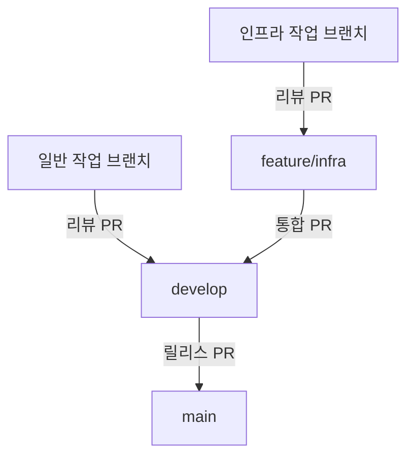

# 프로젝트 4 팀 전체 Git·GitHub 협업 가이드

> 적용 대상: 기획·UX/UI·프론트엔드·백엔드·데이터·모델·QA·인프라·통합·릴리스를 맡는 모든 팀원
>
> 기준일: 2026-11-05
>
> 문서 위치: `TEAM-GIT-COLLABORATION-GUIDE.md`
>
> 성격: 기존 [CONTRIBUTING.md](CONTRIBUTING.md)의 운영 규칙을 유지하면서 역할별 실행 방법과 인계 기준을 확장한 가이드

이 문서는 **팀 전체가 함께 사용하는 협업 문서**다. 기획 문서, 화면 설계, 코드, 데이터 처리, 모델 실험, 테스트, 운영 문서 모두 Issue·브랜치·Commit·PR·리뷰·릴리스로 연결한다. 작업 도구는 팀원이 선택하되, 담당 범위와 결과를 다른 팀원이 확인할 수 있도록 남긴다.

기존 운영 기준과 충돌하는 변경이 필요하면 해당 규칙을 관리하는 Issue와 PR에서 먼저 합의한다. 이 문서 작성 자체가 GitHub 보호 설정, 라벨, 템플릿, 자동화, 배포를 적용하지는 않는다. 아래 명령은 실행 예시이며 실행 결과를 뜻하지 않는다.

## 1. 기존 문서에서 확장한 내용과 이유

| 항목 | 확장 내용 | 이유 |
|---|---|---|
| 독자 | 기획·디자인·구현·데이터·모델·검증·운영 전체 | 비개발 산출물도 기능의 기준과 변경 이력을 구성한다. |
| 작업 시작 | 역할별 산출물·수용 기준·의존성을 Issue에 기록 | 요청과 구현 사이의 해석 차이를 줄인다. |
| 작업 방법 | 터미널 흐름과 GitHub 웹 전용 흐름 제공 | 코드를 작성하지 않는 팀원도 같은 리뷰 절차에 참여한다. |
| 검증 | 문서·앱·데이터·모델·인프라별 근거 구분 | 변경과 무관한 전체 인프라 검사를 일괄 요구하지 않는다. |
| 인계 | 다음 담당자가 사용할 문서·계약·버전·미해결 항목 명시 | 구두 전달만으로 생기는 누락을 줄인다. |
| 운영 상태 | 저장소 파일의 규칙, 과거 관측, 현재 확인할 설정 구분 | 문서에 적힌 목표를 이미 적용된 자동 보호로 오인하지 않는다. |

`main`·`develop`·`feature/infra`의 역할, Issue 번호 규칙, 다른 팀원 리뷰, 릴리스 기준 Issue 종료, 외부 실행 승인 분리는 그대로 유지한다.

## 2. 처음 참여하는 팀원이 먼저 할 일

1. [CONTRIBUTING.md](CONTRIBUTING.md), 이 문서, 담당 영역의 README를 읽는다.
2. 맡을 Issue가 있는지 확인한다. 없으면 목적·범위·담당자·완료 기준을 먼저 기록한다.
3. 일반 작업인지 인프라 통합 작업인지 정하고 기준 브랜치와 PR 대상을 확인한다.
4. GitHub 웹에서 문서를 수정할지, 로컬 저장소에서 작업할지 선택한다.
5. 다른 팀원 중 검토할 사람과 필요한 선행 산출물을 정한다.
6. 실제 회원정보·비밀키 없이 사용할 예시 데이터와 검증 방법을 정한다.

개인 IDE, GitHub Desktop, 터미널, Orca, AI 보조 도구, 별도 worktree는 선택 사항이다. 개인의 병렬 작업 방식이나 A/B/C 작업 공간 구성을 모든 팀원의 공통 의무로 만들지 않는다. 도구를 사용해 작성했더라도 Issue 담당자가 내용과 검증 결과를 책임진다.

### 2.1 Git·GitHub 용어 빠르게 이해하기

| 용어 | 하는 일 | 팀에서 확인할 점 |
|---|---|---|
| 저장소 / repository | 파일과 변경 이력을 함께 관리하는 공간 | 팀이 사용하는 원격 저장소가 맞는지 확인한다. |
| clone | 원격 저장소를 내 작업 디렉터리로 가져와 로컬 저장소를 만든다. | 새 clone에는 로컬 hook을 별도로 설치한다. |
| fetch | 원격 변경과 브랜치 정보를 가져온다. | 현재 작업 파일에 다른 브랜치를 자동 병합하는 단계는 아니다. |
| branch | 같은 프로젝트에서 작업 이력을 나누는 단위 | 한 Issue의 변경을 단기 작업 브랜치에서 진행한다. |
| stage / add | 다음 Commit에 넣을 변경을 선택한다. | 전체 변경을 무조건 담지 말고 관련 파일과 줄을 확인한다. |
| commit | 선택한 변경을 로컬 이력에 기록한다. | 한국어 설명과 실제 Issue 번호를 남긴다. |
| push | 로컬 Commit을 원격 작업 브랜치로 보낸다. | push만으로 PR 승인·병합·릴리스가 끝나지 않는다. |
| PR / Pull Request | 내 브랜치를 다른 브랜치에 합치자고 검토를 요청한다. | `base`는 받을 브랜치, `compare`는 내 작업 브랜치다. |
| review | 다른 팀원이 변경과 근거를 확인한다. | 질문·수정 요청·승인 결과를 PR에 남긴다. |
| merge | 브랜치의 변경 이력을 합친다. | 팀 공유 브랜치 통합은 리뷰된 PR을 통해 진행한다. |
| release | 검증된 변경을 `main` 릴리스 기준으로 확정한다. | 실제 서버 배포 여부와 따로 기록한다. |

Git 동작 설명은 [clone](https://git-scm.com/docs/git-clone), [fetch](https://git-scm.com/docs/git-fetch), [push](https://git-scm.com/docs/git-push), [merge](https://git-scm.com/docs/git-merge) 공식 문서를 참고한다. PR의 base·compare 선택은 [GitHub 공식 PR 생성 안내](https://docs.github.com/en/pull-requests/how-tos/create-pull-requests/creating-a-pull-request)를 따른다.

## 3. 역할별 산출물·완료 기준·인계

한 사람이 여러 역할을 맡을 수 있다. 표의 역할은 인원 배치나 접근 권한을 새로 정하는 규칙이 아니라, 빠뜨리기 쉬운 책임을 확인하기 위한 구분이다. Issue마다 책임 담당자 한 명을 정하고 협업자·리뷰어를 함께 적는다.

| 역할 | 주로 관리할 산출물 | 완료 기준 예시 | 인계 대상과 전달 내용 |
|---|---|---|---|
| 기획·요구사항 | 사용자 시나리오, 범위, 정책, 우선순위, 결정 기록 | 정상·예외 상황의 기대 결과와 제외 범위가 명확함 | UX·구현·QA에 요구사항 식별자, 수용 기준, 미결 사항 전달 |
| UX/UI·디자인 | 화면 흐름, 상태별 화면, 문구, 접근성 기준, 이미지 자산 | 빈 값·오류·로딩·성공·접근 불가 상태와 모바일 동작 확인 | 프론트·QA에 버전이 고정된 화면 근거와 컴포넌트 상태 전달 |
| 프론트엔드 | UI 코드, 상태 관리, API 연동, 화면 테스트 | 승인된 흐름 구현, 입력·오류 처리, 해당 빌드·테스트 통과 | 백엔드·QA에 연동 계약, 화면별 확인 방법, 남은 의존성 전달 |
| 백엔드 | API, 권한, DB 변경, 인증, 서비스 로직, 테스트 | 입력·권한·오류·동시성 처리와 관련 테스트 확인 | 프론트·QA·운영에 API 계약, 마이그레이션, 설정·복구 영향 전달 |
| 데이터 | 수집·정제 코드, 스키마, 품질 기준, 합성 예시 | 출처·이용 조건·버전 기록, 중복·결측·범위 검증 | 모델·백엔드에 입력 계약, 변환 방식, 검증된 예시 전달 |
| 모델·ML | 학습·추론 코드, 평가 방법, 모델 버전, 실행 조건 | 재현 조건과 지표 기준 충족, 실패·성능 한계 기록 | 백엔드·QA·인프라에 입력·출력, 아티팩트 식별자, 자원 요구 전달 |
| QA·검증 | 테스트 계획, 케이스, 결함 Issue, 결과 요약 | 수용 기준에 대응하는 결과와 재현 절차 확보 | 구현·통합 담당자에 대상 버전, 환경, 실패 조건, 미검증 범위 전달 |
| 인프라·운영 | 환경·네트워크·배포·백업·복구 문서와 코드 | 해당 영역 로컬 검증과 필요한 통합 검사, 실행 승인 범위 확인 | 앱·통합·릴리스에 설정 계약, 실행 절차, 승인·운영 의존성 전달 |
| 통합 | PR 순서, 공통 계약 조율, 통합 검사 | 의존 PR과 충돌 해결, 같은 통합 버전에서 결과 확인 | 릴리스 담당자에게 포함 변경과 통합 결과 전달 |
| 릴리스 | 릴리스 PR, 변경 목록, 완료 Issue, 남은 작업 | `main` 반영 기준과 종료 가능한 Issue 확인 | 전체 팀에 릴리스 기준점, 알려진 제약, 실제 배포 상태 전달 |

경로별 소유권과 공통 파일 수정 기준은 [OWNERSHIP.md](docs/handoff/infra/OWNERSHIP.md)를 따른다. 기존 Foundation·Runtime·Lifecycle 구분은 인프라 작업 분담이며, 기획·프론트·QA가 그 구분을 새 직무명으로 사용할 필요는 없다. 소유권 문서는 협업·검사 기준이고 실제 GitHub·운영 시스템 권한을 자동 부여하지 않는다.

### 3.1 다음 담당자에게 인계할 최소 정보

| 항목 | 작성 내용 |
|---|---|
| 기준 | Issue, 요구사항 번호, 관련 문서·PR |
| 사용할 버전 | 브랜치·Commit SHA 또는 승인된 산출물 버전 |
| 준비된 것 | API·화면·데이터·설정 등 사용 가능한 범위 |
| 사용 방법 | 입력 예시, 실행·확인 방법, 예상 결과 |
| 검증 | 실행한 검사, 결과, 검증 환경, 근거 위치 |
| 남은 것 | 실패·보류·미검증 항목과 담당자·선행 조건 |
| 영향 | 개인정보, 공통 계약, DB, 비용, 배포, 복구 영향 |

채팅이나 회의에서 결정한 내용은 관련 Issue 또는 문서 PR에 요약한다. 요구사항을 바꾸면 이전 결정, 새 결정, 이유, 영향받는 구현·테스트를 함께 남긴다.

## 4. Issue에서 작업 범위 확정하기

### 4.1 현재 템플릿 사용

현재 저장소에는 [Issue 템플릿 디렉터리](.github/ISSUE_TEMPLATE/)의 Feature·Bug·Task 양식이 있다. `task.yml`의 화면 표시명은 **`Task / 인프라`**이며, 별도의 Docs 전용 템플릿은 현재 없다. 기획·문서·QA·운영 준비 작업은 기존 Task 양식을 사용하면서 제목·본문에 실제 영역을 적는다. 템플릿 표시명 정비는 별도 개선 사항이다.

| 작업 | 제목 예시 | 권장 양식 |
|---|---|---|
| 요구사항 합의 | `[Task] 복구 이메일 선택 등록 정책과 수용 기준 확정` | Task |
| 화면 문서 | `[Docs] 마이페이지 상태별 화면과 안내 문구 정리` | Task |
| 새 기능 | `[Feature] 마이페이지 복구 이메일 변경 기능 구현` | Feature |
| 결함 | `[Bug] 만료된 복구 링크가 다시 사용되는 문제 수정` | Bug |
| 검증 | `[Task] 복구 이메일 변경 시나리오 통합 검증` | Task |
| 모델 | `[Task] 추천 모델 평가 데이터와 기준 정리` | Task |
| 인프라 | `[Task] SMTP 설정 전달과 발송 실패 처리 검증` | Task |

위 제목과 번호 예시는 실제 Issue 생성이나 기능 완료를 뜻하지 않는다. 라벨은 저장소에 있는 항목만 선택한다. `area:qa`, `area:design` 등 유용한 이름을 본문에 제안할 수 있으나 실제 라벨이 생성되어 있다고 가정하지 않는다.

### 4.2 공통 Issue 본문 예시

```markdown
## 목적과 사용자 가치
어떤 사용자의 어떤 문제를 해결하는가:

## 범위
- 포함:
- 제외:
- 수정 예상 경로 / 영향받는 파트:

## 책임과 의존성
- 담당자:
- 협업자 / 리뷰어:
- 기준 브랜치 / PR 대상:
- 선행 Issue / API·데이터·화면 계약:

## 수용 기준
- [ ] AC-01: 주어진 조건에서 사용자가 어떤 결과를 확인하는가
- [ ] AC-02: 오류·빈 값·권한 없음에서 어떤 결과를 확인하는가
- [ ] AC-03: 어떤 산출물과 검증 결과가 인계되어야 하는가

## 검증 계획
- 방법 / 명령:
- 필요한 환경·데이터:
- 기대 결과:
- 실제 외부 서비스 검증 필요 여부:

## 영향과 미결 사항
- 개인정보·비밀정보·라이선스:
- DB·API·운영·비용·배포 영향:
- 외부 실행 승인 범위:
- 결정이 필요한 사항 / 담당자:
```

수용 기준은 “기능 구현 완료” 대신 관찰할 수 있는 결과로 작성한다. 예를 들어 “이메일이 없어도 가입을 완료한다”, “만료된 링크를 제출하면 정보가 바뀌지 않고 안내를 표시한다”, “문서에 정상·오류·미등록 상태가 모두 정의된다”처럼 검증 가능한 문장을 사용한다.

### 4.3 여러 파트가 함께하는 작업 나누기

기능 전체를 상위 Issue로 묶고, 기획·화면·API·검증·운영처럼 담당자와 완료 기준이 다른 작업을 하위 Issue 또는 연결된 Issue로 나눈다. GitHub의 하위 Issue 기능 사용 여부와 무관하게 본문 체크리스트와 링크로 의존성을 기록할 수 있다.

API 필드나 정책이 아직 바뀔 수 있으면 먼저 공통 계약을 검토한다. 의존 작업은 계약 버전을 고정하고 진행하며, 변경되면 영향받는 팀원과 테스트 목록을 갱신한다. 코드 구현과 실제 SMTP 발송·AWS 연결처럼 필요한 환경이 다른 검증은 완료 기준을 섞지 않고 각각 추적한다.

상태는 `대기 → 작업 중 → 리뷰 중 → 통합 완료·릴리스 대기 → 종료`로 기록한다. 기존 문서의 “개발 중”은 기획·문서·검증 작업에도 해당하는 “작업 중” 상태로 이해한다. Project가 없으면 Issue 본문으로 관리한다.

## 5. 브랜치와 PR 경로

| 브랜치 | 역할 | PR 대상 |
|---|---|---|
| `main` | 검증된 릴리스 기준, 운영상 기본 브랜치 | 없음 |
| `develop` | 전체 팀의 기능·문서·데이터·모델 통합 | `main` |
| `feature/infra` | 여러 인프라 작업의 통합 | `develop` |
| 일반 작업 브랜치 | 기획·UX·앱·데이터·모델·QA·일반 문서의 개별 작업 | `develop` |
| 인프라 작업 브랜치 | 인프라 코드·계약·운영 문서의 개별 작업 | `feature/infra` |



**문서의 업무 범위와 함께 바뀌는 계약**을 기준으로 Issue에서 통합 경로를 정한다. 예를 들어 전체 협업 가이드의 독립 변경은 공통 문서 작업으로 조율할 수 있고, 인프라 배포 절차를 바꾸는 문서는 해당 인프라 작업 경로로 묶는다. 범위가 섞이면 PR을 나누거나 통합 담당자와 순서를 정한다.

### 5.1 이름 규칙

```text
<접두사>/<실제 Issue 번호>-<짧은 영문 설명>
```

현재 [협업 검사 workflow](.github/workflows/collaboration-check.yml)가 허용하는 작업 브랜치 접두사는 `feat/`, `feature/`, `fix/`, `chore/`, `docs/`, `test/`다.

| 작업 | 브랜치 예시 |
|---|---|
| 기획·화면·정책 문서 | `docs/101-recovery-email-flow` |
| 프론트 구현 | `feat/102-profile-email-ui` |
| 백엔드 구현 | `feat/103-recovery-email-api` |
| 버그 수정 | `fix/104-reset-token-reuse` |
| QA·자동 테스트 | `test/105-account-recovery` |
| 모델·데이터 준비 | `chore/106-model-evaluation` |
| 인프라 설정·문서 | `chore/107-smtp-configuration` |

`refactor`는 Commit 타입으로 사용할 수 있지만 **현재 `refactor/` 브랜치는 CI의 허용 목록에 없다.** 리팩터링 작업은 `chore/` 등 허용 접두사를 사용한다. `plan/`, `design/`, `qa/`도 임의로 새 접두사로 사용하지 않는다. 허용 목록 변경이 필요하면 workflow와 문서를 함께 검토한다.

예시 번호는 실제 Issue 번호로 바꾼다. 기존 작업 이력에 번호를 덧붙이려고 공유 이력을 재작성하지 않는다.

## 6. 로컬에서 작업하는 방법

### 6.1 첫 clone과 보호 장치 설치

다음 `REPOSITORY_URL`은 저장소의 Code 메뉴에서 복사한 팀 저장소 URL로 바꾼다. 이미 clone이 있으면 새로 만들지 말고 기존 위치에서 저장소와 변경 상태를 먼저 확인한다.

```bash
git clone 'REPOSITORY_URL' mlo-01-p4-team1
cd mlo-01-p4-team1
git status --short
git config --local --get core.hooksPath
bash scripts/setup-git-hooks.sh
git config --local --get core.hooksPath
```

정상적인 hook 설정값은 `scripts/hooks`다. 설치는 **각 clone에서 한 번씩** 수행한다. `pre-commit`은 stage된 변경의 비밀정보·개인정보 등을 검사하고, `pre-push`는 공유 브랜치 직접 push를 막는 로컬 보조 장치다. GitHub 웹 편집이나 다른 clone까지 보호하지 않으므로 PR 리뷰와 저장소 측 검사를 함께 적용한다.

설치 전 조회에서 다른 `core.hooksPath`가 나오면 기존 hook의 목적을 확인하고 함께 적용할 방법을 정한다. 설치 스크립트는 저장소의 hook 경로 설정을 바꾸므로 기존 보호 장치를 모른 채 대체하지 않는다. 아직 설정이 없어 첫 조회가 빈 결과와 종료 코드 1을 반환하는 경우에는 미설정 상태로 이해한다.

공개되는 Commit 작성자 이름·이메일도 확인한다. 필요한 경우 GitHub의 이메일 비공개 설정과 제공되는 no-reply 주소를 사용한다. 다른 사람 명의나 임의의 자동 작성자 표기를 추가하지 않는다. [GitHub 파일 편집 안내](https://docs.github.com/en/repositories/working-with-files/managing-files/editing-files)는 웹 Commit의 작성자 이메일 선택도 설명한다.

### 6.2 일반 작업 브랜치 생성

아래는 Issue `#101`에 연결한 문서 작업 예시다. `git status --short`에 기존 변경이 있으면 담당 작업을 확인하고 보존한 뒤 진행한다. 다른 사람의 변경을 없애거나 강제로 브랜치를 바꾸지 않는다.

```bash
git status --short
git fetch origin
git switch develop
git pull --ff-only origin develop
git switch -c docs/101-recovery-email-flow
```

로컬 `develop`이 아직 없어서 전환할 수 없다면 원격에 `origin/develop`이 있는지 확인한 후 `git switch --track origin/develop`으로 처음 연결할 수 있다. 다른 worktree가 사용 중이라고 나오면 강제로 가져오지 말고 해당 작업 경로·담당자와 조율한다.

인프라 작업은 위 예시의 기준을 `feature/infra`로 바꾸고 `chore/107-smtp-configuration` 같은 개별 브랜치를 만든다. `feature/infra` 자체에서 여러 사람의 작업을 직접 Commit하지 않는다.

### 6.3 변경 확인·선별 stage·Commit

```bash
git status --short
git diff -- TEAM-GIT-COLLABORATION-GUIDE.md
git add -- TEAM-GIT-COLLABORATION-GUIDE.md
git diff --cached --stat
git diff --cached
git diff --cached --check
git commit -m "docs(team): 전체 파트의 협업과 인계 기준 정리 (#101)"
```

위 파일 경로는 예시다. 실제 Issue에서 수정한 파일을 지정한다. 처음 생성한 파일은 일반 `git diff`에 내용이 안 나올 수 있으므로 파일 자체를 읽고 stage 후 `git diff --cached`에서도 확인한다. 일부 줄만 같은 Issue에 해당하면 편집기의 stage 기능이나 `git add -p`를 사용한다. 다른 변경이 섞일 수 있는 작업 공간에서 무조건 `git add .`를 실행하지 않는다.

기본 Commit 형식은 다음과 같다.

```text
type(scope): 한국어 변경 설명 (#실제Issue번호)
```

| 타입 | 사용하는 경우 | 예시 |
|---|---|---|
| `feat` | 기능 추가 | `feat(auth): 복구 이메일 변경 기능 추가 (#103)` |
| `fix` | 결함 수정 | `fix(auth): 만료된 재설정 링크 사용 차단 (#104)` |
| `docs` | 기획·설계·사용·운영 문서 | `docs(ux): 마이페이지 오류 상태와 문구 정리 (#101)` |
| `test` | 테스트·검증 코드 | `test(auth): 복구 토큰 재사용 시나리오 검증 (#105)` |
| `refactor` | 동작을 유지한 구조 개선 | `refactor(auth): 복구 요청 검증 로직 분리 (#108)` |
| `chore` | 설정·준비·관리 작업 | `chore(model): 평가 실행 설정 정리 (#106)` |

한 Commit은 하나의 목적에 집중한다. `(#101)`는 Issue 참조이며 자동 종료 키워드가 아니다. 아직 검증하지 않은 상태를 “검증 완료”라고 적지 않는다.

### 6.4 push와 PR

```bash
git push -u origin docs/101-recovery-email-flow
```

GitHub에서 `Compare & pull request`를 선택하고 **base=`develop`, compare=`docs/101-recovery-email-flow`**인지 확인한다. 인프라 작업이면 base=`feature/infra`다. 제목에 실제 Issue 번호를 포함하고, 현재 PR 템플릿을 채운 후 다른 팀원에게 리뷰를 요청한다. 작업 중에 기준이나 방향을 검토받으려면 Draft PR을 사용한다.

리뷰 수정은 같은 작업 브랜치에서 추가 Commit·push하면 해당 PR에 반영된다. 공유된 이력을 임의로 지우거나 force push하지 않는다. push가 거절되면 원격 변경과 원인을 확인한 후 해결한다.

## 7. GitHub 웹에서 문서만 수정하는 방법

Git 명령을 사용하지 않아도 기획서, 정책, 테스트 계획, 회의 결정, 사용 안내를 PR로 제출할 수 있다. 기본적인 파일 수정·새 브랜치 Commit은 [GitHub 공식 파일 편집 안내](https://docs.github.com/en/repositories/working-with-files/managing-files/editing-files)를 참고한다.

1. 수정할 내용을 Issue로 기록한다. 예를 들어 `[Docs] 가입 화면 안내 문구와 오류 상태 정리`로 만든다.
2. 저장소 Code 화면의 브랜치 선택에서 `develop`을 선택한다. 인프라 전용 문서라면 합의된 `feature/infra`를 선택한다.
3. 기준 브랜치에서 `docs/실제번호-설명` 형태의 **새 작업 브랜치**를 만든다. 다른 팀원의 작업 브랜치를 재사용하지 않는다.
4. 새 브랜치가 선택되어 있는지 확인하고 파일을 연 뒤 편집한다. 새 문서는 Add file 기능으로 작성한다.
5. Preview로 제목·표·링크·코드 블록을 확인한다. 화면·보고서를 첨부할 때 실제 이메일·계정·토큰·내부 주소가 보이지 않는지 확인한다.
6. 한국어 변경 설명과 `(#실제번호)`를 넣어 **내 작업 브랜치에** Commit한다. 여러 파일이면 같은 작업 브랜치에서 계속 수정한다.
7. 해당 브랜치에서 PR을 만들고 base와 compare를 확인한다. 템플릿에 검증 범위를 기록하고 다른 팀원에게 리뷰를 요청한다.
8. 로컬 검사를 실행하지 못했다면 `not_run`과 이유를 적는다. CI나 검증을 맡은 팀원이 필요한 검사를 수행한 뒤 그 근거를 PR에 보충한다.

웹 화면에 공유 브랜치로 바로 Commit하는 선택지가 보여도 팀의 PR 절차를 따른다. 로컬 hook은 웹 편집에 적용되지 않으므로 웹 작업도 같은 공개 가능성·리뷰 기준을 확인한다. 권한이 없어 작업 브랜치를 만들 수 없다면 담당자에게 권한·기여 경로를 확인하고, 내부 자료를 다른 공개 저장소에 복사해 해결하지 않는다.

## 8. PR 본문과 리뷰

현재 PR 템플릿 경로는 **[.github/pull_request_template.md](.github/pull_request_template.md)**다. 대소문자를 포함해 실제 파일명을 사용한다. 기존 체크 항목을 확인하고, 역할에 따라 아래 내용을 보충한다.

```markdown
## 관련 Issue
Related #101

## 변경 사항
- 작업 목적:
- 기존 문제 / 변경 후 사용자 동작:
- 변경 범위:
- 제외 범위:
- 관련 요구사항·화면·API·데이터 계약:

## 수용 기준 확인
- AC-01: pass / fail / blocked / not_run — 근거
- AC-02: pass / fail / blocked / not_run — 근거

## 검증
- 대상 Commit / 환경:
- 실행 명령 또는 검토 방법:
- 결과와 근거:
- 미실행·실패 항목과 이유:
- 개인정보·비밀정보가 포함되지 않은 근거만 첨부했는지:

## 다른 파트 인계
- 사용할 산출물·버전:
- 공통 계약 변경 / 대응이 필요한 파트:
- 남은 의존성과 후속 Issue:

## AWS·외부 서비스
- 실제 AWS 배포: 미실행 / 승인 범위 내 실행 — 실제 상태
- SMTP 등 외부 서비스 검증: 미실행 / 실행 — 환경과 근거
- DB·운영·비용 영향:
- 복구 방법:
- 남은 검증:

## 리뷰 요청
- 중점 검토 사항:
- 요청 리뷰어:
```

실제 수행한 항목에만 체크한다. 앱을 바꾸지 않은 문서 PR에서는 앱 검사가 적용되지 않는 이유를 적는다. 검사 자체가 필요한데 실행할 수 없는 경우에는 “해당 없음”으로 바꾸지 않고 `blocked` 또는 `not_run`으로 남긴다.

현재 협업 CI는 PR 제목의 `(#번호)`, 본문의 Issue 참조, 허용 브랜치 경로 등을 검사한다. 이 검사를 통과해도 요구사항·보안·동작의 타당성을 모두 검증한 것은 아니다. 규칙의 실제 구현은 [collaboration-check.yml](.github/workflows/collaboration-check.yml)에서 확인한다.

### 8.1 리뷰어가 확인할 내용

| 관점 | 질문 |
|---|---|
| 기획·사용자 | 승인한 요구사항과 화면 흐름에 맞는가? 예외 상태가 설명되는가? |
| 계약·연동 | 다른 파트가 사용하는 필드·상태·오류·설정이 바뀌었는가? |
| 구현·재현 | 변경 목적이 분명하고 재현·검증 근거가 있는가? |
| 개인정보·보안 | 실제 데이터·비밀정보가 섞이지 않았는가? 권한과 로그 영향은 확인했는가? |
| 운영 | DB·설정·배포 순서와 실패 시 복구 방법이 필요한가? |
| 문서 | 결정과 제안, 구현과 미구현, 실행과 미실행이 구분되는가? |

최소 **한 명의 다른 팀원**이 리뷰한다. 자동 리뷰나 AI 검토는 보조 근거다. 작성자 본인의 확인만으로 다른 팀원 리뷰를 대체하지 않는다. 전문 영역을 넘는 변경은 해당 담당자에게 추가 검토를 요청한다.

리뷰어는 수정이 필요한 이유와 기대 결과를 구체적으로 적는다. 작성자는 수정 Commit이나 이유를 답하고 관련 검사를 다시 실행한다. 승인 후 주요 내용이 바뀌면 영향받는 리뷰와 검증을 갱신한다.

## 9. 변경 범위에 맞는 검증과 근거

[TESTING.md](docs/handoff/infra/TESTING.md), 해당 영역 README, [Makefile](Makefile)의 실제 명령을 기준으로 실행한다. 모든 팀원이 모든 검사를 실행하는 방식이 아니라, Issue에서 정한 수용 기준과 변경 영향에 대응하는 검사를 적용한다.

| 변경 범위 | 확인할 내용 | 실행·증빙 기준 |
|---|---|---|
| 기획·정책·UX 문서 | 결정의 일관성, 정상·오류 상태, 링크·표·용어, 구현 가능성 | 문서 diff, 화면 검토, 요구사항과 수용 기준 대응표; 저장소 공통 문서 검사 적용 범위 확인 |
| 공통 계약·인프라 문서 | 경로·계약·소유권·공통 준비 기준 | 기존 기준인 `make prep-check prep-test`와 공개 가능성 검사 |
| 프론트엔드 | 타입·빌드, 관련 UI·상태 테스트, 필요한 화면 동작 | `app/frontend/`에서 `npm run build`, `npm test`; 변경과 관련된 수동·통합 확인 근거 |
| 백엔드 | API 입력·권한·오류, 관련 단위·통합, DB 변경 | 파트별 설치·실행 문서대로 테스트 환경을 준비한 뒤 해당 테스트; 준비되지 않은 환경은 `blocked`로 기록 |
| 데이터 | 스키마·출처·이용 조건, 중복·결측·범위, 재현 가능성 | 버전이 고정된 합성·허용 데이터의 검증 요약과 변환 코드 |
| 모델 | 평가 지표·기준 데이터·재현 조건, 추론 계약·자원 한계 | 데이터·모델·설정 버전, 지표, 평가 명령, 실패 사례; 실제 GPU 여부 명시 |
| QA | 수용 기준별 성공·오류·경계·권한·회귀 | 대상 Commit, 환경, 재현 절차, 기대값·관측값, 결함 Issue |
| Foundation | 공통 검사와 해당 인프라 영역 | `make prep-check prep-test foundation-unit foundation-integration` |
| Runtime | 공통 검사와 해당 실행 영역 | `make prep-check prep-test runtime-unit runtime-integration` |
| Lifecycle | 수명 주기와 공통 연계 | `make lifecycle-unit lifecycle-integration integration-lifecycle`, 관련 공통 검사 |
| 인프라 전체 통합 | 합쳐진 코드에서 영역 간 호환 | 같은 checkout에서 `make predeploy-check` |
| 앱 포함 배포 준비 | 앱 이미지와 배포 준비 조건 | 필요한 이미지·도구·환경을 준비하고 [TESTING.md](docs/handoff/infra/TESTING.md)의 앱 준비 절차 수행; `app-predeploy`의 선행 조건 확인 |

`npm run build`와 `npm test`는 현재 [프론트엔드 package.json](app/frontend/package.json)에 정의된 스크립트다. 이 문서는 존재를 확인하지 않은 `npm run lint`나 파트별 테스트 명령을 필수 성공 항목으로 추가하지 않는다. 의존성 설치나 서비스 구동은 해당 파트의 현재 문서를 따른다.

PR 템플릿의 `python3 scripts/check_public_release.py`와, 앱 변경 시 `python3 app/docker/check_git_candidates.py`도 적용 범위를 확인한다. 문서에 명령이 있다는 사실만으로 그 명령을 실행했거나 통과했다고 기록하지 않는다. 신규 문서를 추가할 때는 공통 파일 소유권 등록 등 저장소 검사 요구도 함께 확인한다.

`docs/handoff/infra/`의 새 파일은 기본적으로 Git 제외 대상이다. 공개할 기술·협업 문서는 내용을 검토한 후 공통 담당자와 정확한 파일 경로를 조율하여 `.gitignore`의 예외, 공개 검사 스크립트의 허용 문서 목록, 소유권 계약에 함께 등록한다. `git add -f`로 제외 규칙을 우회하지 않는다. 등록한 공개 문서에도 개인정보·비밀값·개인 경로 검사를 적용한다. 이 가이드와 개인정보 설계 문서는 저장소 루트에서 관리하며 공통 소유권과 공개 내용 검사를 적용한다.

### 9.1 검증 결과 기록 방식

| 상태 | 뜻 | 함께 적을 내용 |
|---|---|---|
| `pass` | 실제 실행·검토했고 해당 기준을 충족함 | 대상 버전, 환경, 명령·방법, 결과 근거 |
| `fail` | 실행했으나 기대 결과를 충족하지 못함 | 재현 절차, 실패 요약, 결함 Issue |
| `blocked` | 필요한 환경·권한·의존성이 없어 수행할 수 없음 | 막힌 조건, 해소 담당자, 후속 계획 |
| `not_run` | 아직 실행하지 않음 | 이유, 수행할 사람·시점 또는 별도 Issue |

모의 SMTP·모의 AWS·작은 샘플·CPU 검증은 각각 검증한 범위대로 적는다. 실제 메일 발송, 실제 AWS 통신, 전체 데이터, 실제 GPU 검증을 대신한 것으로 표시하지 않는다. 불필요한 원본 로그 대신 비밀값을 제거한 결과 요약을 공유한다.

## 10. 충돌과 실패를 안전하게 해결하기

### 10.1 충돌을 줄이는 작업 습관

수정할 공통 파일과 계약을 Issue에 먼저 적고, 같은 부분을 바꾸는 작업이 있는지 확인한다. 큰 PR은 목적별로 나누고, 기준 변경이 생기면 의존 작업에 전달한다. 코드 생성 결과·모델 바이너리·데이터 파일을 무분별하게 함께 Commit하지 않는다.

### 10.2 내 작업 브랜치에 기준 브랜치 변경 반영

다음은 **변경을 보존했고 working tree가 깨끗한 내 작업 브랜치**에서 최신 `develop`을 반영하는 예시다. 공유 브랜치 자체를 직접 수정하는 예시가 아니다.

```bash
git status --short
git branch --show-current
git fetch origin
git merge origin/develop -m "chore(git): develop 변경 반영 (#101)"
```

인프라 작업은 합의된 `origin/feature/infra`를 기준으로 삼는다. 충돌이 없으면 병합 결과와 필요한 검사를 확인하고 작업 브랜치를 push한다. 충돌이 나면 다음 순서로 처리한다.

1. `git status`와 `git diff --name-only --diff-filter=U`로 충돌 파일을 확인한다.
2. 양쪽 Issue·PR의 의도를 읽고 관련 담당자와 최종 동작을 합의한다.
3. 해당 충돌 부분을 직접 수정한다. 파일 전체를 무조건 “내 것” 또는 “상대 것”으로 선택해 상대 변경을 지우지 않는다.
4. 해결한 파일만 `git add -- 파일경로`로 stage하고 `git diff --cached`와 `git diff --cached --check`를 확인한다.
5. 해당 범위 검사를 실행한 뒤 `git commit -m "chore(git): 기준 브랜치 병합 충돌 해결 (#101)"`로 완료한다.
6. 작업 브랜치를 push하고 PR에 충돌 해결 내용과 재검증 결과를 남긴다.

계속 해결하기 어렵다면 **현재 merge 진행 중임을 확인한 후** `git merge --abort`로 중단하고 담당자와 다시 확인할 수 있다. Git 공식 문서는 merge 시작 전 미커밋 변경이 있으면 원래 상태 복원이 어려울 수 있다고 설명하므로, 이 예시는 깨끗한 작업 상태를 전제로 한다. [Git merge 공식 문서](https://git-scm.com/docs/git-merge)

`reset --hard`, `clean -fd`, 공유 브랜치 force push, 다른 사람의 rebase로 문제를 덮지 않는다. 웹 편집만 사용하던 팀원이 복잡한 코드·DB·잠금 파일 충돌을 만났다면 해당 영역 담당자에게 해결을 요청하고 변경 의도를 함께 확인한다.

### 10.3 검사 실패·실수·되돌리기

검사가 실패하면 최초 실패 원인과 변경 범위부터 확인한다. 관계없는 파일·환경을 일괄 삭제하거나 대규모 수정하지 않는다. 이미 공유·병합한 변경을 되돌려야 하면 통합 담당자와 revert PR 등 복구 방법을 정하고 해당 기능·데이터 영향도 확인한다. 코드 되돌리기가 이미 실행된 DB 변경이나 외부 자원 변경까지 자동 복원하지는 않는다.

## 11. 병합·릴리스·Issue 종료

### 11.1 작업 PR 병합 조건

- Issue의 수용 기준과 적용 대상 검증이 충족되어 있다.
- 최소 한 명의 다른 팀원 리뷰와 수정 요청 처리가 끝났다.
- PR의 base·compare, 변경 파일, 영향 범위가 올바르다.
- 미검증 사항은 릴리스 판단에 영향을 주는지 구분하여 기록했다.
- 통합 담당자가 최종 상태와 충돌 해결 결과를 확인했다.

Draft 상태이거나 필수 조건을 충족하지 못한 PR은 검토를 이어간다. 사용할 merge 방식은 저장소 설정과 통합 담당자의 운영 기준을 따른다. 이 문서는 새로운 squash·rebase 의무를 추가하지 않는다.

작업 브랜치를 병합한 뒤 단기 브랜치 삭제 여부를 확인한다. `main`, `develop`, `feature/infra`는 장기 브랜치이므로 삭제 대상으로 취급하지 않는다. `feature/infra → develop` PR 후에도 `feature/infra`가 계속 필요한지 확인 없이 자동 삭제하지 않는다.

### 11.2 `Related`와 `Closes` 구분

| 위치 | 본문 예시 | 팀에서의 의미 |
|---|---|---|
| 일반 작업 → `develop` | `Related #101` | 관련 작업을 참조하며 통합 완료·릴리스 대기로 관리 |
| 인프라 작업 → `feature/infra` | `Related #107` | 인프라 내부 통합, 전체 릴리스는 아직 아님 |
| `feature/infra` → `develop` | `Related #107` | 전체 통합, main 릴리스 대기 |
| `develop` → `main` | `Closes #101` | 완료 기준을 충족한 Issue를 릴리스와 함께 종료 |

`Related`는 팀이 사용하는 참조 문구이며 GitHub의 자동 종료 키워드가 아니다. `Closes`·`Fixes`·`Resolves` 같은 종료 키워드는 GitHub의 기본 브랜치 동작과 연결된다. 이 프로젝트는 `main`을 기본 브랜치로 운영하는 기준이므로 릴리스 전에 실제 설정을 확인한다. [GitHub Issue 연결·종료 공식 문서](https://docs.github.com/en/issues/tracking-your-work-with-issues/using-issues/linking-a-pull-request-to-an-issue)

종료 키워드를 작업 Commit에 미리 넣으면 그 Commit이 나중에 기본 브랜치에 반영될 때 의도보다 일찍 Issue가 닫힐 수 있다. 작업 Commit은 `(#번호)`, 통합 PR은 `Related #번호`를 사용하고, 릴리스 담당자가 종료 대상을 선정한다.

### 11.3 릴리스 판단

기획·문서 작업도 `develop` 통합 후 다음 파트가 그 버전을 사용할 수 있다. 다만 기존 운영 정책에 따라 Issue 상태는 `통합 완료·릴리스 대기`로 남기고 `main` 반영 시 종료한다. 문서·정책의 승인 여부와 Git 릴리스 상태는 구분해 기록한다.

실제 배포·SMTP 발송·GPU 검증이 완료 기준인 Issue는 코드 병합이나 로컬 검사만으로 종료하지 않는다. 해당 실행 근거가 없는 Issue는 릴리스 PR의 `Closes` 목록에서 제외하고 후속 검증을 이어간다. 상위 기능 Issue는 하위 작업과 전체 수용 기준을 함께 확인한다.

취소·중복·작업 철회는 완료 처리와 구분하여 이유를 적고 닫는다. 릴리스 기록에는 포함 Issue·변경 요약·대상 버전·알려진 제약·실제 배포 상태를 남긴다.

## 12. 개인정보·비밀정보·대용량 자료의 공유 기준

이 프로젝트는 공개 가능성을 전제로 자료를 정리한다. 현재 저장소가 Private여도 실제 회원정보, 운영 비밀, 개인 기기 자료를 저장소에 넣는 근거가 되지는 않는다.

| 자료 | 저장소에서 공유할 내용 | 별도 관리할 내용 |
|---|---|---|
| 회원·인증 | 필드 정의, 합성 예시, 마스킹된 화면, 테스트 코드 | 실제 이름·별명·이메일·비밀번호·복구 링크·토큰·세션 |
| 설정 | 환경변수 이름, 값이 없는 설정 예시, 설정 절차 | SMTP 비밀번호, API 키, 개인키, 서비스 자격증명 |
| 운영·인프라 | 공개 가능한 구조·계약·실행 가이드 | 실제 inventory, state·plan, 민감 로그, 내부 접근 정보 |
| 데이터 | 출처·이용 조건·스키마·정제 코드·허용된 작은 예시 | 실제 개인정보가 포함된 원본, DB dump, 공유 권한 없는 데이터 |
| 모델·실험 | 코드·설정·평가 요약·아티팩트 버전과 해시 | 큰 가중치·checkpoint·중간 생성물·민감한 실험 원본 |
| 디자인·QA | 공개 가능한 이미지, 합성 계정 화면, 재현 절차 | 개인 계정 화면, 수신함·연락처, 원본 민감 로그 |

공개 문서는 개인 기기 절대 경로나 개인 연락처를 재현 방법으로 사용하지 않는다. 팀원이 따라 할 수 있도록 저장소 기준 상대 경로와 설정 이름을 사용한다. Commit·Issue·PR·Actions 로그·이미지·첨부파일에도 동일한 기준을 적용한다.

대용량 모델·데이터·영상은 변경 전에 담당자와 저장 위치, 접근 권한, 용량·비용, 라이선스를 확인한다. Git에는 필요한 메타데이터와 재현 방법을 남기고, 허용된 아티팩트 저장소나 Git LFS 사용 여부는 별도로 정한다. 현재 LFS나 외부 저장소가 이미 구성되어 있다고 가정하지 않는다. GitHub는 일반 Git 파일 크기를 제한하며 LFS 등 별도 방법을 안내한다. [GitHub 대용량 파일 안내](https://docs.github.com/en/repositories/working-with-files/managing-large-files/about-large-files-on-github)

민감한 값이 올라간 것을 발견하면 추가 노출을 중단하고 저장소·해당 시스템 담당자에게 알린다. 유효한 자격증명은 폐기·교체를 검토하고, 이력·로그·첨부파일의 잔존 범위를 확인한다. 최신 파일에서 한 줄을 삭제했다고 과거 노출이 해결되었다고 판단하지 않는다. 원문을 공개 Issue에 다시 붙여 넣지 않는다.

## 13. 외부 실행과 비용·배포 승인

Issue의 담당자 지정, 코드 리뷰 승인, PR 병합은 실제 AWS 생성·수정·삭제, 과금 작업, 운영 배포, 원격 호스트 설정 변경의 실행 허가를 대신하지 않는다. 승인된 범위가 이미 있다면 그 범위를 Issue에서 연결하고 필요한 작업을 진행한다.

| 작업 | 협업 기록에 남길 내용 |
|---|---|
| 읽기·로컬 검토·해당 범위 검사 | 실제 실행한 범위와 결과; 승인된 범위에서 불필요한 재확인 없이 진행 |
| 로컬 테스트 자원 생성 | 만드는 자원, 정리 범위, 실패 시 남는 상태 |
| 실제 SMTP 발송 | 제공자·환경·합성 테스트 수신 계정, 발송 범위·제한과 실행 근거 |
| AWS·원격 호스트 변경 | 대상·계획·예상 비용·승인 범위·복구·정리 방법 |
| 운영 배포·DB 변경 | 적용 순서, 백업·복구, 영향, 담당자, 실행 결과 |

일반 push만으로 Terraform `apply`·`destroy`나 원격 배포가 실행되도록 임의로 연결하지 않는다. 실패를 해결하기 위해 전역 volume prune, 다른 작업 자원 삭제, checkpoint 초기화 등을 실행하지 않는다. 시험에서 직접 만든 자원만 합의한 범위에서 정리하고, 중단·부분 성공·남은 자원도 인계한다.

## 14. 전체 역할이 연결되는 예시: 복구 이메일 선택 등록

다음은 협업 방법을 설명하는 **예시 업무**다. Issue 번호, 구현 완료, 테스트 통과, SMTP 발송을 실제 수행했다고 의미하지 않는다. 서비스 정책과 세부 수치는 [개인정보·회원가입·마이페이지 설계 문서](PRIVACY-MEMBERSHIP-MYPAGE-DESIGN.md)를 따른다.

상위 Issue의 목표를 “복구 이메일을 선택적으로 등록·확인·변경할 수 있고, 미등록 회원도 정해진 기본 가입·이용 흐름을 사용한다”로 정한다. 기획은 등록 여부에 따른 화면과 기능 차이를 명시하고, 구현·QA는 같은 수용 기준을 공유한다.

| 단계 | 담당·예시 Issue | 산출물과 인계 | 검증·PR 경로 |
|---|---|---|---|
| 1. 정책 확정 | 기획 `#101` | 선택 등록 목적, 미등록 상태, 변경·철회·오류 기준 | 승인 기록·수용 기준, `docs/101-… → develop` |
| 2. 화면·문구 | UX `#102` | 등록 전·확인 대기·확인 완료·실패 화면, 안내·접근성 | 화면 검토, `docs/102-… → develop` |
| 3. API·DB | 백엔드 `#103` | 필드·상태·오류 계약, 재인증·일회성 처리, 데이터 변경 영향 | 관련 테스트, `feat/103-… → develop` |
| 4. 화면 구현 | 프론트 `#104` | 승인된 화면과 계약 연동, 대기·오류·재시도 처리 | 빌드·UI 테스트, `feat/104-… → develop` |
| 5. 발송 준비 | 인프라 `#105` | Django SMTP 설정 전달, 비밀관리·실패 처리·운영 의존성 | 해당 설정 검사, `chore/105-… → feature/infra → develop` |
| 6. 통합 검증 | QA `#106` | 등록 없음·중복·만료·오입력·변경·철회 케이스와 결과 | 대상 Commit 고정, `test/106-… → develop` |
| 7. 릴리스 | 통합·릴리스 | 승인된 PR, 동일 통합 버전 검증, 미검증 목록 | `develop → main`, 완료 Issue만 종료 |

프론트와 백엔드가 병렬로 진행할 때는 API·상태 계약을 먼저 고정하고 모의 응답 사용 범위를 적는다. 실제 발송 권한이나 환경이 아직 준비되지 않았다면 로컬 모의 발송 결과와 실제 SMTP 검증을 구분한다. 운영 검증이 필요한 Issue는 근거가 확보될 때까지 남긴다.

이 기능에 데이터·모델 변경이 없다면 해당 파트에 불필요한 코드 수정이나 모델 평가를 요구하지 않는다. 대신 회원 속성이 추천 입력으로 새로 사용되는 등 계약이 바뀔 때 해당 파트를 연결한다.

## 15. 현재 파일 규칙·과거 관측·보완 사항

### 15.1 저장소 문서·파일에서 확인한 기준

| 항목 | 현재 문서화된 기준 또는 파일 상태 |
|---|---|
| 운영 규칙 | [CONTRIBUTING.md](CONTRIBUTING.md)의 Issue·PR·리뷰·릴리스 규칙 |
| 브랜치 경로 검사 | [collaboration-check.yml](.github/workflows/collaboration-check.yml)에 허용 경로·번호 검사 구현 |
| PR 양식 | [.github/pull_request_template.md](.github/pull_request_template.md) |
| Issue 양식 | Feature·Bug·Task, Task의 표시명은 `Task / 인프라`; Docs 전용 양식 없음 |
| 로컬 hook | [scripts/setup-git-hooks.sh](scripts/setup-git-hooks.sh)로 각 clone에서 설치하는 방식 |
| 검증·소유권 | [TESTING.md](docs/handoff/infra/TESTING.md), [OWNERSHIP.md](docs/handoff/infra/OWNERSHIP.md), [Makefile](Makefile) |

파일이 존재하는 것과 원격 설정·Actions 실행·각 clone 설치가 완료된 것은 서로 다른 상태다. 실제 적용 상태는 해당 Issue와 실행 근거로 확인한다.

### 15.2 과거 관측으로 남길 내용

기존 CONTRIBUTING에는 **2026-11-04에 Private 저장소의 브랜치 보호 API와 Ruleset API가 HTTP 403을 반환했다는 기록**이 있다. 이는 당시의 관측이며, 이 문서 작성 과정에서 원격 GitHub의 현재 플랜·권한·보호 설정을 다시 확인한 결과는 아니다. 따라서 현재도 동일하다거나, 반대로 보호가 적용 완료되었다고 단정하지 않는다.

GitHub 보호 브랜치의 기능 제공 범위는 저장소 가시성·플랜 등에 영향을 받으므로 현재 설정을 확인한다. [GitHub 보호 브랜치 공식 문서](https://docs.github.com/en/repositories/configuring-branches-and-merges-in-your-repository/managing-protected-branches/about-protected-branches)

### 15.3 별도 Issue로 보완할 제안

| 제안 | 이유 | 완료 근거 |
|---|---|---|
| Task 표시명·설명 확대 | 기획·QA·문서 담당자가 인프라 전용 양식으로 오해하지 않게 함 | 템플릿 변경 PR과 실제 생성 화면 확인 |
| 팀 역할을 반영한 라벨 정비 | 작업 유형·영역으로 검색·검토를 쉽게 함 | 실제 라벨 목록과 사용 규칙 확인 |
| 현재 branch protection·Ruleset 확인 | 리뷰·CI 강제가 실제 가능한지 확인 | 현재 계정·권한에서 확인한 설정 근거 |
| 앱·데이터·모델 검증 안내 보완 | 파트별 환경 준비·명령·실패 처리 재현 | 해당 파트 문서와 실제 실행 근거 |
| 공통 문서·템플릿 일관성 점검 | 대소문자 경로·역할 명칭·수용 기준의 불일치 정리 | 관련 문서·검사 변경 PR |
| 공개 전 자료 감사 | Commit·Issue·PR·Actions·이미지·라이선스까지 점검 | 범위와 결과가 기록된 감사 Issue |

이 표는 개선 제안 목록이며, 라벨 생성·GitHub 설정 변경·배포 자동화 도입이 이미 수행됐다는 의미가 아니다.

## 16. 팀원 공통 체크리스트

### 작업 시작

- [ ] Issue·담당자·범위·수용 기준과 의존성을 기록했다.
- [ ] 일반 작업인지 인프라 작업인지, 기준 브랜치와 PR 대상을 확인했다.
- [ ] 사용할 합성 데이터·공개 가능한 자료와 관련 문서를 확인했다.
- [ ] 로컬 작업자는 해당 clone의 hook 설치 상태를 확인했다.

### PR 제출

- [ ] 실제 Issue 번호를 Commit·PR 제목·본문에 연결했다.
- [ ] 관련 파일만 stage했고 diff와 공개 가능성을 확인했다.
- [ ] 변경 범위에 맞는 검증 결과와 미검증 사항을 기록했다.
- [ ] 다른 파트가 사용할 계약·버전·후속 작업을 인계했다.
- [ ] 최소 한 명의 다른 팀원에게 리뷰를 요청했다.

### 통합·릴리스

- [ ] 수정 요청·충돌을 해결하고 영향을 받는 검사를 갱신했다.
- [ ] 올바른 대상 PR로 통합하고 필요한 통합 검사를 완료했다.
- [ ] 코드 병합과 실제 외부 실행·배포 승인 및 결과를 구분했다.
- [ ] `develop → main`에서 완료 기준을 충족한 Issue만 종료한다.
- [ ] 장기 브랜치를 유지하고 단기 브랜치·후속 Issue를 정리한다.

## 17. 참고 문서

### 프로젝트 기준

- [프로젝트 공통 기여·운영 규칙](CONTRIBUTING.md)
- [검증 가이드](docs/handoff/infra/TESTING.md)
- [소유권·협업 경계](docs/handoff/infra/OWNERSHIP.md)
- [PR 템플릿](.github/pull_request_template.md)
- [Issue 템플릿](.github/ISSUE_TEMPLATE/)
- [협업 경로·참조 검사](.github/workflows/collaboration-check.yml)
- [로컬 hook 설치](scripts/setup-git-hooks.sh)
- [검증 명령 정의](Makefile)

### Git·GitHub 공식 근거

확인 기준일: 2026-11-05. 제품 화면과 기능 제공 범위는 실제 작업 시 현재 상태를 확인한다.

- Git: [git clone](https://git-scm.com/docs/git-clone), [git fetch](https://git-scm.com/docs/git-fetch), [git push](https://git-scm.com/docs/git-push), [git merge](https://git-scm.com/docs/git-merge)
- GitHub: [PR 생성과 대상 브랜치](https://docs.github.com/en/pull-requests/how-tos/create-pull-requests/creating-a-pull-request)
- GitHub: [웹에서 파일 편집](https://docs.github.com/en/repositories/working-with-files/managing-files/editing-files)
- GitHub: [Issue 연결과 종료 키워드](https://docs.github.com/en/issues/tracking-your-work-with-issues/using-issues/linking-a-pull-request-to-an-issue)
- GitHub: [보호 브랜치](https://docs.github.com/en/repositories/configuring-branches-and-merges-in-your-repository/managing-protected-branches/about-protected-branches)
- GitHub: [대용량 파일](https://docs.github.com/en/repositories/working-with-files/managing-large-files/about-large-files-on-github)
