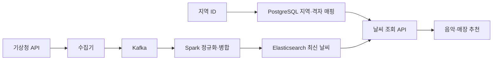

# 날씨 데이터 파이프라인

기상청 격자 자료를 수집·정제해 지역별 날씨 조회와 음악·매장 추천에 제공한다. 이 문서는 2026-11-13 확인한 `develop` 커밋 `41f1018`의 코드 동작을 설명하며, 실제 운영 환경에서의 배포 또는 연동 검증을 뜻하지 않는다.

## 처리 흐름



1. 수집기는 실황·초단기예보와 눈·구름 보조자료 요청을 생성하고 응답을 Kafka로 전달한다. 기본 토픽은 `weather.v1`이다.
2. Spark는 수신 이벤트를 정규화하고 격자별로 묶어 Elasticsearch 최신 문서를 갱신한다. 원천 응답 파일은 별도로 보관하지 않는다.
3. 조회 API는 PostgreSQL에서 지역 ID에 대응하는 격자 좌표를 찾고 Elasticsearch에서 해당 격자의 자료를 읽는다. 조회 시각을 기준으로 자료의 유효기간을 다시 판정한다.

## 저장 정합성

- **지연 자료:** 기본 실황·예보는 최신 완성 회차와 그보다 새로운 미완성 회차를 함께 유지한다. 미완성 회차의 보존 범위는 각 자료의 최신 회차를 기준으로 `runtime_config.json`의 `backfill_hours`를 적용하며 기본값은 6시간이다. 마지막 완성 회차는 범위 밖이어도 유지할 수 있지만, 화면이나 추천에 사용할 수 있는지는 조회 시 신선도를 별도로 확인한다. 완성된 예보가 없으면 가장 최근 부분 예보에 누락 상태를 함께 표시한다.
- **수집 재시도:** 수집기는 중단 중 누락된 요청을 최대 6시간 범위에서 다시 계획한다. 실제 재시도는 제한 시간과 `max_attempts` 중 먼저 도달한 조건에서 종료한다.
- **같은 시각의 값 충돌:** 같은 자료원·발표 시각·대상 시각·항목·수신 시각에 서로 다른 정제 값이 있으면 `WeatherValueConflict`를 발생시키고 해당 격자의 갱신을 중단한다. 원인 확인 후 처리해야 하며, 어떤 값이 정확한지 임의로 선택하지 않는다.
- **중복과 동시 갱신:** 같은 상태를 다시 처리하면 저장을 생략한다. 두 작업이 같은 격자를 동시에 갱신하면 Elasticsearch 버전 조건으로 다시 읽고 병합하며, 최대 8회 충돌하면 `weather_write_conflict`로 실패한다. Spark 배치는 저장 오류를 전파한다. 이미 처리된 다른 격자까지 한 번에 되돌리는 트랜잭션은 아니다.

## 실행과 설정

아래 명령은 저장소의 **`app/` 디렉터리**에서 실행한다. 실행 전 날씨 의존성은 [`requirements.txt`](requirements.txt), Spark 추가 의존성은 [`requirements-spark.txt`](requirements-spark.txt)를 확인한다. 환경변수 이름과 예시는 [`.env.example`](.env.example)에 있다. 실제 키·비밀번호는 저장소에 넣지 않는다.

수집기는 `KMA_API_KEY`, `KAFKA_BOOTSTRAP`이 필요하며 `KAFKA_TOPIC`을 생략하면 `weather.v1`을 사용한다. Spark와 저장에는 Kafka·Elasticsearch·체크포인트 및 검증된 Spark 연결 설정이 필요하다. 지역 조회에는 PostgreSQL 매핑 설정이 필요하다. 프로세스 환경변수가 `pipeline/weather/.env`보다 우선한다.

```bash
# 수집과 Spark 실행: 실제 외부 API·Kafka·Elasticsearch에 연결하므로 환경 준비 후 실행
python -m pipeline.weather.run_collector
python -m pipeline.weather.submit_spark
```

`submit_spark`는 별도 준비된 Spark와 커넥터 잠금 파일·인증 설정을 검증한다. 실행 주기와 실제 배포 설정은 인프라 담당자와 확인한다. `python -m pipeline.weather.prepare_es`는 인덱스 규격만 출력하며, `--apply`를 추가하면 실제 Elasticsearch 인덱스를 생성하거나 호환성을 검사한다.

지역 목록은 `GET /api/regions/tree`, 해당 날씨는 `GET /api/weather?region_id=<지역_ID>`로 조회한다. 날씨 응답의 `current`, `segments`, `valid_until`, `recommendation_ready`를 함께 확인한다. 표시 가능한 현재 날씨가 있더라도 선곡용 예보가 부족하거나 만료되면 `recommendation_ready`는 `false`일 수 있다.

## 검증과 장애 확인

`app/`에서 아래 검사를 실행한다. 첫 번째는 지연 도착·6시간 경계·값 충돌·중복 처리 등을 모의 저장소로 검사한다. 두 번째는 로컬 날씨 조회의 누락과 만료 처리를 검사한다.

```powershell
python -B -m unittest discover -s tests -p test_weather_es.py -v
$env:C_LOCAL_DEMO = '1'
python -B -m backend.manage test backend.weather
```

2026-11-13 작업본 로컬 검사에서는 첫 번째 검사 16개 중 15개가 통과했고 MongoDB 의존성이 필요한 1개는 건너뛰었다. 두 번째 검사 6개는 모두 통과했다. 실제 외부 저장소에 대한 검사는 아니다.

| 상황 | 확인할 내용 |
|---|---|
| 수집 중단 또는 `auth_or_quota_stop` | 기상청 인증·호출 한도, 수집기 상태 파일과 요청 로그를 확인한다. 일일 사용 한도에 도달하면 `budget_wait` 상태가 된다. |
| `WeatherValueConflict` | 동일 발표·대상·수신 시각의 정제 값과 원천 자료를 확인한다. 재시도만으로 값의 우열이 결정되지는 않는다. |
| `weather_write_conflict` | 같은 격자의 동시 저장 충돌이 반복된 상태다. Elasticsearch와 처리 작업의 상태를 확인한다. |
| `FORECAST_UNAVAILABLE` 또는 `recommendation_ready=false` | 지역·격자 매핑, 저장된 자료, 발표·수신·대상 시각과 유효기간을 확인한다. 누락된 예보를 맑음으로 대체하지 않는다. |

수집기 상태·요청 로그는 `WEATHER_STATE_DIR` 또는 기본 경로 `pipeline/weather/runtime/collector/`에 기록된다. 위 로컬 검사는 실제 기상청·Kafka·Spark·PostgreSQL·Elasticsearch 또는 운영 배포의 정상 동작을 보장하지 않는다.
