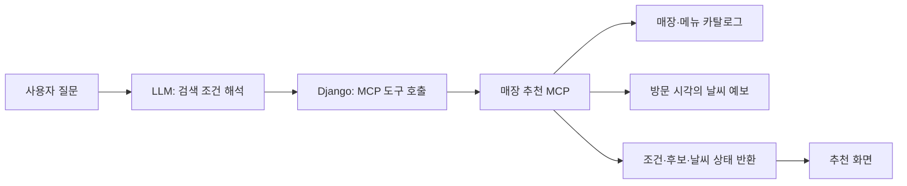

# 매장 추천 MCP

서울·인천·경기의 매장 자료에서 지역, 업종, 분위기, 메뉴와 1인 예산에 맞는 후보를 찾습니다. 방문 시각에 유효한 예보가 있으면 날씨에 어울리는 분위기와 메뉴를 순위에 반영합니다.

이 문서는 2026-11-13 확인한 `develop` 커밋 `41f1018`의 구현을 기준으로 합니다. 이후 로컬에서 수정한 기능이나 운영 배포 결과는 포함하지 않습니다.

## 추천 처리



1. LLM이 질문을 지역·업종·메뉴·예산 등의 조건으로 해석합니다.
2. Django가 `recommend_venues`를 호출하고, MCP가 카탈로그와 방문 시각의 예보를 조회합니다.
3. MCP는 필수 조건을 적용한 뒤 날씨·분위기·메뉴 등의 규칙으로 후보를 정렬합니다.
4. 화면은 MCP가 반환한 매장과 조회 상태를 표시합니다. 조회할 수 없는 조건이나 후보가 없을 때는 그 상태를 반환합니다.

방문 조건을 직접 선택하는 화면도 같은 MCP를 호출하며 LLM은 필수가 아닙니다. MCP는 도구 연결 규격입니다. 현재 기능은 일반 함수 호출로도 구현할 수 있으며, MCP 적용 자체가 추천 정확도를 높이거나 모델을 학습시키지는 않습니다. 이 구현에는 매장 검색용 벡터 인덱스나 RAG 파이프라인이 없습니다. 일반 매장 목록의 별도 추천 모델과 뮤더 음악 추천은 이 문서의 범위에 포함하지 않습니다.

## 매장 자료

| 입력 | 용도 |
|---|---|
| 기본 CSV·fixtures | 성수·을지로 등 기존 시연 자료 |
| `--public-catalog` | 매장·메뉴 ID와 공개 상태를 가진 JSON 스냅샷 |
| 팀 CSV 변환본 | 원문 값을 공통 태그에 매핑한 로컬 시연 자료. `preview_only=true` |
| 팀 CSV SQLite | 팀 원본 행을 보관하고 검색 대상 매장의 메뉴를 조회하는 카탈로그. 운영 사용 시 별도 전달·설정 필요 |

공개 JSON 스냅샷은 `version`, `venues`, `menus`와 `preview_only=false`를 가집니다. 각 레코드는 `is_public=true`인 경우 조회하며 메뉴는 `venue_id`로 매장에 연결합니다. SQLite 카탈로그는 원본 CSV 행과 모든 컬럼을 보관하고 같은 ID로 메뉴를 연결합니다. 추천에서는 카페·주점과 원본의 영업 상태를 사용하며 어린이집 등 기존 제외 대상은 결과에서 제외합니다. 지역 코드와 주소가 맞지 않는 매장은 날씨를 확인하지 않습니다. 카탈로그는 완성된 파일로 교체하며 서버는 다음 조회에서 변경을 확인합니다.

카탈로그는 Google Drive를 실시간으로 읽지 않습니다. 인수한 CSV로 파일을 생성해 실행 환경에 전달해야 합니다. Docker에서는 카탈로그 디렉터리를 읽기 전용으로 마운트하고 그 안에서 파일을 원자 교체합니다. 파일 하나를 직접 마운트한 경우 컨테이너를 재생성해야 교체된 파일을 읽습니다.

팀 CSV에는 점주 공개 승인과 실제 메뉴판 확인 여부가 없을 수 있습니다. SQLite의 `preview_only=false`는 파일 형식의 값이며 공개 승인이나 데이터 정확성의 증거가 아닙니다. 기본 MCP 실행은 시연용 JSON을 거부하고, `--allow-preview-catalog`를 명시한 실행에서만 읽습니다. Django 로컬 시연 실행기는 해당 옵션을 설정합니다.

예산은 팀 CSV의 **1인 평균예산**을 기준으로 비교합니다. 메뉴명과 가격도 원본 입력값을 사용합니다. 주문합계·최소 주문·추가 요금까지 확인한 결제 예상액이 아닙니다.

### 팀 CSV 준비

`app` 디렉터리에서 실행합니다. 팀 자료의 `*_venues_full.csv`와 `*_venue_menus_full.csv` 쌍을 저장소 밖에 준비하고 SQLite 카탈로그를 생성합니다. 원본의 행과 컬럼은 보관하며 원본을 수정하지 않습니다. 원본과 생성 파일은 Git에 추가하지 않습니다. 아래 경로는 실제 준비한 위치로 바꿉니다.

```powershell
$VenueSourceDirectory = 'C:\team-data'
$VenueCatalogPath = 'C:\catalog\catalog.sqlite3'
& ./.local/venue-mcp/Scripts/python.exe -B -X utf8 prototype/venue-recommendation-mcp/build_team_catalog_sqlite.py --source-dir $VenueSourceDirectory --output $VenueCatalogPath
```

지역별 파일이 여러 폴더에 있으면 `--source-dir`을 폴더마다 반복합니다. 기존 카탈로그를 갱신할 때만 `--replace`를 추가합니다. 검색에 사용하는 메뉴는 필요한 매장만 조회합니다. CSV의 메뉴·가격과 분위기는 입력값이므로 실제 매장의 현재 상태와 다를 수 있습니다.

로컬 검증용 JSON을 별도로 만들 때는 같은 폴더에 `이름_venues.csv`, `이름_menus.csv`를 둡니다. 다음 `prepare_team_catalog.py`는 위 SQLite 생성기와 입력 파일 규칙이 다릅니다. 행정동 코드와 주소의 시도·자치구가 충돌하거나 폐업 상태인 매장을 제외하고, 매장과 맞지 않는 메뉴 연결도 제외합니다. 알 수 없는 메뉴에 임의 태그를 붙이지 않습니다.

아래 명령은 `app` 디렉터리 기준입니다. `--source-dir`에 팀 자료 폴더를 지정합니다.

```powershell
& ./.local/venue-mcp/Scripts/python.exe -B -X utf8 prototype/venue-recommendation-mcp/prepare_team_catalog.py --source-dir ./analysis/team-venues --output .local/venue-mcp/team-preview.json
```

서울·경기·인천처럼 원본이 여러 폴더로 나뉘어 있으면 `--source-dir`을 폴더마다 반복해 하나의 시연 카탈로그로 변환합니다. 각 폴더에 해당 지역의 매장·메뉴 CSV 쌍이 있어야 합니다.

```powershell
& ./.local/venue-mcp/Scripts/python.exe -B -X utf8 prototype/venue-recommendation-mcp/prepare_team_catalog.py --source-dir ./analysis/seoul_venues_20261106/by_gu --source-dir ./analysis/incheon_venues_20261110/by_gu --source-dir ./analysis/gyeonggi_4cities_20261109/by_city --output .local/venue-mcp/team-preview.json
```

위 명령은 세 폴더의 예시이며, 추가 경기 폴더도 같은 방식으로 지정합니다. 이름이 같은 지역 파일은 각 폴더에서 따로 읽고, 중복 매장·메뉴 ID와 누락된 파일 쌍이 있으면 전체 변환을 중단합니다. `--areas`를 사용하면 모든 지정 폴더에서 해당 이름을 찾으므로 같은 이름이 여러 곳에 있으면 모두 포함합니다. 파일명 중복은 결과의 검사 내역에서 `중구#1`, `중구#2`처럼 구분합니다.

폴더 일부만 선택하려면 `--areas 마포구 연수구 수원시`를 추가합니다. 기존 변환본을 갱신할 때만 `--replace`를 추가합니다. 변환이 실패하면 기존 출력 파일은 유지됩니다. 원문 CSV·변환 JSON·로컬 DB·API 키는 Git에 포함하지 않습니다.

팀 드라이브의 매장 CSV에 조사 컬럼이 있으면 변환할 때 자동으로 반영합니다. 출처가 있는 행만 조사 분위기·특징·좌석과 후기 메뉴를 사용하고, 기존 매장·메뉴·가격·예산은 보존합니다. 후기에서만 확인한 메뉴의 가격은 미확인으로 두며 현재 판매 여부는 보장하지 않습니다. 조사 CSV를 별도로 `--research-update`에 지정할 수도 있지만, 원본에 이미 조사 내용이 있는 매장은 중복 적용하지 않습니다.

별도의 조사 CSV가 있는 경우에만 변환 명령에 `--research-update <조사_CSV_경로>`를 추가합니다. 조사 컬럼이 이미 팀 원본에 포함돼 있다면 별도 파일은 필수가 아닙니다. 같은 ID·상호·주소와 출처가 있는 매장에만 조사 내용을 연결하며, 기존 매장·메뉴·가격·예산은 유지합니다. 후기에서만 확인된 메뉴를 추가하는 경우 가격은 미확인으로 둡니다. 조사는 과거 방문 후기 기준이므로 현재 운영 및 메뉴를 보증하지 않습니다. 이 변환은 드라이브 원본을 수정하지 않고 별도의 로컬 시연 JSON을 생성합니다.

### 방문 후기 조사 자료 반영

로컬 시연에서 조사 결과를 적용하려면 위 명령에 `--research-local <노트북_매장보완.csv> --research-sources <노트북_출처.csv> --research-home <집PC_연결후보.csv>`를 함께 지정합니다. 세 파일은 별도로 준비해야 하며 저장소에 포함되지 않습니다. 집 PC 파일은 원본 ID·상호·주소, 방문 후기 출처 및 보류·제외 상태를 사전 대조한 후보여야 합니다.

조사 자료 옵션을 사용하면 기존 시연용 분위기·메뉴·예산을 지우고, 출처가 있는 방문 후기의 분위기와 메뉴명만 다시 연결합니다. 후기 기반 메뉴의 현재 판매 여부와 가격은 확인되지 않았으므로 가격과 1인 예산은 미확인입니다. 결과의 `research`에는 방문 후기 출처와 확인일·한계가 포함됩니다. 조사에 없는 매장은 분위기·메뉴가 비어 검색 결과에서 제외될 수 있습니다. 전체 스냅샷은 계속 로컬 시연용이며 운영 공개 승인으로 간주하지 않습니다.

## 로컬 실행

백엔드와 MCP 모두 **Python 3.14**를 사용합니다. 현재 두 의존성 파일의 Pydantic 고정 버전이 달라 가상환경은 분리합니다. 프런트엔드는 기존 pnpm 잠금 파일을 사용합니다.

최초 준비는 저장소 루트에서 실행합니다.

```powershell
Set-Location app/frontend
pnpm install --frozen-lockfile
pnpm build
Set-Location ..
py -3.14 -m venv .local/venue-api
py -3.14 -m venv .local/venue-mcp
& ./.local/venue-api/Scripts/python.exe -m pip install -r backend/requirements.lock
& ./.local/venue-mcp/Scripts/python.exe -m pip install -r prototype/venue-recommendation-mcp/requirements.lock
```

기본 자료로 실행합니다. 이 명령은 LLM을 켜지 않으며 방문 조건 검색을 확인할 수 있습니다.

```powershell
& ./.local/venue-api/Scripts/python.exe -B prototype/venue-recommendation-mcp/run_local_demo.py --mcp-python .local/venue-mcp/Scripts/python.exe --port 18752
```

팀 CSV 변환본과 Codex CLI를 사용하는 로컬 검증 예시입니다. Codex CLI의 기존 ChatGPT 로그인이 필요합니다. 실행 파일을 찾지 못하면 `--codex-cli-executable`에 설치된 실행 파일 경로를 지정합니다.

조사 스냅샷이 이 노트북의 `fixtures/research_preview.json`에 이미 있을 때만 로컬 실행기에 `--research-preview`를 지정해 사용할 수 있습니다. 파일이 없으면 누락 안내 후 실행을 중단합니다. 이 파일은 팀 공유 또는 Git에 포함할 자료가 아닙니다. 다른 환경에서는 인가된 팀 CSV로 별도 변환한 파일을 아래의 `--public-catalog`로 지정합니다. 시연 데이터베이스는 기본 시연과 별도로 보관합니다.

```powershell
& ./.local/venue-api/Scripts/python.exe -B prototype/venue-recommendation-mcp/run_local_demo.py --mcp-python .local/venue-mcp/Scripts/python.exe --port 18752 --public-catalog .local/venue-mcp/team-preview.json --state-dir .local/team-venue-demo --llm-provider codex_cli
```

[매장 탐색 화면](http://127.0.0.1:18752/venues)의 **AI 매장 질문**에 입력합니다. Codex CLI는 로컬 검증 전용으로, 운영 모드에서는 사용하지 않습니다. 실행기는 기존 운영 DB를 사용하지 않고 지정된 로컬 SQLite DB를 사용합니다.

### 실제 날씨 반영

기존 기상청 키를 비공개 환경 설정으로 준비한 뒤 실행합니다. 키를 명령 인수나 저장소에 넣지 않습니다.

```powershell
& ./.local/venue-api/Scripts/python.exe -B -m pipeline.weather.live_cache --once --path .local/venue-mcp/weather-live.json
```

로컬 실행 명령에 `--kma-cache .local/venue-mcp/weather-live.json`을 추가합니다. 프로젝트 날씨 API 응답은 지역·격자, 예보 구간, 발표·수신 시각과 유효성을 검사합니다. 예보가 없거나 만료되면 맑음으로 대체하지 않고 날씨 미반영 상태로 반환합니다. 실제 예보 이용 가능 여부는 환경과 방문 시각에 따라 달라집니다.

### Gemini API 연결

준비된 API 어댑터는 아래 설정을 읽습니다. 실제 API 호출에는 별도 계정의 유효한 키와 지원 모델이 필요합니다.

| 설정 | 값 |
|---|---|
| `GEMINI_ENABLED` | `1` |
| `GEMINI_API_KEY` | 비공개 환경에서 설정 |
| `VENUE_LLM_MODEL` | 연결 계정에서 지원하는 모델명 |
| `GEMINI_TIMEOUT_MS` | 요청 제한 시간. 매장 어댑터의 상한은 30,000ms |

로컬 실행기의 `--llm-provider codex_cli`를 `--llm-provider gemini`로 바꿉니다. API 어댑터의 인증·시간초과·잘못된 도구 응답은 별도로 처리합니다. Codex 로컬 연결 검증은 Gemini 유료 API의 실제 호출 검증을 대신하지 않습니다.

## 연결 규격

- `list_venue_tags`: 공통 태그, 검색 지역, 카탈로그 정보를 반환합니다.
- `recommend_venues`: `region`, `venue_category`, `required_moods`, `preferred_moods`, `orders`, `budget`, `budget_mode`, `visit_at` 등의 구조화된 조건을 받습니다. 간단한 직접 검색에는 `query`도 지원합니다.
- `visit_purposes`에는 `list_venue_tags`가 제공하는 혼술·혼카페·단체 모임·데이트·2차 태그 ID를 전달합니다. 2차 추천에는 방문 후기와 출처가 있는 주류·안주 또는 음료·디저트 조합을 사용합니다. 메뉴로 추천한 경우 `matched_purposes[].menu_names`에 근거를 반환합니다.
- `prefer_lower_budget=true`는 자료상 1인 예산이 낮은 곳을 우선하는 조건입니다. 금액 범위는 `budget`으로 지정합니다.
- `request_text`는 호스트가 원문을 전달하는 필드입니다. 모델이 원문을 다시 작성하는 용도로 사용하지 않습니다.
- `unverified_conditions`는 자료로 확인할 수 없는 필수 요구를 보존합니다. 헌팅·소개팅·식이 제한 등을 근거 없이 일반 업종이나 분위기로 바꾸지 않습니다.
- 응답의 `status`는 `OK`, `NO_MATCH`, `NEEDS_CHECK`입니다. `ranked`는 표시 후보, `counts.ranked`는 전체 일치 후보 수입니다. 예보는 별도의 `forecast_status`로 구분합니다.
- `catalog_metadata.preview_only`, `source_basis`, `budget_basis` 등은 시연 자료 여부와 근거를 나타냅니다.
- 웹 AI 질문은 `POST /api/venues/ai-concierge/chat`에 JSON `{ "message": "질문", "region": "선택 지역" }`를 보냅니다. 같은 출처와 CSRF 검사를 적용하며 `{success, mcp, llm}`을 반환합니다.

`recommend_venues` 도구 호출 인수 예시입니다. 강남구에서 국물 메뉴가 있고 자료상 1인 평균예산이 2만 원 이하인 주점을 찾습니다.

```json
{
  "region": "강남구",
  "venue_category": "PUB",
  "orders": [{ "types": ["menu_soup"] }],
  "budget": { "max_krw": 20000 },
  "budget_mode": "REQUIRE",
  "limit": 5
}
```

| 반환 상태 | 의미 |
|---|---|
| `OK` | 조건을 적용한 매장 후보 반환 |
| `NO_MATCH` | 현재 카탈로그에서 조건에 맞는 후보를 찾지 못함. `empty_reason`으로 사유 구분 |
| `NEEDS_CHECK` | 장소가 모호하거나 자료로 확인할 수 없는 조건이 있어 확인 필요 |

예를 들어 `1,000원 미만`은 `budget_mode=REQUIRE`인 경우 999원 이하의 **자료상 1인 평균예산**을 필수 조건으로 적용합니다. 지역·업종 후보가 있지만 예산 조건을 만족하는 매장이 없으면 `NO_BUDGET`을 반환합니다. 이는 개별 메뉴 가격이나 실제 결제 금액을 보증하는 검사가 아닙니다.

Django의 내장 MCP 연결은 `C_LOCAL_DEMO=1`인 로컬 시연에서 사용할 수 있습니다. 비시연 환경에서는 `VENUE_MCP_SERVICE_ENABLED=1`과 공개 승인 카탈로그 경로를 명시해야 하며, 로그인한 계정에 활성 `CONSUMER` 권한이 있어야 합니다. 시연 전용 카탈로그는 거부합니다. 자연어 질문에 필요한 Gemini 설정과 운영 확인 절차는 [앱 운영 이미지 안내](../../docker/PRODUCTION.md)를 따릅니다. 독립 MCP 서버는 `venue_recommendation_mcp.py --public-catalog <스냅샷>`으로 실행하며 stdio로 연결합니다.

## 검증

`app`에서 실행합니다. 실제 API 키가 필요 없는 검사입니다.

```powershell
& ./.local/venue-mcp/Scripts/python.exe -B -X utf8 prototype/venue-recommendation-mcp/verify_tag_weather.py
& ./.local/venue-mcp/Scripts/python.exe -B -X utf8 prototype/venue-recommendation-mcp/verify_venue_recommendation_mcp.py
& ./.local/venue-mcp/Scripts/python.exe -B -X utf8 prototype/venue-recommendation-mcp/verify_team_catalog.py
& ./.local/venue-mcp/Scripts/python.exe -B -X utf8 prototype/venue-recommendation-mcp/test_team_catalog_sqlite.py
```

`verify_tag_weather.py`는 태그와 초기 시범 자료를 검사하며 과거 야외석 예시도 출력합니다. 현재 `recommend_venues`의 입력에는 야외석 선택이나 좌석 가점이 없습니다. `verify_venue_recommendation_mcp.py`는 SDK 도구 호출, 지역 격리, 필수 메뉴·예산, 예보 누락 등을 검사합니다. LLM 어댑터와 웹 API의 회귀 검사는 `backend.venues.tests`에 있습니다. 모의 제공자 검사, 실제 LLM 호출, 운영 환경 검증은 결과를 구분해 기록합니다.
