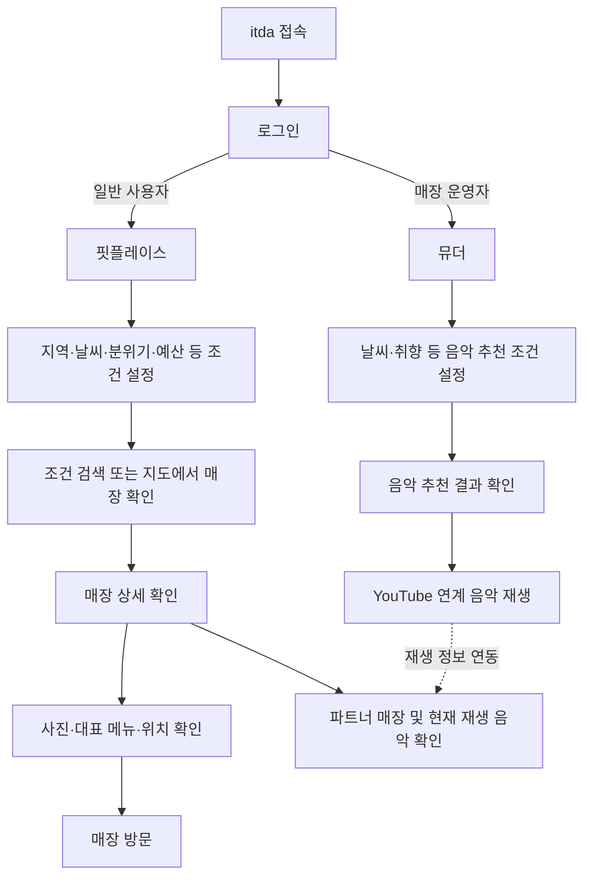
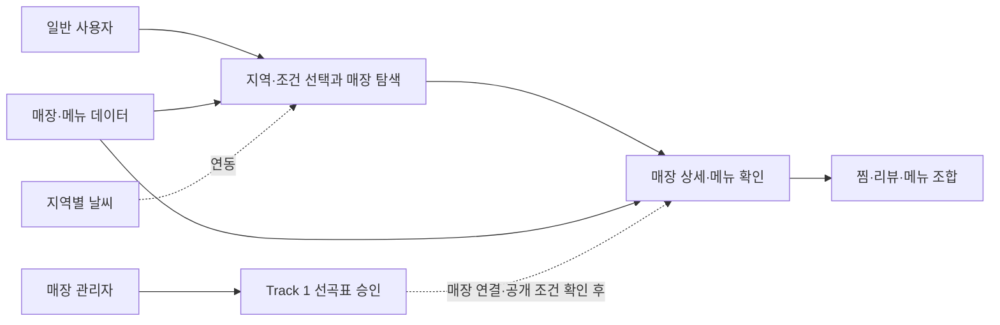

# PRD
### itda — 핏플레이스·뮤더 통합 프로젝트

## 1. 문서 개요

본 문서는 track1(muther)와 track2(핏플레이스)의 기능·데이터·연동 요구사항과 시연 기준을 정리한 문서이다.
기획·개발·인프라·QA 담당자가 동일한 제품 범위와 동작을 확인하는 데 사용한다.

- 문서 상태: 초안 · BRD와 상세 정책 검토 필요
- 평가 방식: 기능 시연 중심
- 요구사항과 수용 기준은 목표 동작이며 구현·연동·검증 완료를 뜻하지 않는다.
- 미결정 정책은 확인 필요로 표시한다. 정량 목표와 기술 세부사항은 확인 전 임의로 확정하지 않는다.

## 2. 제품 목표와 범위

| 구분 | 제품 범위 |
|---|---|
| track1 | 음악 데이터 적재 확인, 조건별 음악 추천, YouTube 연계 재생, 사용자 피드백과 데이터 적재 확인 |
| track2 | 조건별 매장 추천, 현재 위치·선택 지역 기준 검색, 매장 사진·대표 메뉴·위치 등 상세 정보 확인 |
| 공통 | 공통 로그인, 파트너 매장 정보와 해당 매장의 현재 재생 음악 표시 |
| 범위 정합성 확인 필요 | 찜·리뷰와 메뉴 조합은 BRD 7번과 기존 합의에 있으나 BRD 5번 포함 범위에 별도 기재되지 않았다. |
| 추가 확인 필요 | 이벤트 참여·QR·알림 및 관리자 기능의 범위와 세부 정책 |

## 3. 사용자 유형과 권한

| 사용자 | 주요 이용 목적 | 확인할 권한·정책 |
|---|---|---|
| 일반 사용자 | 핏플레이스에서 매장을 검색·추천받고 상세 정보를 확인한다. | 비회원 접근, 위치 사용 및 찜·리뷰 이용 자격 |
| 매장 운영자 | 뮤더에서 음악 추천 조건을 설정하고 음악을 재생한다. | 사업자 이용과 매장 연결·관리 권한 |
| 운영 관리자 | 서비스와 매장 운영에 필요한 정보를 관리한다. | 관리 대상·기능과 역할별 접근 권한 |

## 4. 주요 사용자 흐름

### 4-1. 통합 서비스 목표 흐름

### 4-2. Track 2 업무·데이터 흐름

1. **핏플레이스:** 접속 → 로그인 → 필터 설정 → 조건 검색 또는 지도에서 매장 확인 → 매장 상세 확인 → 매장 방문.
2. **뮤더:** 접속 → 로그인 → 음악 추천 조건 설정 → 음악 추천 및 YouTube 연계 재생.
3. **서비스 연동:** 뮤더 이용 매장을 핏플레이스의 파트너 매장으로 표시하고, 사용자가 해당 매장의 현재 재생 음악을 확인한다.

찜·리뷰와 메뉴 조합의 이용 흐름은 범위 정합성과 세부 정책을 확인한 뒤 확정한다. 화면 전환·저장 시점과 권한은 추가 확인이 필요하다.

## 5. 기능 요구사항

### 5-1. 공통 계정과 로그인

| ID | 입력·처리·결과 | 확인 사항 |
|---|---|---|
| FR-ACC-01 | 일반 사용자와 매장 운영자는 서비스에 접속해 로그인한다. | 가입, 복구, 비회원 접근 범위 |
| FR-ACC-02 | 로그인 후 이용 유형에 맞는 서비스에 접근한다. | 유형 전환과 서버 권한 검증 |

### 5-2. track1 · 음악 데이터·추천·재생

| ID | 입력·처리·결과 | 확인 사항 |
|---|---|---|
| FR-MUSIC-00 | 추천에 필요한 음악 데이터의 적재 여부를 확인한다. | 대상 데이터·적재 성공 기준과 확인 방법 |
| FR-MUSIC-01 | 운영자는 날씨와 취향 등 추천 조건을 설정한다. | 선택 가능한 조건과 기본값 |
| FR-MUSIC-02 | 설정 조건을 적용해 추천 음악을 표시한다. | 후보·추천 기준과 정상 작동 검증 |
| FR-MUSIC-03 | 추천 음악을 YouTube와 연계해 재생한다. 재생할 데이터가 없는 곡은 건너뛴다. | 연결 방식, 이용 조건 및 다음 곡도 재생할 수 없을 때의 처리 |
| FR-FEEDBACK-01 | 사용자 피드백을 수집하고 해당 데이터의 적재 여부를 확인한다. | 수집 항목·저장 기준·확인 권한 |

### 5-3. track2 · 매장 탐색과 상세

| ID | 입력·처리·결과 | 확인 사항 |
|---|---|---|
| FR-EXP-01 | 사용자가 필터를 설정하면 선택 조건에 따라 매장을 탐색·추천한다. | 지역·날씨·분위기·예산의 적용 및 추천·정렬 기준 |
| FR-EXP-02 | 현재 위치를 기준으로 주변 매장을 검색해 표시한다. | 위치 권한, 검색 범위와 위치 이용 불가 시 처리 |
| FR-EXP-03 | 선택한 지역의 매장을 검색해 목록 또는 지도에 표시한다. | 지역 범위·정렬·지도 갱신 방식 |
| FR-EXP-04 | 장소 추천 데이터를 불러와 표시한다. | 실제 데이터 조회·표시 검증 |
| FR-DETAIL-01 | 선택한 매장의 사진·대표 메뉴·위치 등 상세 정보를 표시한다. | 표시 항목, 데이터 출처·갱신 기준 |
| FR-DETAIL-02 | 매장 데이터가 없으면 ‘서비스 준비중’을 표시한다. | 적용 대상과 표시 위치 |
| FR-DETAIL-03 | 메뉴 사진·메뉴 이름 또는 가게 설명이 없으면 해당 정보를 별도로 표시하지 않는다. | 나머지 정보의 표시 방식 |

### 5-4. 찜·리뷰와 메뉴 조합

| ID | 입력·처리·결과 | 확인 사항 |
|---|---|---|
| FR-SAVE-01 | 사용자는 관심 매장을 찜하고 다시 확인한다. | 저장·해제, 로그인·보관 정책 |
| FR-REVIEW-01 | 사용자는 매장의 리뷰를 확인하고 작성한다. | 작성 자격, 수정·삭제·신고·저장 실패 처리 |
| FR-MENU-01 | 사용자는 인원과 예산을 고려한 메뉴 조합을 살펴본다. | 입력 방식·조합·계산 기준 |
| FR-MENU-02 | 조합에 사용되는 메뉴 정보를 확인한다. | 가격·메뉴 정보 부족 및 예산 초과 시 처리 |

### 5-5. 서비스 연동

| ID | 입력·처리·결과 | 확인 사항 |
|---|---|---|
| FR-LINK-01 | 뮤더를 이용하는 매장을 핏플레이스에 파트너 매장으로 표시한다. | 매장 식별·연결, 표시 시작·종료 조건 |
| FR-LINK-02 | 뮤더에서 현재 재생 중인 음악을 해당 매장 화면에 표시한다. | 표시 위치·항목, 곡 변경 반영 시점 |
| FR-LINK-03 | 음악과 파트너 정보가 올바른 매장에 연결된다. | 재생 중지·연동 실패·연결 해제 시 처리 |

## 6. 데이터와 연동 정책

| 데이터 | 사용 목적 | 확인할 내용 |
|---|---|---|
| 음악 | 조건별 추천과 재생 정보 제공 | 출처·사용 범위·적재 상태·추천 가능 기준 |
| 날씨 | 음악 추천과 매장 탐색 조건에 활용 | 출처·갱신 주기·유효성·조회 실패 처리 |
| 매장·메뉴 | 매장 검색·추천과 상세 정보 제공 | 출처·사용 범위·위치·사진·메뉴 정보 갱신 |
| 사용자 피드백 | 사용자 반응을 기록하고 적재 여부 확인 | 수집 항목·저장·보관·삭제·조회 권한 |
| 파트너·재생 정보 | 올바른 매장에 파트너 여부와 현재 재생 음악 표시 | 매장 식별·자격·상태 전달·갱신·중지·오류 처리 |
| 사용자 계정 | 로그인과 이용 유형별 접근 | 식별·권한·개인정보 처리 정책 |

## 7. 예외 및 오류 처리

| 상황 | 확인된 처리 방침 |
|---|---|
| 재생할 음악 데이터가 없음 | 해당 곡을 재생하지 않고 다음 곡으로 넘어간다. | 
| 매장 데이터가 없음 | ‘서비스 준비중’을 표시한다. | 
| 메뉴 사진이 없음 | 해당 사진을 별도로 표시하지 않는다. |
| 메뉴 이름 또는 가게 설명이 없음 | 해당 정보를 별도로 표시하지 않는다. | 
| 연결이 끊김 | 스피너를 표시하며 복구를 시도하고 10초 경과 시 ‘일시적인 문제가 발생했어요.’를 표시한다. | 

## 8. 비기능·품질 요구사항

| 영역 | 요구 방향 | 세부 기준 |
|---|---|---|
| 사용성·접근성 | 주요 탐색·추천 흐름과 입력·상태를 이해하고 이용할 수 있어야 한다. | 지원 화면·기기·접근성 및 검증 환경 확인 필요 |
| 권한·보안 | 사용자 유형에 맞게 접근하고 필요한 권한을 검증한다. | 권한·보관·보호 정책 확인 필요 |
| 데이터 신뢰성 | 누락·장애를 구분하고 확인되지 않은 정보를 확정 사실처럼 표시하지 않는다. | 데이터 최신성·동기화 목표 확인 필요 |
| 추천·검색 품질 | 설정한 조건과 제공된 데이터에 따라 결과를 확인할 수 있어야 한다. | 추천 품질·검색 범위·평가 자료 및 수치 목표 미정 |
| 성능·운영 | 시연 환경에서 주요 흐름을 실행하고 오류를 확인할 수 있어야 한다. | 응답 시간·측정 환경·복구 기준 미정 |

## 9. 기능별 수용 기준

시연 검증 초안이다. 정책과 시험 데이터가 미정인 항목은 확정 후 통과 여부를 판정한다.

| ID | 관련 요구사항 | 확인 상황과 기대 결과 |
|---|---|---|
| AC-01 | FR-ACC-01, FR-ACC-02 | 로그인한 사용자가 확정된 이용 유형과 권한에 맞는 서비스에 접근한다. |
| AC-02 | FR-MUSIC-00, FR-FEEDBACK-01 | 지정한 음악 데이터와 사용자 피드백의 적재 여부를 확인한다. 확인 방법은 미정이다. |
| AC-03 | FR-MUSIC-01~03 | 시연 조건에 따른 추천 결과가 표시되고 YouTube 연계 재생이 가능하다. 데이터 없는 곡은 건너뛴다. |
| AC-04 | FR-EXP-01~04 | 조건·현재 위치·선택 지역을 각각 이용해 매장 결과를 확인한다. 검색 범위와 시험 데이터는 확정이 필요하다. |
| AC-05 | FR-DETAIL-01~03 | 선택 매장의 사진·대표 메뉴·위치 등 제공된 정보를 확인한다. 매장 데이터가 없으면 ‘서비스 준비중’을 표시하고 누락된 메뉴 사진·이름·가게 설명은 별도로 표시하지 않는다. |
| AC-06 | FR-LINK-01~03 | 올바른 매장에 파트너 정보와 현재 재생 음악이 표시된다. 곡 변경·중지·실패 기준은 미정이다. |
| AC-07 | 공통 연결 장애 | 연결 끊김 시 스피너와 복구 시도 후 10초 경과 시 지정된 오류 문구를 표시한다. |
| AC-08 | FR-SAVE-01, FR-REVIEW-01, FR-MENU-01~02 | 범위와 이용·계산 정책이 확정된 뒤 찜·리뷰와 메뉴 조합을 해당 기준에 맞게 확인한다. |

## 10. 운영 기록과 데이터 확인

시연과 운영 상태를 확인하기 위해 아래 기록의 필요 여부와 실제 확보 가능성을 담당자와 확인한다. 이미 저장되고 있다는 뜻은 아니다.

- 음악·매장 데이터 적재의 성공·실패 및 확인 시점
- 음악 추천·매장 검색·추천 요청의 처리 결과
- 사용자 피드백의 저장·적재 여부
- 외부 재생·날씨 조회·서비스 간 연결과 데이터 조회 오류
- 시연에 사용한 버전·환경·데이터, 확인 결과 및 남은 문제

기록 항목·접근 권한·보관 기간과 개인정보 처리 기준은 미정이다.

## 11. 시연 및 QA 계획

1. 서버 연동, 시연 환경·계정·실제 데이터와 YouTube 연결 조건을 확인한다.
2. 음악 데이터 적재, 조건별 추천, YouTube 연계 재생과 피드백 데이터 적재를 시연한다.
3. 조건별 매장 추천, 현재 위치·지역 검색과 매장 상세를 시연한다.
4. 파트너 매장 표시와 현재 재생 음악이 올바른 매장에 연결되는지 확인한다.
5. 데이터 누락과 연결 끊김의 합의된 처리 방침을 점검한다.
6. 시연 후 음악 추천 정상 작동과 핏플레이스 장소 추천 데이터 조회·표시를 QA한다.

각 결과에 확인 날짜, 버전, 환경, 데이터, 성공·실패와 남은 문제를 기록한다. 일정과 담당자는 미정이다. 이벤트 발행은 제외하며 QR·이벤트 참여와 찜·리뷰·메뉴 조합의 시연 범위는 정합성 확인 후 결정한다.

## 12. 미결정 사항과 의존성

| 항목 | 결정·확인할 내용 |
|---|---|
| 범위 정합성 | 찜·리뷰와 메뉴 조합의 BRD 5번·7번 범위, 이벤트 참여·QR·알림·관리자 기능 |
| 데이터 | 음악·매장·메뉴·날씨 데이터별 출처·사용 범위·갱신 및 피드백 처리 |
| 탐색·추천 | 필터·검색 범위·정렬, 장소·음악 추천과 메뉴 조합 기준 |
| 계정·권한 | 비회원 접근, 이용 유형, 위치 사용과 관리 권한 |
| 서비스 연동 | 매장 식별, 파트너 자격, 현재 재생 음악의 표시·갱신·중지·오류 |
| 외부 연동 | YouTube 재생 조건과 날씨 조회 실패 시 처리 |
| 서버·시연 | 연동 일정, 환경·계정·담당자와 시험 조건·품질 목표 |
| 운영 기록 | 확인할 이력·접근 권한·보관 기간과 실제 확보 가능 여부 |

## 13. 관련 문서

- [BRD](BRD.md): 프로젝트 배경·목표·범위와 사업 요구사항.
- [프로젝트 README](../README.md): 프로젝트와 저장소 안내.
- 프론트엔드 화면 문서: 준비 중.
