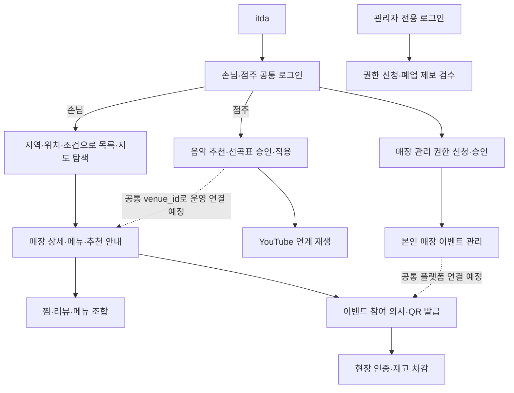

# PRD

### 핏플레이스·뮤더 통합 프로젝트

- 갱신일: 2026-11-16

## 1. 문서 개요

track1(muther)와 track2(핏플레이스)의 기능·데이터·연동 요구사항과 검증 기준을 정리한다. 기획·개발·인프라·통합 담당자가 같은 범위와 동작을 확인하는 데 사용한다.

## 2. 제품 목표와 범위

| 구분 | 제품 범위 |
| --- | --- |
| track1 | 음악 데이터 적재·추천·YouTube 재생·피드백, 장르·분위기 분류기 개선 |
| track2 탐색 | 조건·위치·지역별 목록·지도, 상세·메뉴·가격 |
| track2 추천 | Two-Tower 개인화 순위, Gemini 추천 이유 안내, 매장 추천 MCP |
| 사용자 기능 | 찜·리뷰·인원과 예산에 따른 메뉴 조합 추천 |
| 이벤트 | 점주 발행·손님 참여 의사·QR 인증·재고·알림 |
| 운영 | 폐업 제보·관리자 검수, 활동 내역 |
| 공통 | 역할별 로그인·매장 관리 권한, 공통 매장 ID와 승인 선곡표 연결 |

## 3. 사용자 유형과 권한

| 사용자 | 주요 기능 | 권한·진입 기준 |
| --- | --- | --- |
| 일반 사용자 | 매장 탐색·상세·찜·리뷰·메뉴 조합, 이벤트 참여·QR·제보·활동 내역 | 손님·점주 공통 로그인 `/platform/login` |
| 매장 운영자 | 음악 추천·선곡표 적용, 본인 매장 이벤트 관리 | 매장 관리 권한 신청·심사 후 해당 매장 연결 |
| 운영 관리자 | 점주 권한 신청 심사, 매장 정보·폐업 제보 검수 | 관리자 전용 로그인 `/platform/admin/login` |

2026-11-12 운영 기록 기준으로 공개 가입은 비활성 상태다. 관리자 패스키 로그인과 합성 매장 1건 승인에 대한 제한된 검증 기록이 있으며, 모든 역할·매장의 운영 권한 검증을 완료한 상태는 아니다.

## 4. 주요 사용자 흐름

공통 매장 ID로 승인된 테스트 선곡표를 적용하고 조회한 결과는 로컬 Docker·PostgreSQL 환경에서 확인됐다. 점주 작업공간과 공개 매장의 운영 연결은 별도 과제다. 적용 선곡표 조회는 현재 재생 중인 곡의 실시간 표시를 뜻하지 않는다.

## 5. 기능 요구사항

### 5-1. 공통 계정과 로그인

| ID | 입력·처리·결과 | 상태·비고 |
| --- | --- | --- |
| FR-ACC-01 | 손님·점주가 공통 로그인으로 진입하고 이용 유형에 맞는 화면에 접근한다. | 손님 준비 화면, 점주 진입·신청·심사 반영 기록 |
| FR-ACC-02 | 점주는 관리 권한을 승인받은 본인 매장을 관리하고, 관리자는 별도 로그인 경로로 심사·검수한다. | 이벤트·선곡표 운영 연결은 권한 확인 후 예정 |

### 5-2. track1 · 음악 데이터·추천·재생

| ID | 입력·처리·결과 | 상태·비고 |
| --- | --- | --- |
| FR-MUSIC-00 | 음악 데이터의 적재 상태를 확인하고 오디오 특징으로 장르·분위기 태그를 보강한다. | 분류기 학습·평가 |
| FR-MUSIC-01 | 점주가 장르·분위기와 날씨 반영 여부를 설정한다. | 기존 서비스 흐름 |
| FR-MUSIC-02 | 조건을 반영한 3시간 선곡표를 생성하고 점주가 확인·조정·승인한다. | 기능 명세 |
| FR-MUSIC-03 | 음악을 YouTube와 연계해 재생한다. 재생 데이터가 없는 곡은 건너뛴다. | 재생 불가 곡 건너뛰기 방침 적용 |
| FR-FEEDBACK-01 | 사용자 피드백과 데이터 적재 여부를 확인한다. | 기존 요구사항 유지, 개별 운영 검증 결과와 구분 |

### 5-3. track2 · 매장 탐색과 상세

| ID | 입력·처리·결과 | 상태·비고 |
| --- | --- | --- |
| FR-EXP-01 | 업종·예산·현재 영업 여부 등 조건을 적용해 매장을 탐색한다. 지역 날씨를 확인한다. | 기능 명세 |
| FR-EXP-02 | 현재 위치를 기준으로 주변 매장을 검색한다. | 기능 명세 |
| FR-EXP-03 | 선택한 지역의 매장을 목록 또는 지도에서 확인하고 상세로 이동한다. | 기능 명세 |
| FR-EXP-04 | 후보 매장에 개인화 점수를 반영하고 Gemini로 추천 이유를 안내한다. | 아래 추천 규칙 적용 |
| FR-DETAIL-01 | 매장 사진·위치·대표 메뉴를 표시하고 상세에서 카테고리별 메뉴·가격과 이벤트를 확인한다. | 기능 명세 |
| FR-DETAIL-02 | 매장 데이터가 없으면 ‘서비스 준비중’을 표시한다. | 기존 처리 방침 |
| FR-DETAIL-03 | 메뉴 사진·이름 또는 가게 설명이 없으면 해당 정보를 별도로 표시하지 않는다. | 기존 처리 방침 |

**추천 규칙**

- 날씨·예산 등 탐색 조건으로 후보를 고른 뒤 개인화 점수를 반영한다.
- 사용자와 매장의 18차원 입력을 각각 `18 → 32 → 16` 구조로 변환한다. ReLU와 L2 정규화를 적용하며 코사인 유사도를 이용한다.
- 추천 점수 구성은 정규화 유사도 50%와 규칙 점수 50%다.
- 고정 시드로 초기화한 모델 가중치를 사용한다. 사용자 행동이 발생하면 모델을 다시 학습하는 대신 사용자 취향 벡터를 갱신한다.
- 사용자 취향 벡터 갱신식: `새 벡터 = normalize(기존 벡터 + 0.25 × 행동 가중치 × 매장 벡터)`. 행동 가중치는 찜 3.0, 참여 의사 5.0, QR 인증 6.0이다. 클릭의 세부 가중치는 별도 확인 대상이다.
- Gemini는 날씨·후보 매장·이벤트 정보를 바탕으로 추천 이유를 요약한다. 추천 순위 계산과 안내 문장 생성을 구분한다.

### 5-4. 찜·리뷰와 메뉴 조합

| ID | 요구사항 | 상태 |
| --- | --- | --- |
| FR-SAVE-01 | 관심 매장을 찜하고 다시 확인한다. 찜 행동을 취향 벡터에 반영한다. | MVP 포함 |
| FR-REVIEW-01 | 매장 리뷰를 확인하고 작성하며 활동 내역에서 리뷰 이력을 확인한다. | MVP 포함 |
| FR-MENU-01 | 인원과 예산을 고려한 메뉴 조합을 살펴본다. | MVP 포함, 계산 정책·검증 결과 확인 필요 |
| FR-MENU-02 | 조합에 사용되는 메뉴 정보를 확인한다. | 메뉴·가격 조회와 조합 계산의 구현 여부를 구분 |

### 5-5. 서비스 연동

| ID | 입력·처리·결과 | 상태·비고 |
| --- | --- | --- |
| FR-LINK-01 | 점주 관리 권한을 승인하고 점주 작업공간과 공개 매장을 공통 `venue_id`로 연결한다. | 운영 연결 예정 |
| FR-LINK-02 | 매장에 승인·적용한 선곡표를 같은 매장의 손님 상세에서 조회한다. | 로컬 Docker·PostgreSQL 테스트 선곡표 적용·조회 확인 |
| FR-LINK-03 | 승인 선곡표가 없는 파트너 매장에 날씨 기반 음악 테마를 안내한다. | 설계 단계, 운영 적용 미검증 |

기존 목표인 실시간 재생 정보 표시는 승인 선곡표 조회와 별개다. 실시간 곡 변경·중지·재생 상태 동기화는 미검증이다.

### 5-6. 이벤트·QR·제보·알림

| ID | 입력·처리·결과 | 상태·비고 |
| --- | --- | --- |
| FR-EVENT-01 | 점주가 본인 매장의 이벤트 시간·혜택·수량을 설정해 발행한다. | 권한 확인 후 공통 플랫폼 연동 예정 |
| FR-EVENT-02 | 손님이 ‘참여할게요’를 선택하면 참여 의사를 기록하고 일회용 QR을 발급한다. 이때 재고는 유지한다. | 기능 명세 |
| FR-QR-01 | 현장 QR 인증에 성공하면 재고 1개를 차감한다. 동일 계정·동일 이벤트 인증은 하루 1회로 제한한다. | 인계서에 인증·재고·중복 차단 테스트 기록 |
| FR-REPORT-01 | 손님이 폐업을 제보한다. 제보 누적 시 매장을 숨기며, 관리자가 폐업을 확인하면 숨김을 유지하고 정상 영업을 확인하면 다시 표시한다. | 제보 누적 임계값 확인 필요 |
| FR-NOTIFY-01 | 찜한 매장의 이벤트 시작과 참여 예정 이벤트의 조기 종료·재고 소진을 알린다. 종료 후 5분간 마감 상태를 표시한다. | 기능 명세 |
| FR-ACTIVITY-01 | 찜·리뷰·이벤트 참여·QR 인증·제보 이력과 미읽음 알림을 한곳에서 확인한다. | 기능 명세 |

### 5-7. 매장 추천 MCP

| ID | 입력·처리·결과 | 상태·비고 |
| --- | --- | --- |
| FR-MCP-01 | 지역·방문 시각·분위기·메뉴·예산을 받아 Django에서 MCP를 호출하고 공개 매장·메뉴를 조회한다. | 로컬 테스트 매장 조회 결과 |
| FR-MCP-02 | 같은 격자의 예보는 요청당 한 번 조회하고 유효한 예보만 추천에 반영한다. 방문 시간대 예보가 없으면 날씨 미반영 상태를 안내한다. | 기능 명세 |

MCP 조회와 Two-Tower 온라인 추천의 내부 호출 관계는 별도 확인 대상이다.

## 6. 데이터와 연동 정책

| 데이터 | 규칙·처리 |
| --- | --- |
| 음악 | 음원 특징으로 장르 14개·분위기 9개 다중 라벨 분류. 전처리 후 사용 가능 8,756곡 중 1차 모델 학습에 7,004곡 사용 |
| 날씨 | 재수집 범위 6시간 내 미완성 회차를 보존하고 최신 완성 회차를 선택. 같은 예보 항목의 발행·수신 시각이 같은데 값이 다르면 갱신을 중단하고 기존값 유지 |
| 매장·메뉴 | 분석용 카탈로그와 온라인 추천 경로 구분. 온라인 경로는 CSV·DB 미러 조회 → 18차원 인코딩 → Two-Tower 점수 계산. `feature/nomal_user`의 `a2e98f` 기준. 운영 연결 별도 검증 |
| 사용자·매장 특성 | 날씨 0~1, 시간 2~4, 예산 5~7, 매장·메뉴 취향 8~13, 매장 유형 14~15, 음악 무드 16~17. 일부는 소프트·멀티핫 값이며 전체 벡터 L2 정규화 |
| 사용자 행동 | 모델 가중치를 고정하고 사용자 16차원 벡터를 선택 매장 방향으로 갱신. 프로세스 메모리 기반 |
| 이벤트·QR | 참여 의사와 인증을 별도 상태로 취급. 참여 시 재고 유지, 인증 성공 시 차감, 계정·이벤트별 일 1회 제한 |
| 매장·선곡표 | 공통 `venue_id`와 관리 권한을 기준으로 승인 선곡표 연결. 실제 재생 상태와 구분 |

데이터의 운영 인수 후 통합 결과는 별도 확인하며 테스트 매장과 운영 매장을 구분한다.

## 7. 예외 및 오류 처리

| 상황 | 처리 방침 |
| --- | --- |
| 재생할 음악 데이터가 없음 | 해당 곡을 건너뛴다. |
| 매장 데이터가 없음 | ‘서비스 준비중’을 표시한다. |
| 메뉴 사진·이름 또는 가게 설명이 없음 | 해당 정보를 별도로 표시하지 않는다. |
| 연결이 끊김 | 스피너로 복구 시도를 안내하고 10초 경과 시 ‘일시적인 문제가 발생했어요.’를 표시한다. |
| 방문 시간대의 유효한 예보가 없음 | 날씨를 추천에 반영하지 않고 그 상태를 안내한다. |
| 날씨 값 충돌 | 동일한 예보 발행·수신 시각에 값이 다르면 갱신을 중단하고 기존값을 유지한다. |
| 동일 계정·동일 이벤트 당일 중복 인증 | 하루 1회 인증 제한을 적용한다. |
| 이벤트 조기 종료·재고 소진 | 참여 예정자에게 알리고 종료 후 5분간 마감 상태를 표시한다. |

이 표의 처리 방침은 운영 환경의 모든 예외 검증이 완료됐다는 뜻은 아니다.

## 8. 비기능·품질 요구사항

### 8-1. 품질 기준

- 사용자에게 데이터 누락·연결 장애·날씨 미반영 상태를 구분해 안내한다.
- 점주 관리 권한과 공통 매장 ID를 확인해 다른 매장의 선곡표·이벤트를 연결하지 않는다.
- 음악 분류 지표와 매장 추천 품질, 실제 사용자 만족도를 구분한다.
- 사용자 행동 갱신에서 중복·유실 방지와 벡터 보존을 검증한다.
- 코드·이미지 버전, 시험 데이터, 환경과 확인 날짜를 결과에 함께 기록한다.

### 8-2. 인프라와 외부 연동

인프라 구성과 역할은 다음과 같다. 설계·검증 기록을 기준으로 하며 현재 운영 상태와는 구분한다.

| 영역 | 구성과 역할 |
| --- | --- |
| 배치 | AWS 5계정·5VPC·16EC2·3AZ, Private EC2 14대와 Public Gateway 2대 |
| 서비스 진입 | CloudFront·ALB → Control A/B, 업무 서버는 Private Subnet |
| 데이터 처리 | Kafka·Spark·Elasticsearch 각 3노드, PostgreSQL과 S3를 이용한 업무·데이터 처리 |
| 사설망 운영 | SSM·VPC별 S3 Endpoint, Gateway A/B HTTP 프록시. NAT Gateway 없이 필요한 HTTP 경로 연결 |
| 모델 연계 | Gateway·Tailscale을 통해 별도 PC의 모델 API 연결 |
| Foundation | Terraform으로 자원 정의, 검증된 inventory를 Runtime에 전달 |
| Runtime | Ansible로 호스트 설정·배포, systemd·Compose, 상태 검사·구성 롤백 |
| Lifecycle | Python 실행기로 종료·보존·재개 관리. 로컬 검증 구현, 실제 AWS 종료·삭제 연동 미완료 |
| 외부 기능 | 기상청 날씨 조회, YouTube 재생, Gemini 매장 안내 |

관련 문서: [아키텍처](architecture/README.md), [인프라 기준](handoff/infra/BASELINE.md), [Foundation](../aws-infra/foundation/README.md), [Runtime](../aws-infra/runtime/README.md), [Lifecycle](../aws-infra/lifecycle/README.md), [Docker 가이드](../app/docker/README.md).

## 9. 기능별 수용 기준

아래는 요구사항을 확인할 시험 기준이다. 기대 결과와 실제 검증 상태를 구분하며, 검증 기록이 없는 항목을 통과로 판정하지 않는다.

| ID | 관련 요구사항 | 시험 상황과 기대 결과 | 검증 상태 |
| --- | --- | --- | --- |
| AC-01 | FR-ACC-01~02 | 역할별 로그인 후 허용된 화면에 진입하고 본인 매장 관리 권한을 확인한다. | 관리자 로그인·합성 매장 승인 검증 기록, 전체 권한 검증과 구분 |
| AC-02 | FR-MUSIC-00, FR-FEEDBACK-01 | 지정한 음악 데이터와 피드백 적재 결과를 확인한다. | 기존 검증 대상, 개별 운영 통과 근거 없음 |
| AC-03 | FR-MUSIC-01~03 | 조건별 선곡표를 확인·적용하고 YouTube 재생을 실행한다. 데이터 없는 곡은 건너뛴다. | 기능 명세 |
| AC-04 | FR-EXP-01~04 | 위치·지역·필터에 따른 후보를 표시하고 개인화 점수와 안내를 확인한다. | 개발 명세·단일 행동 시나리오 기록. 추천 정확도 검증 아님 |
| AC-05 | FR-DETAIL-01~03 | 목록·지도 선택과 상세 매장이 일치하고 메뉴·가격을 표시한다. 누락 정보는 7번 방침을 따른다. | 기능 명세, 운영 탐색 화면 연결 예정 |
| AC-06 | FR-LINK-01~03 | 공통 매장 ID에 승인 선곡표를 적용하고 같은 매장 상세에서 조회한다. | 로컬 Docker·PostgreSQL 테스트 확인, 운영 연결 예정 |
| AC-07 | 공통 연결 장애 | 복구 시도 중 스피너를 표시하고 10초 경과 시 지정 문구를 안내한다. | 요구사항 정의, 검증 완료 기록 없음 |
| AC-08 | FR-SAVE-01, FR-REVIEW-01 | 찜·리뷰와 활동 내역을 확인한다. 찜 시 명세대로 취향 벡터를 갱신한다. | 활동 내역·벡터 갱신 명세 |
| AC-09 | FR-EVENT-01~02, FR-QR-01 | 참여 시 재고 유지·QR 발급, 인증 성공 시 1개 차감, 동일 계정·동일 이벤트 당일 재인증 제한을 확인한다. | 인계서 테스트 기록 |
| AC-10 | FR-REPORT-01 | 관리자 폐업 확인 후 숨김, 정상 영업 확인 후 재표시를 확인한다. | 기능 명세 |
| AC-11 | FR-NOTIFY-01, FR-ACTIVITY-01 | 이벤트 상태별 알림, 종료 후 5분 마감 표시와 사용자 활동 이력을 확인한다. | 기능 명세 |
| AC-12 | 날씨 정책 | 예보가 분할 도착해도 최신 완성 회차를 선택하고 값 충돌 시 기존값을 유지한다. | 일괄·분할 처리 모두 11:30 예보 선택한 회귀검사 결과 |
| AC-13 | FR-MCP-01~02 | 방문 조건으로 공개 매장·메뉴를 조회하고 유효한 예보가 없으면 날씨 미반영을 안내한다. | 로컬 테스트 매장 화면 |

FR-MENU-01~02는 MVP에 포함한다. 메뉴 조합 계산 정책과 검증 결과는 확인이 필요하다.

## 10. 운영 기록과 데이터 확인

| 구분 | 기록된 내용 | 기준 |
| --- | --- | --- |
| 음악 분류 내부 | 동일 시험 876곡, 평균 mAP 0.8180 → 0.8274 | MERT-v2+MLP와 같은 특징의 MLP·RBF-SVM 50:50 비교 |
| 음악 분류 외부 | 외부 498곡 평균 mAP 0.6890 → 0.7274. 분위기 +0.0938·장르 -0.0172 | 평가 498곡은 학습 제외, 정답 태그가 있는 장르 7종·분위기 8종 기준 |
| 외부 평가 조건 | 별도 외부 200곡 학습 추가·가중치 2·보정을 함께 변경 | 변경 각각의 단독 효과는 미확인. 서비스 차수와 모델 실험 차수 구분 |
| 개인화 행동 | 포차 이벤트 참여 의사 후 사용자·매장 유사도 0.779 상승이라는 단일 시나리오 인계서 기록 | 전체 추천 품질 개선 지표가 아님 |
| 인프라 | EC2 16대·ALB 두 대상·Kafka·Spark·Elasticsearch 정상 기록 | 2026-11-11 |
| 운영 진입 | 손님 준비 화면, 점주 진입·신청·심사 반영. 관리자 로그인·합성 매장 1건 승인 기록 | 11월 9일 라우팅·11월 12일 수령 운영 기록 |

날짜·버전·환경이 다른 결과를 합쳐 전체 통합 성공으로 판정하지 않는다. 기존 PR의 테스트 기록은 [README](../README.md)의 수행 결과를 참고한다.

## 11. 직무별 업무와 검증 역할

| 직무 | 담당 업무 | 확인 산출물 |
| --- | --- | --- |
| 서비스·사업 기획 | 사용자 문제, 제공 가치, 업무 범위와 성공 기준 정의 | BRD, 범위·목표 검토 결과 |
| 제품 요구사항·정책 관리 | 기능 요구사항, 권한·예외 처리와 수용 기준 관리 | PRD, 기능별 정책·수용 기준 |
| UX 설계 | 사용자 유형별 이용 흐름, 화면 이동과 상태 설계 | 사용자 흐름도, 화면 설계서 |
| UI 디자인 | 화면 구성과 시각 요소, 상태별 표현 설계 | 화면 디자인, 공통 UI·상태별 표시 기준 |
| 프론트엔드 개발 | 화면·사용자 입력·API 연동과 상태 표시 구현 | 화면 구현, API 응답·오류 표시 검증 결과 |
| 백엔드·API 개발 | 음악·매장·메뉴·이벤트·QR·알림 API와 업무 로직 구현 | API 명세, 권한·재고·중복 처리 테스트 결과 |
| 데이터 수집·정제 | 음악·매장·메뉴·날씨 데이터 확보·정제·적재와 품질 관리 | 데이터 목록·출처, 누락·중복·적재 점검 결과 |
| AI·추천 모델 개발 | 음악 분류 모델 학습·평가, 매장 추천과 AI 안내 로직 개발 | 모델·추천 규칙 명세, 평가 조건·결과 |
| 데이터 파이프라인 개발 | 배치·스트림 처리와 수집·저장·조회 경로 구현 | 데이터 흐름도, 날씨 회차·재처리·데이터 전달 검증 결과 |
| 인프라·배포 운영 | 서버·네트워크·DB·컨테이너 구성, 배포·상태 검사 | 환경 구성 문서, 배포·상태 검사·복구 기록 |
| 인증·서비스 통합 | 공통 인증·권한, 매장·선곡표 연결과 API·화면 통합 | 권한·매핑 명세, 서비스 간 통합 검증 결과 |
| QA·검증 | 정상·예외 시나리오 검증과 결함·재검증 관리 | 테스트 시나리오, 환경·버전별 결과와 미통과 항목 |

## 12. 후속 과제

- 손님 매장 목록·지도·상세와 점주 이벤트·QR의 공통 플랫폼 연결.
- 점주 관리 권한 승인 후 점주 작업공간과 공개 매장 연결, 적용 선곡표 운영 조회.
- 사용자 행동 중복·유실 방지, 벡터 보존과 모델 학습·추천 품질 평가.
- 분석용 매장 카탈로그와 운영 추천 경로의 연결 검증.
- Lifecycle의 실제 AWS 종료·삭제 연동.
- Kibana 연결과 브라우저 권한 검증.

## 13. 관련 문서

- [BRD](BRD.md): 사업 대상·목표·범위·운영 원칙.
- [프로젝트 README](../README.md): 프로젝트와 수행 결과 요약.
- [기존 음악 서비스 PRD](../app/docs/PRD.md): track1 상세 참고.
- [아키텍처](architecture/README.md) · [인프라 기준](handoff/infra/BASELINE.md) · [테스트 안내](handoff/infra/TESTING.md): 구성·검증 방법.
